# Pacific Marine Academy: Full Site Content

Scraped from local mirror of the site.

## Site-wide: Header / Navigation

Pacific Marine Academy

  🚢 Free One on One Mentorshib with Merchant Navy Officer Join Now

 

- Home
- About Us

- About Institute
- Our Course

- IMU CET Preparation
- DNS Sponsorship
- Diploma in Nautical Science
- BSC Nautical Science
- B.Tech Marine Engineering
- Admission Form
- Result
- Free Study Materials
- Available Forms
- Gallery

- Photo Gallery
- Video Gallery
- Blogs
- Contact
  Menu

-
About Us

Our Course

Gallery

## Site-wide: Footer

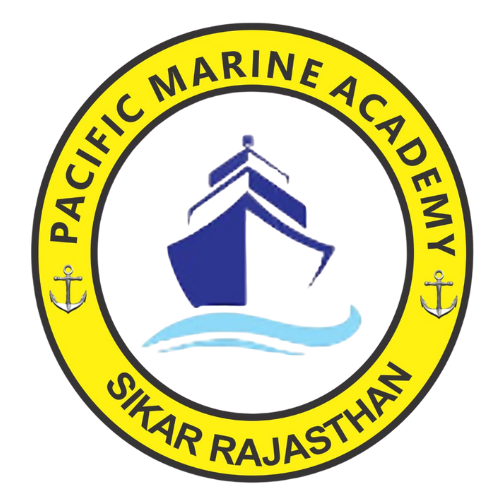

At Pacific Marine Academy, we specialize in IMU-CET coaching, DNS sponsorship preparation, and Merchant Navy interview preparation. Our goal is to help aspiring cadets clear competitive exams and secure sponsorships with leading shipping companies.
With expert faculty, structured study materials, and regular mock tests, we ensure students are fully prepared for IMU-CET, DNS courses, and sponsorship interviews. Our personalized guidance and industry-oriented approach make us one of the most trusted academies for Merchant Navy coaching in India.

## QUICK LINK

-  Home
-  About Academy
-  CO-Founder Message
-  Result
-  Photo Gallery
-  Videos Gallery
-  Blog
-  Contact

## Course

-  IMU CET Preparation
-  DNS Sponsorship (Written+Interview)
-  Diploma in Nautical Science
-  BSC (Nautical Science)
-  B.Tech (Marine Engineering)

 Course Registration

## Get In Touch

###   Location

 2nd Floor, Above PNB Bank , Nawalgarh Road, Sikar, Rajasthan 332001

###   Phone :

 +91 8426074109

###   Mail Us :

 pacificmarineacademy2022@gmail.com

###   Operation Hours

 Monday-Saturday: 09.00 to 07.00 (Sunday: Closed)

  Phone-alt   Facebook   Instagram   Youtube   Whatsapp   Telegram

© 2024 Pacific Marine Academy | All Rights Reserved | Developed by **My Digital Desh**

---

## Best IMU CET Coaching in Sikar - Pacific Marine Academy

Meta description: Best IMU CET Coaching in Sikar, Jaipur - Pacific Marine Academy We have been on a mission to provide a platform for students.

## India's Best Offline Merchant Navy Coaching

## Welcome to

## Pacific Marine Academy – Your Gateway to the Merchant Navy

At Pacific Marine Academy, we help aspiring cadets achieve their dream of joining the Merchant Navy with confidence. As one of the best IMU-CET coaching institutes in India, we offer a structured curriculum, expert faculty guidance, and personal mentorship to prepare you for IMU-CET, DNS sponsorship exams, and Merchant Navy interviews.
With our result-oriented approach, modern classrooms, and consistent record of high selection and sponsorship success rates, we ensure you are fully prepared to start your maritime career. Join the hundreds of successful students who trusted Pacific Marine Academy to launch their future at sea.

## Why choose Pacific Marine Academy?

### India’s Best IMU-CET Coaching

Known for producing top IMU-CET rankers and sponsored candidates every year.

### Expert & Experienced Faculty

Learn from Merchant Navy professionals and subject experts who guide you step by step.

### Years of Maritime Coaching Experince

Covers IMU-CET syllabus, DNS Sponsorship, Interview Training & Personality Development.

### Structured Curriculum & Complete Preparation

Well-planned study schedule covering IMU-CET syllabus, DNS Sponsorship, Interview Training & Personality Development

COURSE COMPLETION
  0 %

YEARS EXPERINCED TEACHERS
  0 +

SPONSERED CADETS IN 3 YEARS
  0 +

IMU-CET RESULT IN 2025
  0 %

## Our Blogs

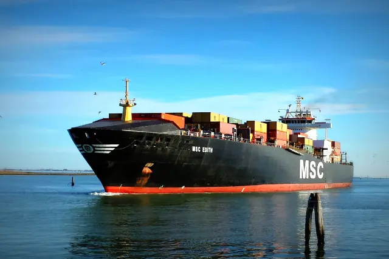

## IMU CET Preparation

**IMU CET** (Indian Maritime University Common Entrance Test) and various DNS (Diploma in Nautical Science) sponsorship exams. The academy’s IMU CET

 Read More

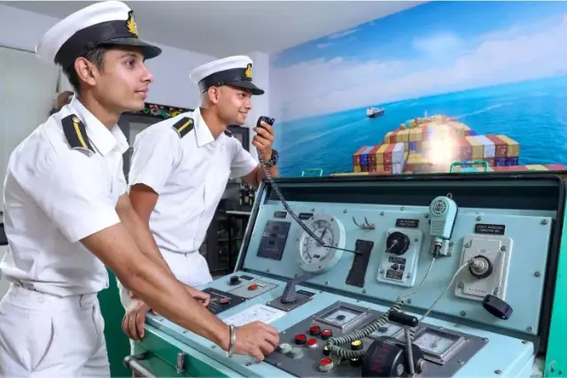

## DNS Sponsorship

the **DNS Sponsorship** exam. This course is designed for aspiring merchant navy cadets who want to secure a sponsorship from a shipping company

 Read More

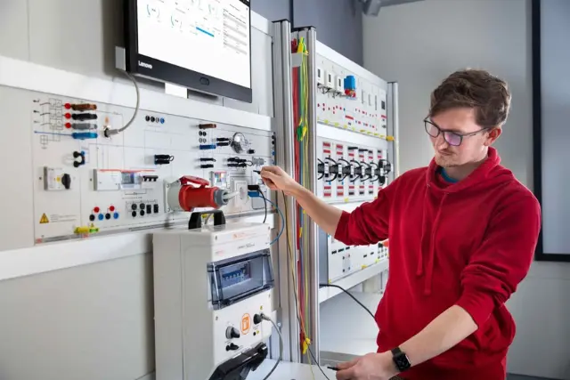

## Diploma in Nautical Science

The Diploma in Nautical Science (DNS) is a one-year, pre-sea training course designed as the first step for aspiring seafarers aiming to become deck officers

 Read More

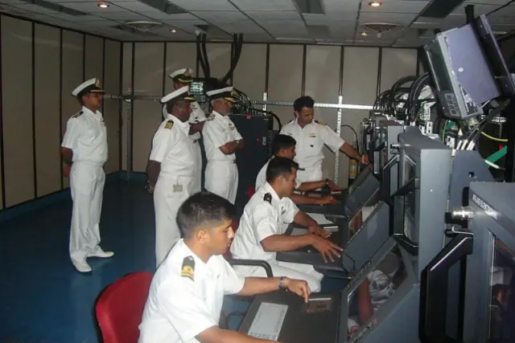

## BSC Nautical Science

A Bachelor of Science in Nautical Science is an undergraduate program that focuses on the theoretical and practical aspects of operating a ship.

 Read More

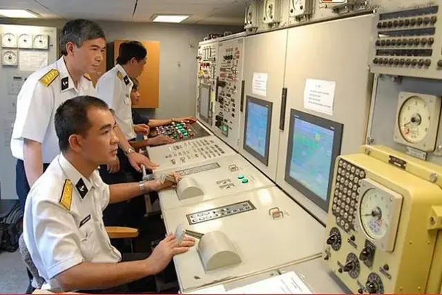

## B.Tech Marine Engineering

**B.Tech Marine Engineering** program. This four-year undergraduate course is a gateway for aspiring engineers to join the merchant navy.

 Read More

## Our Team

## Shubkaran Choudhary (Captian)

## Inouthern Marink Solytlant
 Co-Founder of Pacific Marine Academy

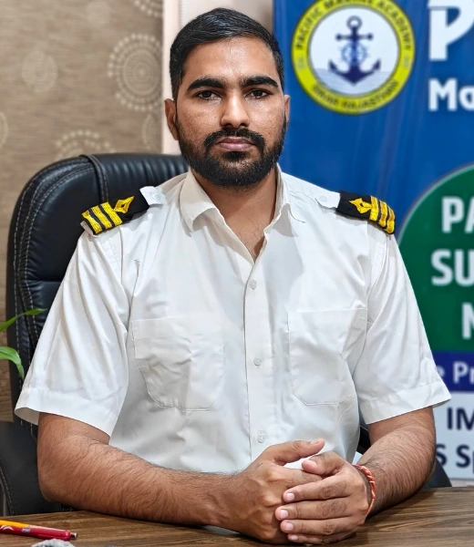

## Mahipal Singh Jhuriya

## 2nd Engineer
 Founder of Pacific Marine Academy

## Youtube Video's

[Embedded video]

[Embedded video]

[Embedded video]

[Embedded video]

[Embedded video]

[Embedded video]

[Embedded video]

[Embedded video]

[Embedded video]

[Embedded video]

❮
❯

## Sponsored

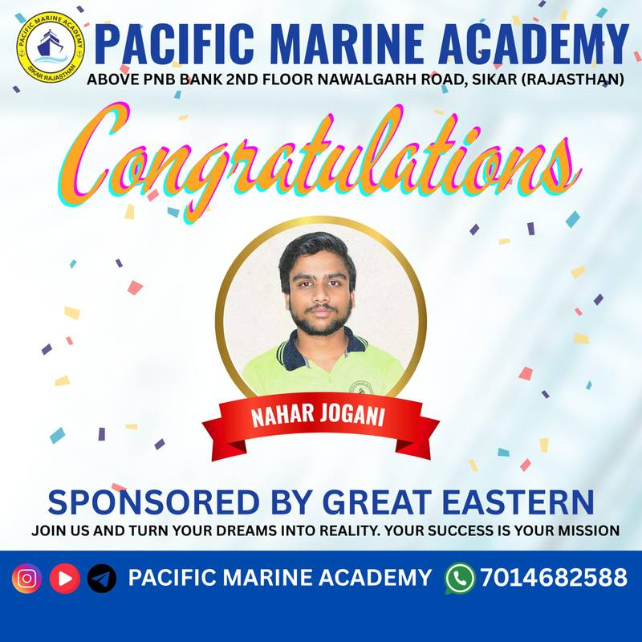

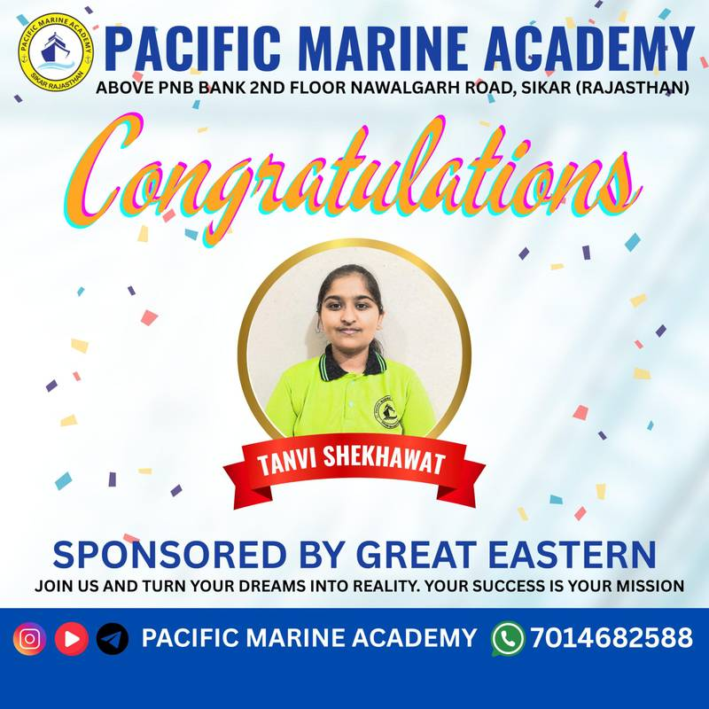

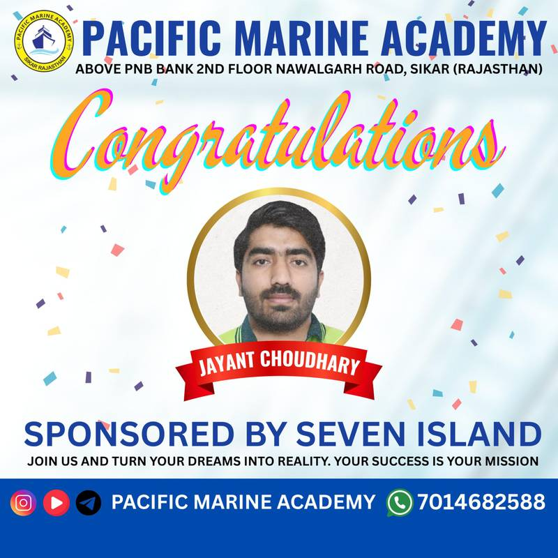

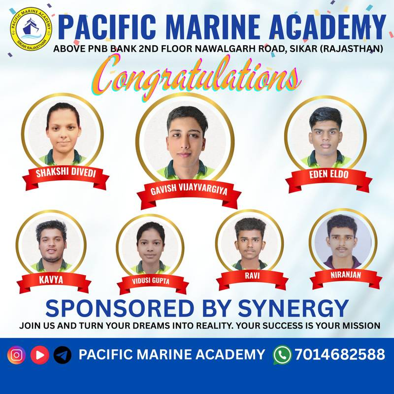

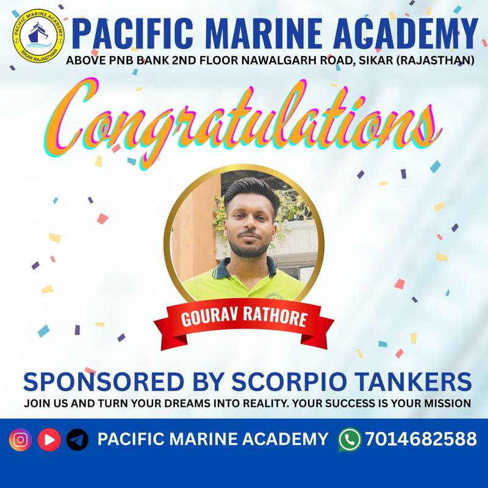

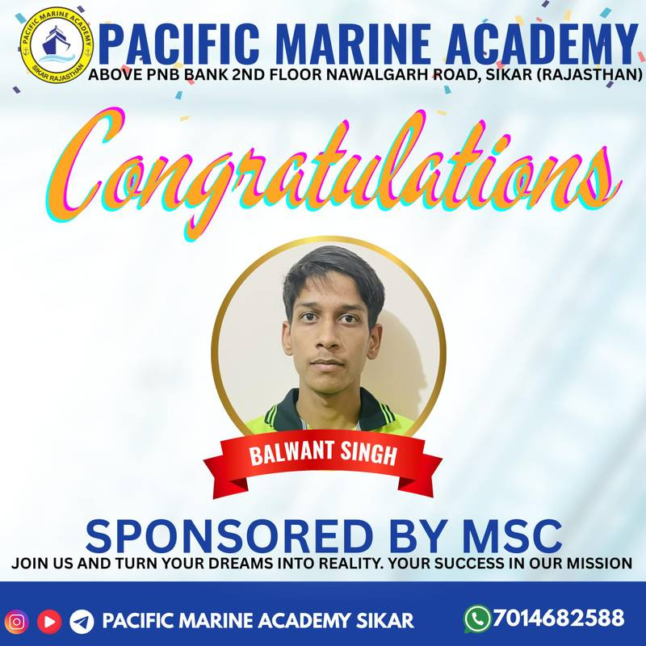

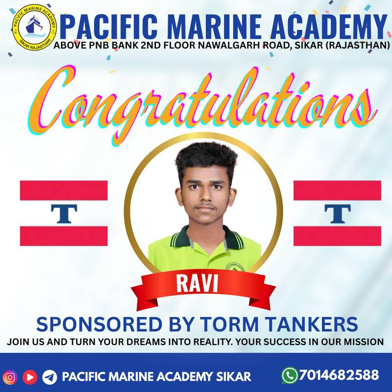

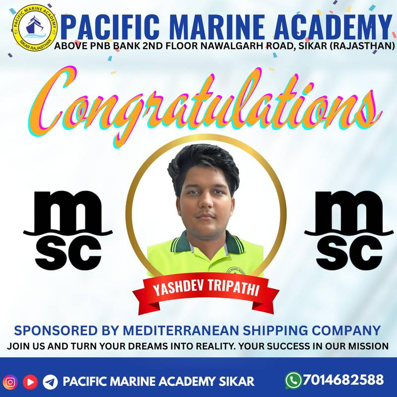

 View More

## Student’s Feedback

 ** EXCELLENT **

 Based on **354 reviews**

 Posted on Google

 CDT Rudra Kashyap
   Trustindex verifies that the original source of the review is Google.
I am from gaya district of bihar and visited pacific marine academy......i can say that i got all the things here which i was looking for an offline academy...... Discipline.... faculty....hostel....office staff...classroom ..... everything fine

 Posted on Google

 NIRVED SINGH
   Trustindex verifies that the original source of the review is Google.
My nephew take admission in Pacific marine academy as my friend son also study in this coaching as faculty is very cooperative

 Posted on Google

 Aryan Muwal
   Trustindex verifies that the original source of the review is Google.
My friend dipesh thori studied from pacific marine academy i consider this is a proper settled merchant navy coachinh in india

 Posted on Google

 AJEET KUMAR SINGH
   Trustindex verifies that the original source of the review is Google.
My son is studying in this institution, Thanks to the pacific team for the overall support. I recommend you all aspirants to join this coaching

 Posted on Google

 Rahul jangra 001
   Trustindex verifies that the original source of the review is Google.
Best imucet coaching in india

 Posted on Google

 Anil Verma
   Trustindex verifies that the original source of the review is Google.
Thanks pacific marine academy for ur guidance in imucet exam

 Posted on Google

 Expert Air Solutions
   Trustindex verifies that the original source of the review is Google.
I am here from sikar.....thanks god that we have India's best dns sponsorship coaching in my city only otherwise 80% of students here are from other states.......Thanks pacific for guidance and interview preparation to my brother

 Posted on Google

 mohit kuri
   Trustindex verifies that the original source of the review is Google.
This is a good coaching for imucet preparation in jaipur and sikar.

 Posted on Google

 Piyush Bakshi
   Trustindex verifies that the original source of the review is Google.
I am from yamuna nagar hariyana and stuying in pacific marine academy for imucet preparation and dns sponsorship

## All Winning Awrd

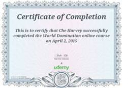

## Registration Now

Please fill the Form for Registration of your Interested courses:

## Registration Now

Please enable JavaScript in your browser to complete this form.

Layout

Student Name *

Father's Name *
Layout

Mobile Number *

Date of Birth *

12th PCM % *
Full Address *
Submit

[Embedded map]

---

## 1. The "Fourth Arm of Defence" - Pacific Marine Academy

Meta description: Historically, the Merchant Navy has been the lifeline of nations during war. Without merchant ships,fuel, food, and military equipment cannot reach the front

# 1. The “Fourth Arm of Defence”

By  Pacific Marine Academy  /  March 19, 2026

Historically, the Merchant Navy has been the lifeline of nations during war. Without merchant ships,fuel, food, and military equipment cannot reach the front lines.

- **World War II Legacy:** More than 30,000 merchant seafarers lost their lives keeping supply chains open.
- **Modern Role:** In 2026, merchant vessels remain “non-combatants” under international law, but they are protected by naval missions like **Operation Sankalp**. This Indian Navy operation provides direct escorts to Indian-flagged vessels in volatile zones.

## 📡 2. “Grey Zone” Warfare in 2026

Modern maritime conflict isn’t just about torpedoes; it’s about technology.

- **GPS Jamming & AIS Spoofing:** In high-risk zones, ships often experience “GNSS interference,” making digital charts unreliable. Crews must return to traditional radar and visual navigation.
- **“Going Dark”:** To avoid detection by hostile drones or missiles, some ships disable their **Automatic Identification System (AIS)**, a practice known as going dark.
- **Cyber Resilience:** As ships become more automated, the threat of a “cyber-attack” on a ship’s steering or engine system during a conflict is a major focus for 2026 training.

## 💰 3. Working in a War Zone: Benefits & Risks

Sailing into a designated “War Risk Area” (as defined by the IBF or Lloyd’s) comes with strict protocols and significantly higher pay.

- **Double Basic Pay:** Seafarers often receive a **100% bonus** on their basic salary for every day the ship is within a high-risk zone.
- **Death & Disability Compensation:** Doubled insurance payouts are mandatory for crews in these regions.
- **The Right to Refuse:** Under the **Maritime Labour Convention (MLC)**, a seafarer has the legal right to refuse to sail into a war zone and must be repatriated at the company’s expense if they choose to leave.

## ⚓ 4. Security Protocols (MARSEC Levels)

Ships use the **ISPS Code** (International Ship and Port Facility Security) to manage threats:

- **Level 1 (Normal):** Standard security.
- **Level 2 (Heightened):** Increased patrolling and restricted access points.
- **Level 3 (Exceptional):** The highest level, triggered when an attack is “probable or imminent.” At this level, cargo operations may stop, and the ship may be ordered to leave the port immediately under naval guidance
**Enroll Today in our 2026 Foundation Batch and Take the First Step toward the Captain’s Chair**. For more details visit our website

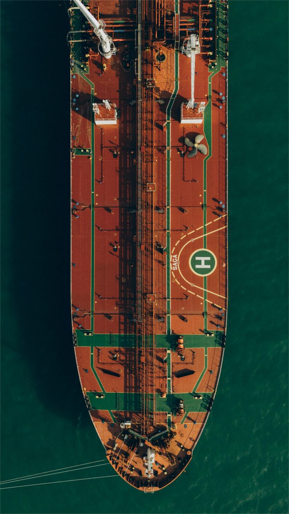

Previous
 The “Tech-Savvy” Deck Officer: Navigation in 2026
Next
 🚢 The Silent Fleet: Navigating the 2026 “Electronic Blackout” in Global Chokepoints

### Leave a Comment Cancel Reply

Your email address will not be published. Required fields are marked *

Type here..

 Name*

 Email*

 Website

 Save my name, email, and website in this browser for the next time I comment.

---

## 10 Reasons Why We Are the Best Merchant Navy Coaching in India for 2026 - Pacific Marine Academy

Meta description: The best Merchant Navy coaching in India is not just about teaching subjects; it is about building a foundation for a life at sea. For students who have

# 10 Reasons Why We Are the Best Merchant Navy Coaching in India for 2026

By  Pacific Marine Academy  /  December 28, 2025

The **best Merchant Navy coaching in India** is not just about teaching subjects; it is about building a foundation for a life at sea. For students who have completed Class 12 with PCM, the maritime industry offers a prestigious career, but the path to entry is highly competitive. To succeed, you need a strategic approach to the **IMU-CET preparation** and a clear roadmap for **DNS Sponsorship guidance**.

At **Pacific Marine Academy**, we provide a comprehensive ecosystem designed to turn aspirants into officers. If you are looking for the **best Merchant Navy coaching in India**, here is why our academy stands out as the top choice for students nationwide.

## **1. Expert-Led IMU-CET Preparation**

The Indian Maritime University Common Entrance Test (IMU-CET) is the mandatory gateway for all maritime courses. As the **best Merchant Navy coaching in India**, we focus on a result-oriented curriculum that covers Physics, Chemistry, Mathematics, English, and General Aptitude. Our students consistently achieve top All-India Ranks because we use data-driven mock tests and updated 2026 study materials.

## **2. Specialized DNS Sponsorship Guidance**

Securing a sponsorship before joining a college is the only way to guarantee a job in today’s maritime sector. Our **DNS Sponsorship guidance** program is unparalleled. We train students for the specific entrance exams of global giants like Anglo-Eastern, Synergy, and Fleet Management. This focus on placement security is what defines the **best Merchant Navy coaching in India**.

## **3. Advanced Merchant Navy Interview Preparation**

Technical knowledge alone is not enough to impress recruiters from international shipping companies. Our **Merchant Navy interview preparation** includes:

- Mock interviews with industry veterans.
- Psychometric test practice.
- Communication and soft skills grooming.
- Leadership and stress-management workshops.

## **4. Strategic Location and Facilities**

While we are a leading **Marine Academy in India**, our primary campus in Sikar offers a disciplined environment conducive to learning. We provide premium hostel facilities for outstation students, ensuring that candidates from every state can access the **best Merchant Navy coaching in India** without any logistical hurdles.

## **5. Digital Learning via Our Mobile App**

In today’s age, flexibility is key. Beyond our physical classrooms, we offer a high-tech Android app for **IMU-CET online coaching**. This allows students across the country to access recorded lectures, live doubt-clearing sessions, and a pan-India test series, solidifying our position as the **best Merchant Navy coaching in India** for both offline and online learners.

## **6. Understanding the Merchant Navy Career After 12th**

Navigating a **Merchant Navy career after 12th** can be confusing. Our counselors provide personalized roadmaps for:

- **B.Sc. Nautical Science** (3-year degree)
- **B.Tech Marine Engineering** (4-year degree)
- **DNS (Diploma in Nautical Science)** (1-year course)

## **7. Physical Fitness and Medical Awareness**

A career at sea requires strict adherence to DG Shipping medical standards. We guide our students on eye-sight requirements (6/6 vision), physical fitness, and the medical certificates needed to ensure they are fit for the voyage ahead.

## **8. High Selection Rate**

The true hallmark of the **best Merchant Navy coaching in India** is its success rate. Year after year, our students secure seats in the most prestigious maritime institutes and get placed with the world’s leading shipping fleets.

## **Conclusion: Start Your Journey Today**

The ocean is vast, but your path to it should be clear. By choosing the **best Merchant Navy coaching in India**, you are not just preparing for an exam; you are investing in a lifetime of adventure and professional success. Join **Pacific Marine Academy** and let us help you navigate your way to the horizon.

For more updates, visit our website

Previous
 How to Start Your Career in the Merchant Navy: The Ultimate 2026 Guide
Next
 Merchant Navy Salary in India 2026: A Complete Rank-Wise Breakdown

### Leave a Comment Cancel Reply

Your email address will not be published. Required fields are marked *

Type here..

 Name*

 Email*

 Website

 Save my name, email, and website in this browser for the next time I comment.

---

## About Institute - Pacific Marine Academy

Meta description: At Pacific Marine Academy, we help aspiring cadets achieve their dream of joining the Merchant Navy with confidence. As one of the best IMU-CET coaching

## About Academy

 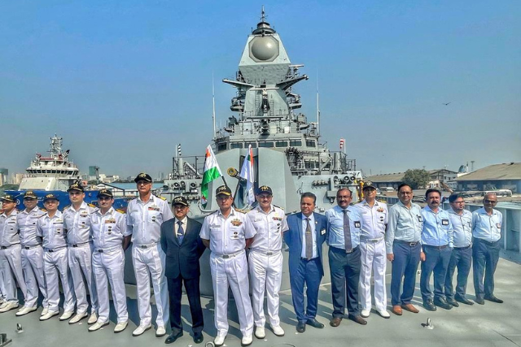

## Welcome to

## Pacific Marine Academy – Your Gateway to the Merchant Navy

At Pacific Marine Academy, we help aspiring cadets achieve their dream of joining the Merchant Navy with confidence. As one of the best IMU-CET coaching institutes in India, we offer a structured curriculum, expert faculty guidance, and personal mentorship to prepare you for IMU-CET, DNS sponsorship exams, and Merchant Navy interviews.
With our result-oriented approach, modern classrooms, and consistent record of high selection and sponsorship success rates, we ensure you are fully prepared to start your maritime career. Join the hundreds of successful students who trusted Pacific Marine Academy to launch their future at sea.

## Mission

Navy and IMU-CET coaching centers in Sikar aim to provide comprehensive and up-to-date training for aspiring candidates. Their mission is to offer expert instruction, rigorous practice, and holistic development to ensure students excel in their exams. These centers focus on disciplined learning environments, advanced teaching methodologies, and personalized attention. They also provide career guidance and support to help students achieve their professional goals in the maritime and defense sectors.

## Vision

They strive to produce highly skilled and knowledgeable candidates who excel in their careers. These centers aim to foster a culture of excellence, innovation, and integrity. By leveraging advanced teaching methods and a supportive learning environment, they aspire to set new benchmarks in education. Ultimately, they seek to contribute to the nation’s maritime and defense sectors with competent and confident professionals.

---

## Admission Form - Pacific Marine Academy

Meta description: Admission Form Please enable JavaScript in your browser to complete this form.Please enable JavaScript in your browser to complete this form.LayoutStudent

## Admission Form

Please enable JavaScript in your browser to complete this form.

Layout

Student Name *

Father's Name *
Layout

Mobile Number *

Date of Birth *

12th PCM % *
Full Address *
Submit

---

## mydigitaldesh, Author at Pacific Marine Academy

Meta description:

# Author name: mydigitaldesh

Blog

## B Tech Marine Engineering

 mydigitaldesh  /  September 29, 2024

Btech Marine Engineering is a 4-year degree course in the stream of Engineering which prepares its students for a career

---

## Pacific Marine Academy, Author at Pacific Marine Academy

Meta description:

# Author name: Pacific Marine Academy

Blog

## IMU CET Cutoff Trends: What Rank Do You Actually Need to Get In?

 Pacific Marine Academy  /  July 8, 2026

“What rank do I need to clear IMU CET?” is probably the single most-searched question among Merchant Navy aspirants every

Blog

## Why Sikar Is Becoming a Hub for Merchant Navy Coaching in Rajasthan

 Pacific Marine Academy  /  July 3, 2026

Ask a Merchant Navy aspirant from Rajasthan five years ago where to get IMU CET coaching, and the answer was

Blog

## From a Small Town in Rajasthan to the World’s Oceans — Real Stories of Pacific Marine Academy Students

 Pacific Marine Academy  /  June 29, 2026

Introduction There is something powerful about a student from a small town who dares to dream big. No metro city.

Blog

## IMU CET 2026 AIR 33: How Lakshya Sharma Cracked India’s Toughest Maritime Exam with Pacific Marine Academy

 Pacific Marine Academy  /  June 21, 2026

In a country of 1.4 billion people, achieving All India Rank 33 in one of the most competitive maritime entrance

Blog

## Why Pacific Marine Academy is India’s Best IMU CET Coaching — Our Results Speak for Themselves

 Pacific Marine Academy  /  June 17, 2026

Introduction Every year, thousands of students across India sit for the IMU CET — India’s most competitive maritime entrance exam.

Blog

## From Classroom to Cross-Ocean: Why Aspirants Trust Pacific Marine Academy

 Pacific Marine Academy  /  June 14, 2026

Choosing where to complete your pre-sea training is the most critical decision of your maritime career. With dozens of institutes

Blog

## How to Join the Merchant Navy from Haryana: Complete Guide

 Pacific Marine Academy  /  June 12, 2026

For youth across Rohtak, Bhiwani, Hisar, Sonipat, and Gurugram, the Merchant Navy offers an incredible career path. If you want

Blog

## How to Secure IMU-CET Success and DNS Sponsorship: Pacific Marine Academy Admissions Open

 Pacific Marine Academy  /  June 3, 2026

A career in the Merchant Navy offers an unparalleled blend of adventure, financial independence, global travel, and rapid professional growth.

Blog

## Merchant Navy vs. Indian Navy: Which Path is Yours?

 Pacific Marine Academy  /  April 27, 2026

Choosing between the Merchant Navy and the Indian Navy is one of the most common dilemmas for students in India

Blog

## Life at Sea 2026: The “Social” Revolution and Mental Well-being

 Pacific Marine Academy  /  April 27, 2026

For decades, the Merchant Navy was defined by a single word: Isolating. While the high salaries and global travel were

1 2 3 Next →

---

## Available Forms - Pacific Marine Academy

Meta description: Batch: AUGUST 2026

## Avaiable Forms

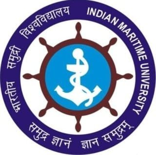

## IMUCET UG 2026

**Batch:** AUGUST 2026

**Course:** DNS/BSC/BTECH

**Form Fees:** ₹1200 (General/OBC)

**Form Fees:** ₹800 (SC/ST)

**Status:** Open

**Last Date:** 24 April 2026

 Apply Now

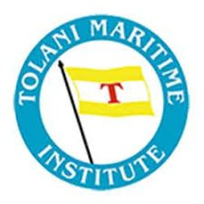

## TOLANI

**Batch:** AUGUST 2026

**Course:** DNS

**Form Fees:** ₹888

**Status:** Open

**Last Date:** 31 MAY 2026

 Apply Now

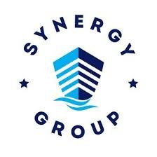

## SYNERGY

**Batch:** AUGUST 2026

**Course:** DNS/B.SC/B.TECH

**Form Fees:** ₹2478

**Status:** Open

**EXAM Date:** 17 MAY 2026

**Last Date:** TBA

 Apply Now

## FLEET

**Batch:** AUGUST 2026

**Course:** DNS

**Form Fees:** ₹00

**Status:** Open

**Start Date:** 20 March 2026

**Last Date:** 3 May 2026

 Apply Now

## V-SHIP

**Batch:** AUGUST 2026

**Course:** DNS / B.E MARINE

**Form Fees:** ₹1300

**Status:** Open

**Last Date:** TBA

 Apply Now

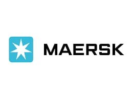

## MAERSK

**Batch:** AUGUST 2026

**Course:** BSC/BTECH

**Form Fees:** ₹1330

**Status:** Open

**Last Date:** TBA

 Apply Now

## ANGLO EASTERN

**Batch:** AUGUST 2026

**Form Fees:** ₹503

**Status:** Open

 Apply Now

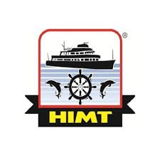

## HIMT

**Batch:** AUGUST 2026

**Course:** BSC/BTECH

**Form Fees:** ₹999

**Status:** Open

**Last Date:** TBA

 Apply Now

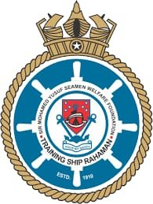

## TS RAHAMAN

**Batch:** AUGUST 2026

**Course:** DNS

**Form Fees:** ₹900

**Status:** Open

**Last Date:** 31 MARCH 2026

 Apply Now

## GREAT EASTERN

**Batch:** AUGUST 2026

**Course:** DNS

**Form Fees:** ₹833

**Status:** Open

**Last Date:** 30 April 2026

 Apply Now

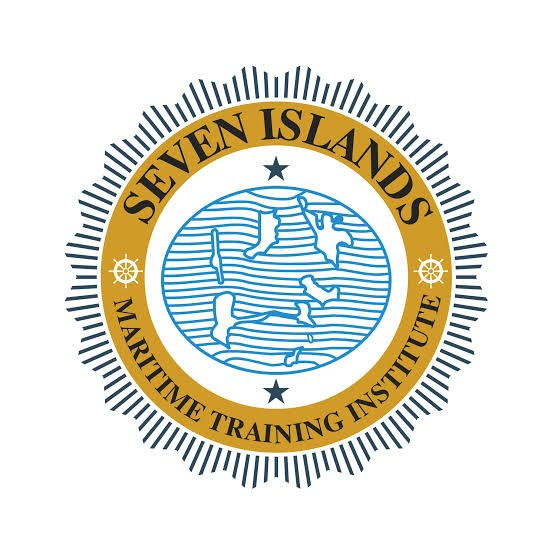

## SEVEN ISLANDS

**Batch:** AUGUST 2026

**Course:** DNS

**Form Fees:** ₹923

**Status:** Open

**Last Date:** TBA

 Apply Now

## SOMS / Centurion University

**Batch:** AUGUST 2026

**Course:** DNS

**Form Fees:** ₹00

**Status:** Open

**Last Date:** TBA

 Apply Now

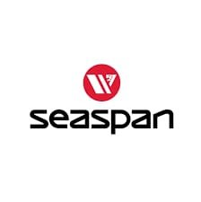

## SEASPAN

**Batch:** AUGUST 2026

**Course:** DNS (girls only)

**Form Fees:** ₹00

**Status:** Open

**Last Date:** TBA

 Apply Now

## SEASPAN

**Batch:** AUGUST 2026

**Course:** BSC

**Form Fees:** ₹1310

**Status:** Open

**Last Date:** TBA

 Apply Now

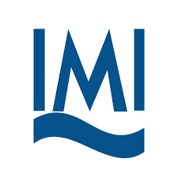

## IMI

**Batch:** AUGUST 2026

**Course:** DNS/B.TECH

**Form Fees:** ₹2100

**Status:** Open

**Last Date:** TBA

 Apply Now

## GANPAT

**Batch:** AUGUST 2026

**Course:** DNS / B.Sc / B.Tech

**Form Fees:** ₹500 approx.

**Status:** Open

**Last Date:** TBA

 Apply Now

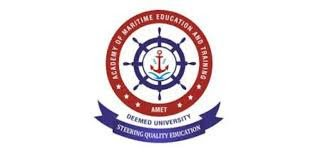

## AMET

**Batch:** AUGUST 2026

**Course:** DNS / B.Sc / B.Tech

**Form Fees:** ₹1250

**Status:** Open

**Last Date:** 1 June 2026

 Apply Now

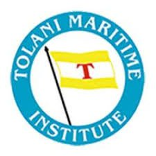

## TOLANI MARITIME INSTITUTE

**Batch:** AUGUST 2026

**Course:** BSC/BTECH

**Form Fees:** ₹1499

**Status:** Open

**Last Date:** 31 May 2026

 Apply Now

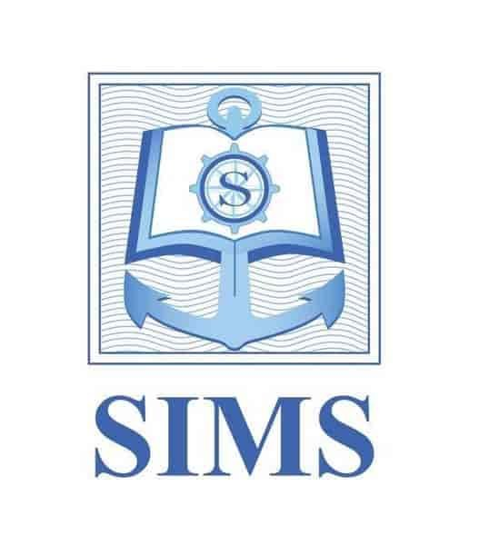

## SIMS

**Batch:** AUGUST 2026

**Course:** BTECH/DNS

**Form Fees:** ₹1100

**Status:** Open

**Last Date:** TBA

 Apply Now

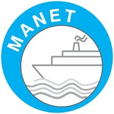

## MANET PUNE

**Batch:** AUGUST 2026

**Course:** DNS/ B.Sc / B.Tech

**Form Fees:** ₹1800

**Status:** Open

**Last date:** 15 June 2026

 Apply Now

---

## B Tech Marine Engineering - Pacific Marine Academy

Meta description: Btech Marine Engineering is a 4-year degree course in the stream of Engineering which prepares its students for a career in Marine Engineering. A bachelor’s

# B Tech Marine Engineering

By  mydigitaldesh  /  September 29, 2024

Btech Marine Engineering is a 4-year degree course in the stream of Engineering which prepares its students for a career in Marine Engineering. A bachelor’s degree in Btech Marine Engineering acts as an entry point for interested students to join merchant navy through the engine side. The syllabus includes subjects like- Applied Thermodynamics, Ship Structure & Construction, Naval Architecture, Fluids Mechanics, Marine Heat Engine & Air Conditioning, etc. This blog will cover all you need to know about btech marine engineering so keep reading!

### **Btech Marine Engineering: An Overview**

We at Merchant Navy Decoded only recommend – MERI Kolkata and Tolani Maritime Institute for a Btech Marine Engineering.

**Merchant Navy Entrance Examination- Btech Marine Engineering**

Following are the entrance exams for the above-mentioned colleges

Next
 How to Start Your Career in the Merchant Navy: The Ultimate 2026 Guide

### Leave a Comment Cancel Reply

Your email address will not be published. Required fields are marked *

Type here..

 Name*

 Email*

 Website

 Save my name, email, and website in this browser for the next time I comment.

---

## Best B.Tech Marine Engineering Coaching in Sikar - Jaipur

Meta description: Pacific Marine Academy in Sikar, Rajasthan, is a coaching institute that prepares student Best B.Tech Marine Engineering Coaching in Sikar - Jaipur

## B.Tech Marine Engineering

Pacific Marine Academy in Sikar, Rajasthan, is a coaching institute that prepares students for a career in the merchant navy, with a strong focus on the **B.Tech Marine Engineering** program. This four-year undergraduate course is a gateway for aspiring engineers to join the merchant navy. The program is designed to align with the International Convention on Standards of Training, Certification and Watchkeeping (STCW) for seafarers, ensuring that students receive a world-class education that is recognized globally.

The B.Tech Marine Engineering curriculum at a reputable institution, and which Pacific Marine Academy prepares students for, is a blend of theoretical knowledge and practical training. It covers a wide range of subjects essential for operating and maintaining a ship’s complex machinery. Key subjects include Marine Machinery Systems, Marine Internal Combustion Engines,

Marine Boilers, Naval Architecture, and Marine Steam Plants. Students are also trained on simulators to gain a realistic understanding of shipboard operations. The course prepares students to become competent marine engineers who can handle the various systems on a modern vessel, from propulsion and power generation to refrigeration and fluid mechanics.

The eligibility criteria for this course are strict, requiring candidates to have completed 10+2 with Physics, Chemistry, and Mathematics (PCM) as mandatory subjects. A minimum aggregate of 60% in PCM is often required, along with at least 50% in English in the 10th or 12th examination. Candidates must also meet specific age and physical fitness standards, including eyesight requirements, as prescribed by the Merchant Shipping (Medical Examination) Rules.

Pacific Marine Academy’s coaching program is tailored to help students meet these stringent requirements. They prepare students for the IMU-CET, which is a key entrance exam for B.Tech Marine Engineering courses in India. The academy’s training includes not only academic preparation but also mock interviews and guidance for company-specific sponsorship exams. Their focus on holistic development ensures that students are not just academically prepared but also possess the discipline and professional character required for a career at sea.

Upon successful completion of the B.Tech Marine Engineering course, graduates are well-equipped to join a ship as a Junior or Trainee Engineer. The career progression is clear, with opportunities to advance through the ranks to become a Second Engineer and eventually a Chief Engineer. This course offers a direct path to a high-paying, global career with excellent growth prospects in both the onshore and offshore sectors of the maritime industry.

---

## Best BSC Nautical Science Coaching in Sikar, Jaipur, India

Meta description: A Bachelor of Science in Nautical Science is an undergraduate program that focuses on the theoretical and practical aspects of operating a ship.

## BSC Nautical Science

## What is a B.Sc. Nautical Science?

A Bachelor of Science in Nautical Science is an undergraduate program that focuses on the theoretical and practical aspects of operating a ship. It’s designed to train future deck officers for the merchant navy. The course covers a wide range of subjects, from navigation and seamanship to marine engineering and meteorology. The curriculum is a blend of classroom lectures, hands-on training, and practical experience.

## Eligibility and Admission

To be eligible for the program, students must have completed their 10+2 with Physics, Chemistry, and Mathematics (PCM) as core subjects. Admission to a B.Sc. Nautical Science program is typically based on an entrance exam, such as the **IMU CET** (Indian Maritime University Common Entrance Test). Candidates must also meet certain physical and medical standards.

## Syllabus and Curriculum

The syllabus for a B.Sc. Nautical Science program is comprehensive and covers a wide range of subjects, including:

-
**Navigation:** Students learn about celestial navigation, electronic navigation systems (like GPS and radar), and chart work.

-
**Seamanship:** This includes topics like ropework, ship handling, anchoring, and mooring operations.

-
**Marine Engineering:** Students get a basic understanding of marine engines, ship machinery, and maintenance procedures.

-
**Meteorology:** They learn about weather patterns, forecasting, and how to use weather information for safe navigation.

-
**Cargo Operations:** The course also covers the principles of cargo handling, stowage, and securing.

-
**Marine Law and Regulations:** Students are taught about international maritime laws, safety regulations, and pollution prevention.

## Career Prospects

After completing the three-year program, graduates are required to complete a one-year sea training period. Upon successful completion of the training and passing the necessary examinations, they can obtain a Second Mate’s certificate of competency. With this certificate, they can join a ship as a third officer. With experience and further training, they can move up the ranks to become a chief officer and eventually a **captain** of a ship.

The merchant navy offers a rewarding career with a high salary, opportunities for travel, and a clear path for professional growth. A B.Sc. in Nautical Science is the first step toward a successful career at sea.

---

## Best Diploma in Nautical Science Coaching in Sikar, Jaipur

Meta description: Best Diploma in Nautical Science Coaching in Sikar, Jaipur At Pacific Marine Academy, this course is a cornerstone of their offerings

## Diploma in Nautical Science

The Diploma in Nautical Science (DNS) is a one-year, pre-sea training course designed as the first step for aspiring seafarers aiming to become deck officers in the merchant navy. At Pacific Marine Academy, this course is a cornerstone of their offerings, providing a focused and intensive preparation for a dynamic career on the high seas.

The DNS program is structured to transform a student into a competent and knowledgeable deck cadet, ready for the challenges of shipboard life. The curriculum is meticulously crafted to meet the stringent standards set by the Directorate General of Shipping (DGS), Government of India, and other international maritime organizations. It covers a wide range of subjects essential for safe and efficient ship operations. Students delve into the principles of navigation, mastering the use of charts and modern bridge equipment.

They learn about seamanship, including rope work, anchoring, and handling various types of vessels. Safety is paramount in the maritime industry, and the course places a strong emphasis on international regulations like SOLAS (Safety of Life at Sea) and MARPOL, along with training in fire fighting, first aid, and survival techniques.

A key feature of the DNS course is its practical-oriented approach. After completing the one-year pre-sea training at an approved college, students embark on 18 months of mandatory onboard training as a deck cadet. This is a crucial phase where theoretical knowledge is applied in a real-world setting. Cadets gain hands-on experience in bridge watch-keeping, cargo handling, and general ship maintenance.

Pacific Marine Academy’s role in this journey is to provide the foundational coaching and guidance necessary for students to secure admission into a reputable maritime college and to gain sponsorship from a shipping company. The academy prepares students for the competitive IMU-CET (Indian Maritime University Common Entrance Test) and the rigorous sponsorship exams and interviews conducted by shipping companies. They offer a structured curriculum, experienced faculty, and mock interviews to build the confidence and knowledge of their students.

Upon successful completion of the onboard training and various examinations, the cadet is awarded a Bachelor of Science in Applied Nautical Science degree by the Indian Maritime University and becomes eligible to appear for the Second Mate’s Certificate of Competency (CoC) examination. This certification is a globally recognized passport to a career as a Third Officer, the first step on a clear and progressive career ladder that can lead to the prestigious rank of Ship Captain. The Diploma in Nautical Science, as facilitated by Pacific Marine Academy’s preparatory coaching, offers a fast-track entry into a rewarding career filled with adventure, responsibility, and the opportunity to travel the world.

---

## Best DNS Sponsorship Coaching in Sikar, Jaipur - India

Meta description: Best DNS Sponsorship Coaching in Sikar, Jaipur India Pacific Marine Academy, located in Sikar, Jaipur coaching program for the DNS Sponsorship

## DNS Sponsorship

## Pacific Marine Academy: DNS Sponsorship Course

Pacific Marine Academy, located in Sikar, Rajasthan, offers a specialized coaching program for the **DNS Sponsorship** exam. This course is designed for aspiring merchant navy cadets who want to secure a sponsorship from a shipping company before they join a one-year Diploma in Nautical Science (DNS) course. Sponsorship is highly sought after as it guarantees a sea training berth with a specific company after the completion of the diploma, which is a critical step toward a successful career as a deck officer.

## What is DNS Sponsorship?

DNS Sponsorship is essentially a job offer from a shipping company. Before students enroll in a DNS program at an approved maritime college, they can appear for sponsorship exams conducted by various shipping companies like Maersk, Anglo-Eastern, Great Eastern Shipping, and more.

Clearing this exam and the subsequent interview secures a seat for them in the DNS course and guarantees a job with the company after they complete their one-year training. This sponsorship is a game-changer for a merchant navy career, as it removes the uncertainty of finding a job after graduation.

## The Pacific Marine Academy's Coaching Approach

Pacific Marine Academy’s DNS Sponsorship course is a comprehensive program that prepares students for every stage of the selection process. The coaching focuses on a holistic approach that includes:

-
**Written Exam Preparation:** The sponsorship exams usually consist of multiple-choice questions covering subjects like **Physics, Chemistry, Mathematics, English, and General Aptitude**. The academy provides in-depth coaching for all these subjects, ensuring students have a strong grasp of the fundamentals. The curriculum is tailored to the specific patterns of various shipping companies’ exams.

-
**Interview Training:** The interview is a crucial part of the selection process. The academy conducts mock interviews to help students build confidence and polish their communication skills. They receive guidance on how to answer common technical and HR-related questions, as well as how to present themselves professionally.

-
**Psychological and Medical Guidance:** Many companies conduct a psychological test to assess a candidate’s suitability for a career at sea. The academy provides guidance for these tests. They also prepare students for the stringent medical examinations, which are mandatory for all merchant navy aspirants.

-
**Study Materials and Test Series:** The course includes access to well-structured study materials and a comprehensive test series. These practice tests mimic the actual exam environment and help students assess their progress and identify areas that need improvement.

## Why Choose This Course?

Choosing the DNS Sponsorship course at Pacific Marine Academy gives students a significant edge. The coaching is led by professionals with extensive experience in the maritime industry, who provide valuable insights and mentorship. The structured program increases a candidate’s chances of securing sponsorship, which is a crucial first step in a stable and rewarding career in the merchant navy. By joining this course, aspiring cadets are not just preparing for an exam; they are laying the groundwork for a successful professional life at sea.

---

## Best IMU CET Preparation Coaching in Sikar, Jaipur, India

Meta description: Best IMU CET Preparation Coaching in Sikar, Jaipur, India IMU CET (Indian Maritime University Common Entrance Test) and various DNS

## IMU CET Preparation

Pacific Marine Academy, located in Sikar, Rajasthan, is a dedicated coaching center specializing in preparing aspiring candidates for the highly competitive **IMU CET** (Indian Maritime University Common Entrance Test) and various DNS (Diploma in Nautical Science) sponsorship exams. The academy’s IMU CET Preparation Course is designed to be a comprehensive and results-oriented program, aiming to provide students with the necessary tools and knowledge to successfully navigate the complexities of these entrance tests.

The IMU CET is a computer-based, multiple-choice exam that serves as the gateway to numerous undergraduate and postgraduate courses in maritime studies. For undergraduate courses, the exam syllabus is based on the 10+2 level, covering key subjects that form the foundation of a career in the merchant navy. These subjects include:

-
**Physics:** A strong understanding of physics principles is crucial for a career at sea. Topics range from mechanics and thermodynamics to electricity and magnetism, all of which are essential for navigating and operating marine vessels.

-
**Chemistry:** Knowledge of chemistry is vital for various aspects of marine engineering and safety, including the properties of fuels, lubricants, and other chemicals used on board.

-
**Mathematics:** From navigation calculations to engineering problems, mathematics is the backbone of a mariner’s job. The course focuses on topics like calculus, algebra, and geometry.

-
**English:** Effective communication is paramount in the maritime industry. The course includes sections on grammar, vocabulary, and comprehension to ensure students are well-versed in written and verbal communication.

-
**General Aptitude:** This section tests a candidate’s logical reasoning, critical thinking, and general knowledge, which are all essential qualities for an officer on a ship.

Pacific Marine Academy’s course goes beyond just theoretical knowledge. It employs a multi-faceted approach that includes:

-
**Structured Classroom Sessions:** Experienced faculty, including master mariners and naval officers, provide expert guidance and in-depth instruction on all subjects.

-
**Extensive Study Material:** Students receive detailed notes, textbooks, and practice questions that are meticulously curated to align with the IMU CET and sponsorship exam patterns.

-
**Regular Mock Tests:** The academy conducts a series of mock tests that simulate the actual exam environment. These tests help students become familiar with the format, manage their time effectively, and identify their strengths and weaknesses.

-
**Interview Preparation:** Securing a sponsorship from a shipping company is often as important as clearing the IMU CET. The academy provides dedicated training for interviews, including mock interviews with industry professionals, to boost students’ confidence and communication skills.

-
**Career Counseling:** The academy offers end-to-end guidance, from the application process to choosing the right course and college. They also provide support until a student secures their first job at sea, emphasizing their commitment to the entire career journey of their students.

By offering a holistic and comprehensive preparation program, Pacific Marine Academy aims to equip students with not just the academic knowledge but also the discipline, confidence, and skills required to succeed in the demanding and rewarding world of the merchant navy.

---

## Blogs - Pacific Marine Academy

Meta description:

Blog

## IMU CET Cutoff Trends: What Rank Do You Actually Need to Get In?

 Pacific Marine Academy  /  July 8, 2026

“What rank do I need to clear IMU CET?” is probably the single most-searched question among Merchant Navy aspirants every

Blog

## Why Sikar Is Becoming a Hub for Merchant Navy Coaching in Rajasthan

 Pacific Marine Academy  /  July 3, 2026

Ask a Merchant Navy aspirant from Rajasthan five years ago where to get IMU CET coaching, and the answer was

Blog

## From a Small Town in Rajasthan to the World’s Oceans — Real Stories of Pacific Marine Academy Students

 Pacific Marine Academy  /  June 29, 2026

Introduction There is something powerful about a student from a small town who dares to dream big. No metro city.

Blog

## IMU CET 2026 AIR 33: How Lakshya Sharma Cracked India’s Toughest Maritime Exam with Pacific Marine Academy

 Pacific Marine Academy  /  June 21, 2026

In a country of 1.4 billion people, achieving All India Rank 33 in one of the most competitive maritime entrance

Blog

## Why Pacific Marine Academy is India’s Best IMU CET Coaching — Our Results Speak for Themselves

 Pacific Marine Academy  /  June 17, 2026

Introduction Every year, thousands of students across India sit for the IMU CET — India’s most competitive maritime entrance exam.

Blog

## From Classroom to Cross-Ocean: Why Aspirants Trust Pacific Marine Academy

 Pacific Marine Academy  /  June 14, 2026

Choosing where to complete your pre-sea training is the most critical decision of your maritime career. With dozens of institutes

Blog

## How to Join the Merchant Navy from Haryana: Complete Guide

 Pacific Marine Academy  /  June 12, 2026

For youth across Rohtak, Bhiwani, Hisar, Sonipat, and Gurugram, the Merchant Navy offers an incredible career path. If you want

Blog

## How to Secure IMU-CET Success and DNS Sponsorship: Pacific Marine Academy Admissions Open

 Pacific Marine Academy  /  June 3, 2026

A career in the Merchant Navy offers an unparalleled blend of adventure, financial independence, global travel, and rapid professional growth.

Blog

## Merchant Navy vs. Indian Navy: Which Path is Yours?

 Pacific Marine Academy  /  April 27, 2026

Choosing between the Merchant Navy and the Indian Navy is one of the most common dilemmas for students in India

Blog

## Life at Sea 2026: The “Social” Revolution and Mental Well-being

 Pacific Marine Academy  /  April 27, 2026

For decades, the Merchant Navy was defined by a single word: Isolating. While the high salaries and global travel were

1 2 3 Next →

---

## Blogs - Page 2 of 3 - Pacific Marine Academy

Meta description:

Blog

## Digitalization & AI: Is the “Autonomous Ship” a Threat to Your Career?

 Pacific Marine Academy  /  April 27, 2026

As we move through 2026, the maritime industry is undergoing its most significant technological shift since the transition from sail

Blog

## Life After IMU-CET: Choosing Between B.Tech and DNS

 Pacific Marine Academy  /  April 27, 2026

Congratulations! You’ve cleared the entrance exam or are planning to do so. Now comes the most debated question in the

Blog

## IMU-CET 2026 Syllabus Changes: What You Need to Know

 Pacific Marine Academy  /  April 27, 2026

The Indian Maritime University Common Entrance Test (IMU-CET) is the ultimate gateway for anyone dreaming of a career at sea.

Blog

## Why Pacific Marine Academy is the Best IMU CET Coaching in India for 2026

 Pacific Marine Academy  /  April 27, 2026

Introduction The journey to a successful career in the Merchant Navy begins with one critical step: the Indian Maritime University

Blog

## The 2026 “Electronic Blackout”: How Modern Seafarers Navigate Global Chokepoints

 Pacific Marine Academy  /  March 20, 2026

If you have been following the news this March, you know that the Strait of Hormuz and the Red Sea

Blog

## The “Strait of Hormuz” Crisis

 Pacific Marine Academy  /  March 20, 2026

In March 2026, the Strait of Hormuz has become a global focal point. This is the most “viral” topic you

Blog

## 🚢 The Silent Fleet: Navigating the 2026 “Electronic Blackout” in Global Chokepoints

 Pacific Marine Academy  /  March 19, 2026

As of March 2026, the world’s most vital maritime arteries—the Strait of Hormuz and the Red Sea—have transformed. For the

Blog

## 1. The “Fourth Arm of Defence”

 Pacific Marine Academy  /  March 19, 2026

Historically, the Merchant Navy has been the lifeline of nations during war. Without merchant ships,fuel, food, and military equipment cannot

Blog

## The “Tech-Savvy” Deck Officer: Navigation in 2026

 Pacific Marine Academy  /  February 18, 2026

The year 2026 marks a historic “tipping point” for the maritime industry. As of January 1st, new IMO (International Maritime

Blog

## The “Back-Up Plan” Strategy: Shore-Based Careers in 2026

 Pacific Marine Academy  /  February 18, 2026

One of the greatest myths about the Merchant Navy is that you have to sail until you retire. In 2026,

← Previous 1 2 3 Next →

---

## Blogs - Page 3 of 3 - Pacific Marine Academy

Meta description:

Blog

## Will AI Replace Seafarers? The Future of Merchant Navy Careers in 2026

 Pacific Marine Academy  /  January 25, 2026

As we move through 2026, the maritime industry is buzzing with talk of Autonomous Surface Ships (MASS) and AI-powered navigation.

Blog

## Girls in the Merchant Navy 2026: Why the “Blue Economy” is the New Pink ⚓

 Pacific Marine Academy  /  January 25, 2026

For decades, the Merchant Navy was seen as a “Man’s World.” But in 2026, the tide has officially turned. From

Blog

## Top 10 Merchant Navy Sponsorship Companies in India: 2026 Edition

 Pacific Marine Academy  /  January 25, 2026

In 2026, the gap between a “job seeker” and a “job holder” in the Merchant Navy is a Sponsorship Letter.

Blog

## Can You Pass the 2026 Merchant Navy Medical? 🩺

 Pacific Marine Academy  /  January 15, 2026

Before you spend a single rupee on IMU-CET preparation, you must ask yourself: Am I medically fit according to the

Blog

## The Parallel Preparation Strategy

 Pacific Marine Academy  /  January 15, 2026

Most students make the mistake of waiting until after their 12th Board exams to begin. In 2026, the timeline is

Blog

## Merchant Navy in 2026: Instagram Reels vs. The Hard Reality

 Pacific Marine Academy  /  January 15, 2026

Scroll through Instagram or YouTube, and you’ll see cadets in crisp white uniforms, posing against sunsets in Singapore or flaunting

Blog

## Merchant Navy Salary in India 2026: A Complete Rank-Wise Breakdown

 Pacific Marine Academy  /  January 4, 2026

One of the most frequent questions we receive at Pacific Marine Academy is: “Exactly how much can I earn in

Blog

## 10 Reasons Why We Are the Best Merchant Navy Coaching in India for 2026

 Pacific Marine Academy  /  December 28, 2025

The best Merchant Navy coaching in India is not just about teaching subjects; it is about building a foundation for

Blog

## How to Start Your Career in the Merchant Navy: The Ultimate 2026 Guide

 Pacific Marine Academy  /  December 28, 2025

Are you a Class 12 student with a passion for the ocean and a desire for a global career? The

Blog

## B Tech Marine Engineering

 mydigitaldesh  /  September 29, 2024

Btech Marine Engineering is a 4-year degree course in the stream of Engineering which prepares its students for a career

← Previous 1 2 3

---

## Can You Pass the 2026 Merchant Navy Medical? 🩺 - Pacific Marine Academy

Meta description: Before you spend a single rupee on IMU-CET preparation, you must ask yourself: Am I medically fit according to the DG Shipping 2026 guidelines? The Merchant

# Can You Pass the 2026 Merchant Navy Medical? 🩺

By  Pacific Marine Academy  /  January 15, 2026

Before you spend a single rupee on **IMU-CET preparation**, you must ask yourself: Am I medically fit according to the DG Shipping 2026 guidelines? The Merchant Navy is one of the most physically demanding careers, and the medical standards are non-negotiable.

As the **best Merchant Navy coaching in India**, we have seen brilliant students lose their chance because they didn’t check their eligibility early. Here is everything you need to know to stay ahead.

**1. The “6/6” Rule: Eyesight Requirements**

Eyesight is the #1 reason for rejection. Google searches for “Is LASIK allowed in Merchant Navy 2026?” have surged recently.

- **Deck Department (Nautical):** You need **6/6 vision** in both eyes without glasses. **Color Blindness** is a permanent disqualification.
- **Engine Department:** Corrective lenses (glasses) are often allowed, but your unaided vision must still meet specific limits (typically 6/12 in each eye or better).
- **The LASIK Question:** While many companies accept LASIK, it must be fully healed, and your corneas must meet minimum thickness standards. Always get a checkup from a **DG Shipping-approved doctor** before assuming you are fit.
**2. BMI and Physical Constitution**

In 2026, the industry is stricter about the “Body Mass Index” (BMI). A seafarer needs to be agile enough to climb vertical ladders and enter enclosed spaces.

- **Height:** Minimum **157 cm** for males and **145 cm** for females (with some relaxations for specific regions like Northeast India).
- **Weight:** Must be proportionate to height. Having a BMI over 30 (Obese) or under 18 (Underweight) can lead to temporary unfitness.
**3. New 2026 STCW Competency Standards**

Effective **January 1, 2026**, the DG Shipping has incorporated new mandatory training regarding “Prevention of Violence and Harassment” (PSSR Course ID 957).

- **What this means for you:** Your medical and safety certification will now include modules on mental health awareness and workplace conduct. This shift shows that the 2026 Merchant Navy is focusing as much on **mental fitness** as physical strength.
**4. Routine Tests You Should Do Early**

Don’t wait for the company interview. Get these “Big 4” tested at your local clinic today:

- **Audiometry:** Can you hear a whisper from 5 meters away?
- **Blood Pressure:** Must be below **150/90** for freshers.
- **Chest X-Ray:** To ensure no history of tuberculosis or respiratory issues.
- **Urine/Blood Sugar:** To rule out diabetes or kidney irregularities.
**Conclusion: Fitness is the First Step**

At **Pacific Marine Academy**, we don’t just teach Physics and Maths; we guide you on your fitness journey. We recommend all our students undergo a “Pre-Coaching Medical Checkup” so they can focus on their **DNS Sponsorship guidance** with 100% confidence.

**Enroll Today in our 2026 Foundation Batch and Take the First Step toward the Captain’s Chair**. For more details visit our website

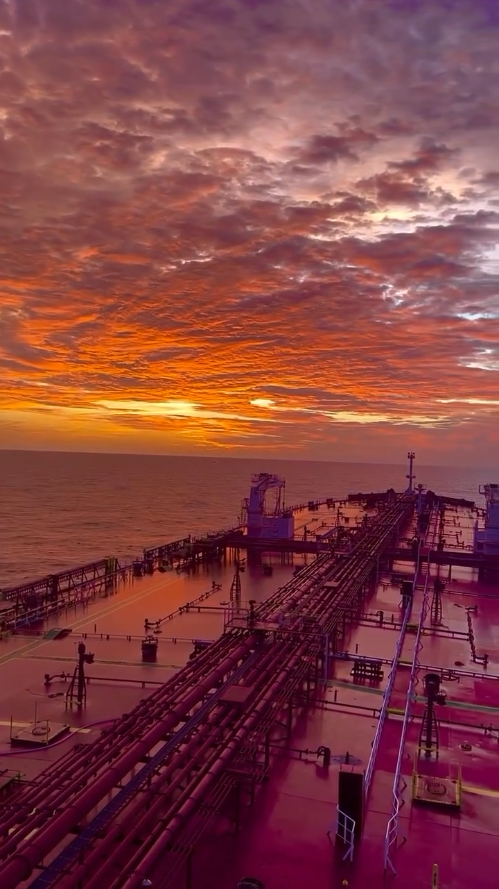

Previous
 The Parallel Preparation Strategy
Next
 Top 10 Merchant Navy Sponsorship Companies in India: 2026 Edition

### Leave a Comment Cancel Reply

Your email address will not be published. Required fields are marked *

Type here..

 Name*

 Email*

 Website

 Save my name, email, and website in this browser for the next time I comment.

---

## Blog Archives - Pacific Marine Academy

Meta description: Your blog category

# Blog

Your blog category

Blog

## IMU CET Cutoff Trends: What Rank Do You Actually Need to Get In?

 Pacific Marine Academy  /  July 8, 2026

“What rank do I need to clear IMU CET?” is probably the single most-searched question among Merchant Navy aspirants every

Blog

## Why Sikar Is Becoming a Hub for Merchant Navy Coaching in Rajasthan

 Pacific Marine Academy  /  July 3, 2026

Ask a Merchant Navy aspirant from Rajasthan five years ago where to get IMU CET coaching, and the answer was

Blog

## From a Small Town in Rajasthan to the World’s Oceans — Real Stories of Pacific Marine Academy Students

 Pacific Marine Academy  /  June 29, 2026

Introduction There is something powerful about a student from a small town who dares to dream big. No metro city.

Blog

## IMU CET 2026 AIR 33: How Lakshya Sharma Cracked India’s Toughest Maritime Exam with Pacific Marine Academy

 Pacific Marine Academy  /  June 21, 2026

In a country of 1.4 billion people, achieving All India Rank 33 in one of the most competitive maritime entrance

Blog

## Why Pacific Marine Academy is India’s Best IMU CET Coaching — Our Results Speak for Themselves

 Pacific Marine Academy  /  June 17, 2026

Introduction Every year, thousands of students across India sit for the IMU CET — India’s most competitive maritime entrance exam.

Blog

## From Classroom to Cross-Ocean: Why Aspirants Trust Pacific Marine Academy

 Pacific Marine Academy  /  June 14, 2026

Choosing where to complete your pre-sea training is the most critical decision of your maritime career. With dozens of institutes

Blog

## How to Join the Merchant Navy from Haryana: Complete Guide

 Pacific Marine Academy  /  June 12, 2026

For youth across Rohtak, Bhiwani, Hisar, Sonipat, and Gurugram, the Merchant Navy offers an incredible career path. If you want

Blog

## How to Secure IMU-CET Success and DNS Sponsorship: Pacific Marine Academy Admissions Open

 Pacific Marine Academy  /  June 3, 2026

A career in the Merchant Navy offers an unparalleled blend of adventure, financial independence, global travel, and rapid professional growth.

Blog

## Merchant Navy vs. Indian Navy: Which Path is Yours?

 Pacific Marine Academy  /  April 27, 2026

Choosing between the Merchant Navy and the Indian Navy is one of the most common dilemmas for students in India

Blog

## Life at Sea 2026: The “Social” Revolution and Mental Well-being

 Pacific Marine Academy  /  April 27, 2026

For decades, the Merchant Navy was defined by a single word: Isolating. While the high salaries and global travel were

1 2 3 Next →

---

## CO-Founder Message - Pacific Marine Academy

Meta description: Pacific Marine Academy has earned a strong reputation as one of the most reliable and result-oriented coaching institutes for aspiring Merchant Navy

## CO-Founder Message

## Shubkaran Choudhary (Captian)

## Inouthern Marink Solytlant

Pacific Marine Academy has earned a strong reputation as one of the most reliable and result-oriented coaching institutes for aspiring Merchant Navy professionals. Co-Founded by Capt. Shubkaran Choudhary , a seasoned maritime expert with a passion for training the next generation of seafarers, the academy has consistently delivered excellence in maritime education.
Located in Sikar, the academy offers specialized coaching for IMU-CET, sponsorship exams, DNS courses, and company-specific entrance tests.

Under his leadership, Pacific Marine Academy has become one of the most trusted coaching institutes for merchant navy aspirants. The center is known for its result-oriented training, disciplined environment, and personalized guidance that prepares students not just to crack entrance exams, but to thrive in their maritime careers.
With a team of experienced faculty, updated study materials, and a strong focus on both academics and personality development, the institute has consistently produced top-ranking candidates.

Whether it’s IMU-CET, sponsorship exams, or interview preparation, Pacific Marine Academy offers comprehensive coaching that instills confidence, competence, and character-qualities every seafarer needs.

---

## Contact - Pacific Marine Academy

Meta description: Send a message through given form, If your enquiry is time sensitive please use below contact details.

## Contact

Please enable JavaScript in your browser to complete this form.

Name *
Email
Phone No. *
Message
Submit

## Get In TouchGet In Touch

Send a message through given form, If your enquiry is time sensitive please use below contact details.

###   Address

 2nd Floor, Above PNB Bank , Nawalgarh Road, Sikar, Rajasthan 332001

###   Phone

 +91 8426074109

###   Email

 pacificmarineacademy2022@gmail.com

###   Operation Hours

 Monday-Saturday: 08:00 to 05:00 (Sunday: Closed)

  Phone-alt   Facebook   Instagram   Youtube   Whatsapp   Telegram

[Embedded map]

---

## Course - Pacific Marine Academy

Meta description: Are you planning to do merchant navy after 10th Or looking for navy career after 12th? Here, you would get to learn all about merchant navy admission. There

## Course

## MERCHANT NAVY & IMU-CET COURSES AFTER 10TH AND 12TH

## Merchant navy courses after graduation – 2
 Navy career after 12th – 2

Are you planning to do merchant navy after 10th Or looking for navy career after 12th? Here, you would get to learn all about merchant navy admission. There are many courses offered for the merchant navy job training according to merchant navy eligibility after the candidates clear 10th / 12th standard. One does not have to possess a great qualification for joining merchant navy; one can take merchant navy admission even after 10th / 12th. There are many training institutes that offer the Merchant Navy courses after 10th or merchant navy courses after 12th. Following are the courses:

-  G.P. Rating: Merchant Navy course is a 6 months long pre-sea training program. GP Rating stands for General Purpose Rating. Students who have passed 10th standard with mathematics, science, and English subjects are eligible to pursue the Merchant Navy courses. You can opt for merchant navy after 10th
- Diploma in Nautical Science (DNS) – 12th with PCM 60% is compulsory
There are huge employment opportunities in this field. Candidates who have finished the basic course in merchant navy can get jobs very easily through various consultants and placement agencies. Merchant navy fleet consists of cargo ships, container ships, barge carrying ships, tankers, bulk carriers, refrigerators ships, passenger ships, as well as roll off/roll on ships. The possibility of finding employment in cargo ships is more as compared to the others. There are many marine training institutes that proclaim to be the No.1 merchant navy center and offer Merchant Navy courses, but I would advise you to go ahead with some established good names in the industry. Here you will get comprehensive information on merchant navy admission.

##### Eligibility Criteria for a Lateral Entry in a B. Tech Program

An individual is eligible to join a B. Tech Program as a lateral if:-

He / She has completed the first year of engineering from an AICTE recognized Engineering College in India

He / She has completed a three year diploma course in either Mechanical, Electrical, Automobile, Machine tool and Maintenance Engineering , Plant Engineering, Electrical Power Systems, Digital Electronics, Industrial Electronics, Instrumentation and control, Electronics and Communication, Electronics and Telecommunication or Electronics Engineering

 He / She has completed Production Engineering or an Advanced Diploma in Die Making.

 You can also learn about the merchant navy after graduation.

##### B.Tech Marine Engineering

A contemporary ship houses all the complex system like boilers, gas turbines, diesel engines, alternators, steam engines, refrigeration, steam turbines, winches, pumps monitoring systems etc. Also check out the merchant navy eligibility and merchant navy courses after 12th Or merchant navy after graduation.

##### Eligibility Criteria for a B.Tech Program

An individual is eligible to join a B. Tech Program if:-

- He / She has passed class XII with Physics, Chemistry and Math and scored an aggregate of 45%
-  The age should not be more than 25 Years

##### B.Tech Naval Architecture

The cadet, first needs to clear both the ‘4 modular course’ as well as ‘4 years Marine Engineering’. After clearing the exams, the cadet is appointed as a Junior Engineer on a ship. This is perfect for a ravishing navy career after 12th

##### B.SC (Nautical Science)-3(Year)

B.SC Nautical Science is a full time 3 Years residential course. It is approved by the DG of Shipping, Mumbai which falls under Govt. of India.

Pass in HSC/10+2 from a Recognized Board with 45% Average in PCM (Physics, Chemistry, Mathematics Subjects)

**Age Limit:**25 Years (Maximum age: 30 year for SC/ST Candidate)

No Color Blindness, 6/6 Vision, No Eye Glasses Permitted

##### B.Tech in Petroleum Engineering

B.Tech in Petroleum Engineering is a full time 4 Years residential course. It is approved by the DG of Shipping, Mumbai which falls under Govt. of India. The subjects taught in this course helps in crafting an efficient Petroleum Engineer..

##### Eligibility Criteria for GP Rating

-  Admission for General Purpose Rating ( GP ) – 6 months Course
-  ELIGIBILITY -> PASS IN 10th Std.
-  AGE LIMIT -> Min. 17years 6 months – 25 yrs (maximum)
-  VISION -> No Color Blindness, 6/6 Vision in each eye. No Eye Glasses permitted.

##### Eligibility Criteria for Graduate Marine Engineering

Graduate in B.E. (Marine) Engineering / Naval Architecture with minimum marks of 50% in final year and should have obtained 50% marks in English at 10th or 12th Standard or in the Degree / Diploma course conducted by the Board or any University. (MEDICAL FITNESS AS PER DGS NORMS & AGE NOT MORE THAN 28 YRS. ON THE DATE OF COMMENCEMENT OF CLASSES.) You can also read about the merchant navy eligibility and all about marine engineering courses.

##### Eligibility Criteria for ETO

Passed 10, +2 with PCM & English with minimum 50% marks in final exam, from a recognized board. Passed three years Diploma or four years Degree with 60% marks in Electrical Engineering, Electronics and Telecommunication/communication Engineering, or Electronics and Instrumentation or equivalent. The Diploma / Degree courses must have been recognized by any state or Central Government or the AICTE. (MEDICAL FITNESS AS PER DGS NORMS & AGE NOT MORE THAN 35 YRS. ON THE DATE OF COMMENCEMENT OF CLASSES.

##### Eligibility Criteria for Diploma Nautical Science(DNS)

- Pass in HSC/(10+2) From a Recognized Board with 45% Average in PCM (Physics, Chemistry & Mathematics Subject). (or) B.sc in Physics, Chemistry, Mathematics or Electronics with Physics as individual subject in one of the years with an average of not less than 55% marks in the Final year. (or)BE (or) B.tech Degree.
-  Age limit : 1.Upto 25 years.
-  No Color Blindness, 6/6 Vision in each eye. No Eye Glasses permitted.

---

## Digitalization & AI: Is the "Autonomous Ship" a Threat to Your Career? - Pacific Marine Academy

Meta description: As we move through 2026, the maritime industry is undergoing its most significant technological shift since the transition from sail to steam. With the rise

# Digitalization & AI: Is the “Autonomous Ship” a Threat to Your Career?

By  Pacific Marine Academy  /  April 27, 2026

As we move through 2026, the maritime industry is undergoing its most significant technological shift since the transition from sail to steam. With the rise of **MASS (Maritime Autonomous Surface Ships)** and AI-driven navigation, many aspiring seafarers are asking a critical question: “Will robots take my job before I even reach the rank of Captain?”

As the **best IMU CET coaching in India**, it is our responsibility to look beyond the headlines and understand how digitalization actually creates a more secure, high-tech, and sustainable career for the next generation of officers.

## 1. Debunking the Myth: Robots vs. Humans

The fear of “Ghost Ships” sailing the oceans without a single human on board is largely exaggerated for the near future. While autonomous technology is advancing, it is not designed to **replace** seafarers but to **augment** their capabilities.

- **The “Remote Operator” Role:** Even a fully autonomous ship requires a human in a shore-based Control Center to intervene during emergencies or complex port maneuvers.
- **On-Board Maintenance:** Machinery in a saltwater environment requires constant physical maintenance. AI can detect a leak, but it cannot (yet) weld a pipe, overhaul a generator, or manage a physical fire at sea.

## 2. AI as Your “Super-Assistant”

Instead of being a threat, AI is becoming a powerful tool that makes life on board safer and more efficient.

- **Predictive Maintenance:** Sensors in the engine room now use AI to predict when a component will fail before it actually breaks. This shifts the role of a Marine Engineer from “repairing” to “technology management.”
- **Smart Navigation (ECDIS 4.0):** AI algorithms now analyze weather patterns, piracy risks, and fuel consumption in real-time to suggest the most efficient route to the Bridge Officers.

## 3. The New Skillset: “Digital Seamanship”

To remain competitive and secure sponsorships from top-tier companies in 2026, you must evolve. The **best IMU CET coaching in India** isn’t just about Physics and Math anymore; it’s about preparing for a digital workplace.

- **Cybersecurity Awareness:** As ships become more connected, they become targets for hackers. Future officers must understand how to protect a ship’s digital infrastructure.
- **Data Literacy:** Being able to read and interpret data from AI dashboards will be a mandatory skill for both Deck and Engine departments by 2030.

### Traditional vs. Digital Seafarer: The 2026 Shift

 | **Feature** | **Traditional Officer** | **2026 Digital Officer**
 | **Navigation** | Manual paper charts & basic GPS | AI-assisted ECDIS & Satellite Imaging
 | **Maintenance** | Reactive (Fix when broken) | Predictive (AI alerts before failure)
 | **Communication** | Limited/Expensive Satellite link | High-speed Internet (Starlink/IoT)
 | **Key Skill** | Physical Strength & Memory | Technical Troubleshooting & Data Analysis

## 4. Why This is Good News for You

- **Reduced Human Error:** Over 75% of maritime accidents are caused by human fatigue. AI takes over the monotonous, repetitive tasks, allowing officers to focus on high-level decision-making.
- **Better Work-Life Balance:** Digitalization allows for better shore-to-ship connectivity. With high-speed internet now standard on most modern fleets, you stay connected with your family while the ship’s systems handle the routine data logs.

## Conclusion: Opportunity, Not Threat

The autonomous ship is not a threat to your career; it is a threat to the old way of doing things. The industry is hungry for tech-savvy officers who can bridge the gap between traditional seamanship and modern AI tools.

At **Pacific Marine Academy**, we have integrated **Digital Maritime Literacy** into our coaching modules. We ensure that our students aren’t just prepared for an exam, but for a 30-year career in an AI-enhanced world.

**Don’t fear the future—lead it.Enroll Today in our 2026 Foundation Batch and Take the First Step toward the Captain’s Chair**. For more details visit our website

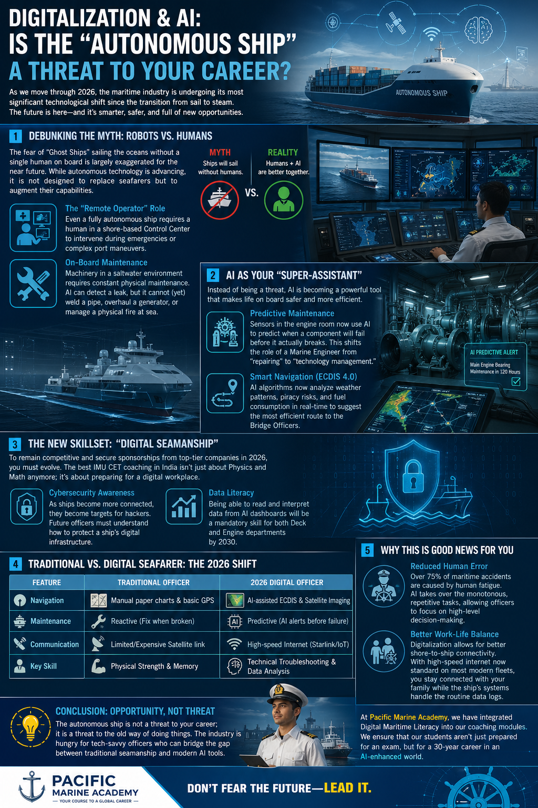

Previous
 Life After IMU-CET: Choosing Between B.Tech and DNS
Next
 Life at Sea 2026: The “Social” Revolution and Mental Well-being

### Leave a Comment Cancel Reply

Your email address will not be published. Required fields are marked *

Type here..

 Name*

 Email*

 Website

 Save my name, email, and website in this browser for the next time I comment.

---

## Founder Message - Pacific Marine Academy

Meta description: Welcome to Pacific Marine Academy – the place where your journey to the Merchant Navy begins. When I founded this academy, my vision was simple – to provide

## Founder Message

## Mahipal Singh Jhuriya

## 2nd Engineer
 Founder of Pacific Marine Academy
 Mahipal sir contact number: 7014682588

Welcome to Pacific Marine Academy – the place where your journey to the Merchant Navy begins. When I founded this academy, my vision was simple – to provide aspiring cadets with the right guidance, structured preparation, and personal mentorship needed to clear IMU-CET, secure DNS sponsorship, and build a successful career at sea.
I strongly believe that success is a combination of hard work, the right strategy, and proper guidance. At Pacific Marine Academy, we focus on all three. Our experienced faculty, well-planned study modules, and regular mock tests ensure that you are not just prepared for exams, but also for the challenges of life at sea.
Remember, a career in the Merchant Navy is not just a job – it’s a lifestyle full of opportunities, discipline, and adventure. With dedication and commitment, you can achieve great heights, and we are here to guide you every step of the way.
Wishing you all the best for your journey ahead. Your dream career starts here.

---

## Free Study Materials - Pacific Marine Academy

Meta description: Free Study Materials PDF IMUCET SUNDAY MOCK TEST Download Free PDF Imucet 2024 paper Download Free PDF IMUCET SYLLABUS Download Free PDF SEAS RIVERS STRAITS

## Free Study Materials

-     PDF

## IMUCET SUNDAY MOCK TEST

 Download Free

-     PDF

## Imucet 2024 paper

 Download Free

-     PDF

## IMUCET SYLLABUS

 Download Free

-     PDF

## SEAS RIVERS STRAITS

 Download Free

-     PDF

## COUNTRIES CAPITALS CURRENCIES

 Download Free

-     PDF

## PORTS AND SHIPPING

 Download Free

-     PDF

## DNS BSC B.TECH

 Download Free

---

## From a Small Town in Rajasthan to the World's Oceans — Real Stories of Pacific Marine Academy Students - Pacific Marine Academy

Meta description: There is something powerful about a student from a small town who dares to dream big.

# From a Small Town in Rajasthan to the World’s Oceans — Real Stories of Pacific Marine Academy Students

By  Pacific Marine Academy  /  June 29, 2026

## Introduction

There is something powerful about a student from a small town who dares to dream big.

No metro city. No expensive private school. No family connections in the shipping industry.

Just a dream, a determined heart, and the right guidance.

Every year, students from the villages and towns of Rajasthan — places like Sikar, Churu, Jhunjhunu, Nagaur, and Hanumangarh — are walking into Pacific Marine Academy with one dream: to sail the world’s oceans in a white uniform with golden epaulettes.

And they are achieving it.

This is not a story about one student. This is the story of hundreds of young men and women from the heartland of India who refused to let their zip code define their destiny — and how Pacific Marine Academy made it possible.

## The Rajasthan Nobody Talks About

When people think of Rajasthan, they think of palaces, deserts, and tourism.

They rarely think of merchant navy officers.

But here is the truth: **Rajasthan produces some of India’s most determined and hardworking young people.** Students who have grown up understanding the value of sacrifice, discipline, and relentless effort. Students who, when given the right opportunity and guidance, rise to the very top.

Pacific Marine Academy saw this potential long before anyone else did.

Founded in Sikar — the heart of the Shekhawati region — Pacific Marine Academy was built on one belief: **that geography should never be a barrier to ambition.**

## Story 1: The Boy from Churu Who Became a Navigation Officer

Ravi grew up in Churu, a small town in northern Rajasthan known more for its extreme temperatures than its career opportunities.

His father was a farmer. His family had never heard of IMU CET. The idea of a career at sea seemed as distant as the ocean itself.

But Ravi had seen a video online of a merchant navy officer standing on the deck of a massive cargo ship somewhere in the Atlantic. Something stirred inside him.

He found Pacific Marine Academy. He enrolled. He studied.

Eighteen months later, Ravi cleared IMU CET, secured DNS sponsorship, and completed his pre-sea training. Today, he sails on international cargo routes, earning a salary that has transformed his family’s life — tax-free, at sea, while seeing the world.

“I never thought someone like me, from a place like Churu, could do this,” he says. “Pacific Marine Academy showed me I was wrong.”

## Story 2: Lakshya Sharma — AIR 33 in IMU CET 2026

Some results need no embellishment.

**Lakshya Sharma. IMU CET 2026. All India Rank 33.**

Top 33 in the entire country. From Pacific Marine Academy, Sikar, Rajasthan.

When Lakshya joined Pacific Marine Academy, he was a hardworking but unpolished student with raw potential and a burning ambition. Under the guidance of Mahipal Sir and the structured preparation system at the academy — including Pacific Marine Academy’s own IMU CET preparation book — Lakshya’s potential was sharpened into excellence.

Weekly mock tests. Personalised feedback. Late-night doubt-clearing sessions. A faculty that believed in him as much as he believed in himself.

The result? AIR 33 in one of India’s most competitive entrance exams.

Lakshya’s story is not just about a rank. It is proof that when a small-town student meets world-class coaching, extraordinary things happen.

## What Every Student’s Story Has in Common

Across hundreds of students, from dozens of towns and villages across Rajasthan and beyond, every Pacific Marine Academy success story shares the same ingredients:

**1. A dream that refused to die** Every student came to Pacific Marine Academy with a spark — sometimes small, sometimes bright, but always real.

**2. The courage to start** Leaving home, joining coaching, committing to a process — these are not small acts. They require courage that small-town students have in abundance.

**3. The right guidance** This is where Pacific Marine Academy changes everything. Expert faculty, proven study material, rigorous mock tests, and personal mentoring transform potential into performance.

**4. Relentless effort** No rank, no sponsorship, no career comes without hard work. Pacific Marine Academy’s students are known for their grit — a quality the Rajasthan heartland breeds naturally.

## Your Story Is Waiting to Be Written

Right now, somewhere in Rajasthan — in Sikar, in Churu, in Nagaur, in a village without a famous name — there is a student staring at the sky and dreaming of the ocean.

Maybe that student is you.

Maybe you have been told the merchant navy is too competitive, too far away, too difficult for someone from a small town.

Lakshya Sharma was told the same thing. So was Ravi. So was Deepak.

They chose Pacific Marine Academy. They chose to bet on themselves. And they won.

**The ocean does not care where you are from. It only cares how hard you prepared.**

Pacific Marine Academy is ready to help you prepare — with the best faculty, the best study material, and a proven track record that stretches from the classrooms of Sikar all the way to the decks of ships sailing the world’s oceans.

## Take the First Step Today

Your journey from a small town in Rajasthan to the world’s oceans begins with one phone call.

📞 **Call Now: 84260 74109** 🌐

**Visit: pacificmarineacademy.com** 📍 **Pacific Marine Academy | Sikar, RajasthanLimited seats available for the 2026 batch. Don’t wait — your future is calling.**

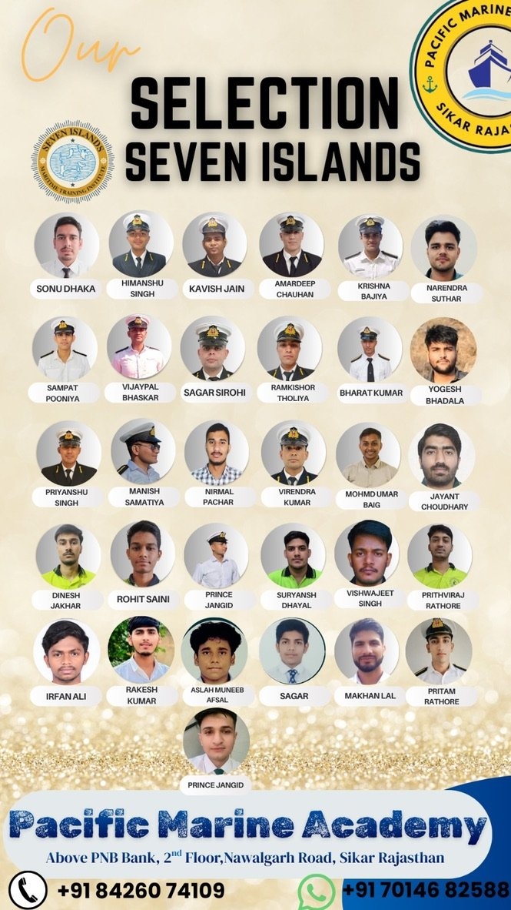

Previous
 IMU CET 2026 AIR 33: How Lakshya Sharma Cracked India’s Toughest Maritime Exam with Pacific Marine Academy
Next
 Why Sikar Is Becoming a Hub for Merchant Navy Coaching in Rajasthan

### Leave a Comment Cancel Reply

Your email address will not be published. Required fields are marked *

Type here..

 Name*

 Email*

 Website

 Save my name, email, and website in this browser for the next time I comment.

---

## From Classroom to Cross-Ocean: Why Aspirants Trust Pacific Marine Academy - Pacific Marine Academy

Meta description: Choosing where to complete your pre-sea training is the most critical decision of your maritime career. With dozens of institutes across India, finding an

# From Classroom to Cross-Ocean: Why Aspirants Trust Pacific Marine Academy

By  Pacific Marine Academy  /  June 14, 2026

Choosing where to complete your pre-sea training is the most critical decision of your maritime career. With dozens of institutes across India, finding an academy that offers more than just a certificate is essential.

At **Pacific Marine Academy**, we don’t just train students; we forge world-class maritime professionals. Here is why aspiring seafarers from across India—including major North Indian educational hubs—choose us to launch their careers on the high seas.

## 1. 100% Focus on Sponsorship & Placement Assistance

The greatest risk in the maritime industry today is completing a course and finding yourself without a ship. We target this head-on:

- **Strategic Tie-Ups:** We maintain strong relationships with leading global shipping lines and management companies.
- **Sponsorship Preparation:** Our dedicated placement cell provides intensive training for company sponsorship exams and psychometric tests, ensuring you have a signed contract early in your journey.

## 2. Elite Faculty & Master Mariner Mentorship

You cannot learn how to navigate a global vessel from a textbook alone. Our instructors are seasoned industry veterans, including retired **Captains, Chief Engineers, and Master Mariners**. They bring real-world bridge and engine room experiences directly into the classroom, teaching you the exact problem-solving skills required at sea.

## 3. State-of-the-Art Training Infrastructure

Modern ships run on advanced technology, and your training facility should too. Pacific Marine Academy features cutting-edge infrastructure designed to simulate life on a real vessel:

- Advanced Navigation Bridge Simulators.
- Fully equipped marine engine workshops and electrical labs.
- Hands-on survival craft and firefighting mock-ups.

## 4. A Seamless Transition for Outstation Students

We understand that moving away from home—especially from states like Haryana, Punjab, or Uttar Pradesh—can be a major transition for young students. We’ve built a campus environment that feels like a second home:

- **Disciplined Residential Life:** A structured campus routine that builds the camaraderie, punctuality, and leadership traits mandatory for a successful officer.
- **North Indian & Regional Cuisines:** Our mess facilities prioritize hygienic, nutritious, and familiar meals catering to diverse dietary preferences (including dedicated vegetarian options).
- **24/7 Security & Support:** Comprehensive on-campus medical care and strict warden supervision to ensure complete safety and peace of mind for parents back home.

## 5. Comprehensive IMU-CET Preparation

Securing a top rank in the **Indian Maritime University Common Entrance Test (IMU-CET)** is your gateway to elite maritime courses. Pacific Marine Academy provides targeted coaching modules covering Physics, Chemistry, Mathematics, English, and General Aptitude, drastically improving our students’ selection rates.

## Your Journey Begins Here

The maritime industry rewards discipline, technical skill, and elite training. At Pacific Marine Academy, we provide the launchpad; all you need to bring is your determination.

**Ready to take the first step toward a global career?** Don’t wait for application deadlines to pass.
**Enroll Today in our Foundation Batch and Take the First Step toward the Captain’s Chair. For more details visit our website

Previous
 How to Join the Merchant Navy from Haryana: Complete Guide
Next
 Why Pacific Marine Academy is India’s Best IMU CET Coaching — Our Results Speak for Themselves

### Leave a Comment Cancel Reply

Your email address will not be published. Required fields are marked *

Type here..

 Name*

 Email*

 Website

 Save my name, email, and website in this browser for the next time I comment.

---

## Gallery - Pacific Marine Academy

Meta description: Photo Gallery

## Photo Gallery

 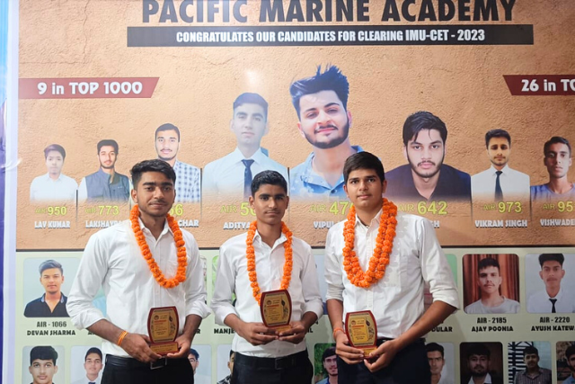

 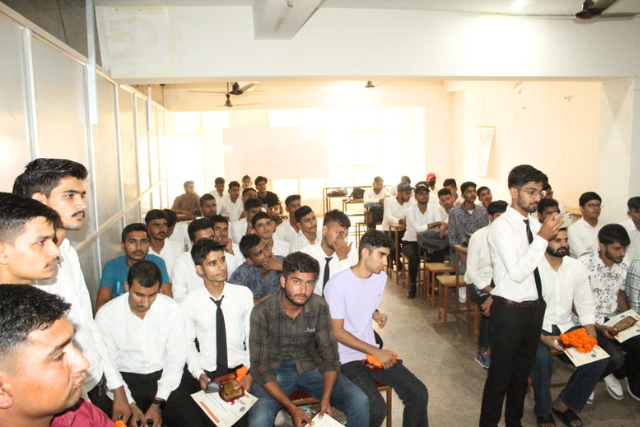

 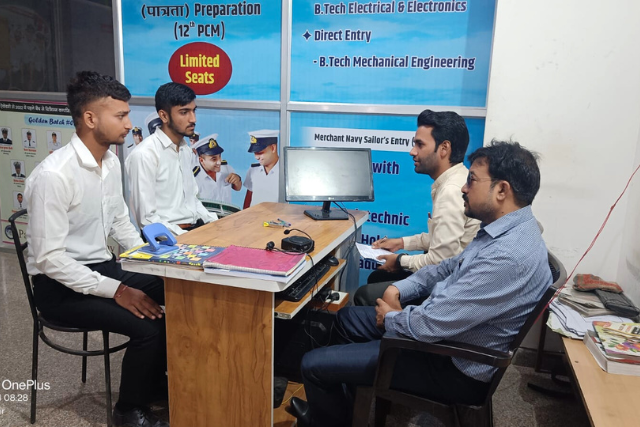

 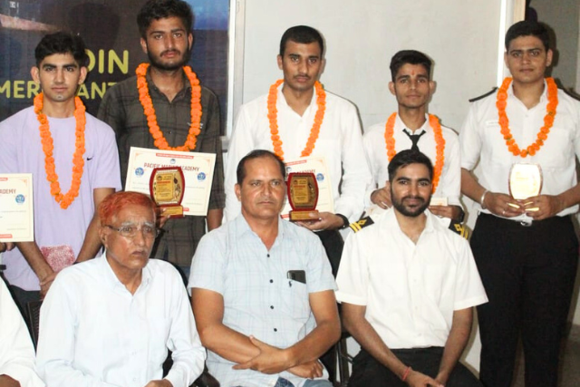

 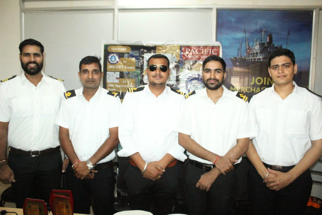

 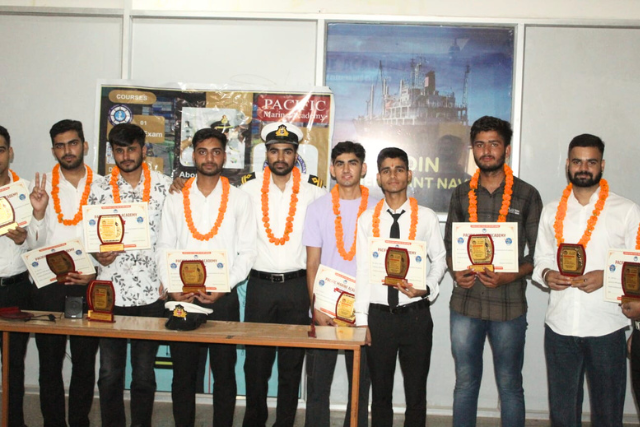

 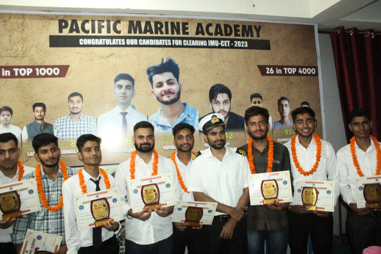

 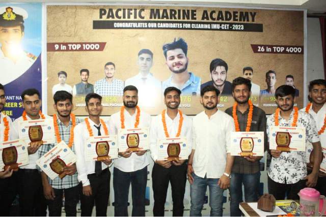

 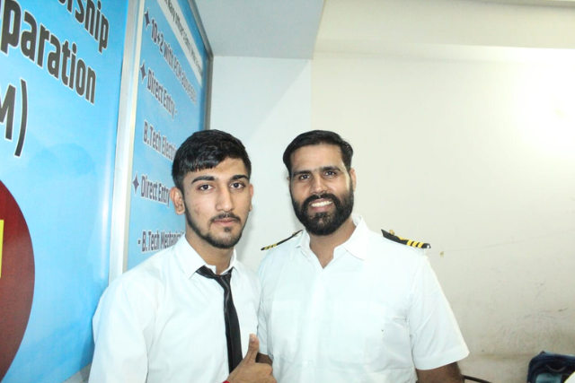

 

 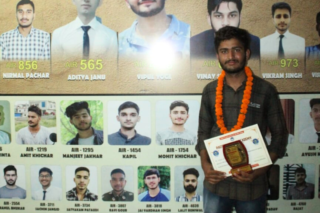

 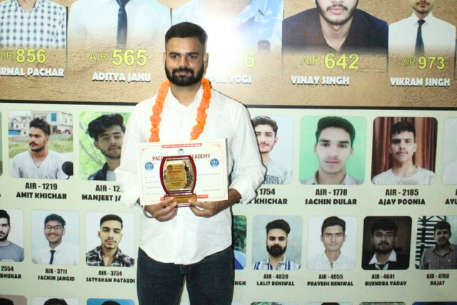

 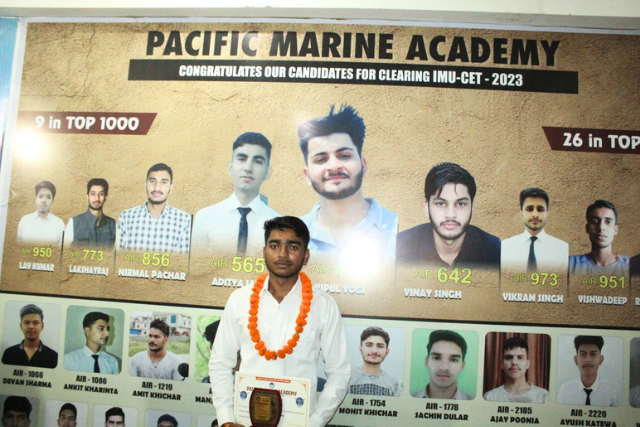

 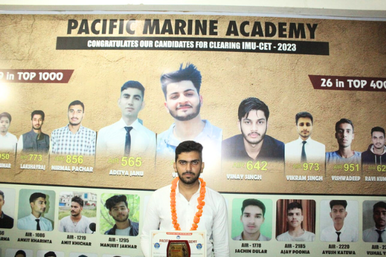

 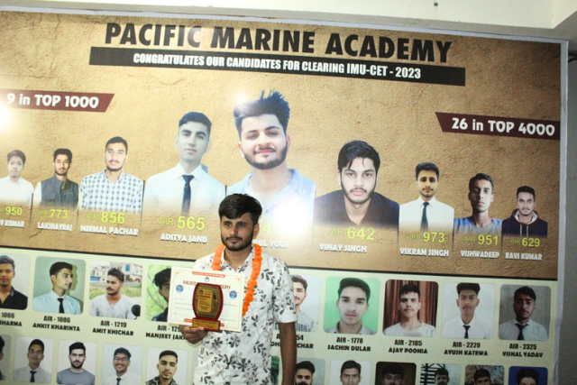

 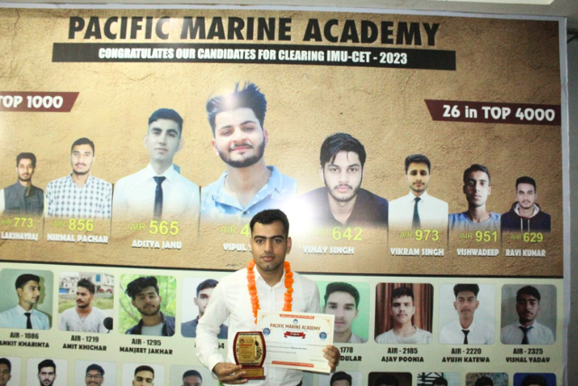

 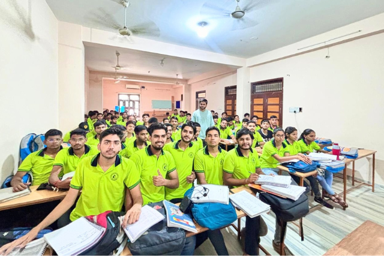

 

---

## Girls in the Merchant Navy 2026: Why the "Blue Economy" is the New Pink ⚓ - Pacific Marine Academy

Meta description: For decades, the Merchant Navy was seen as a "Man’s World." But in 2026, the tide has officially turned. From the bridge of the world’s largest container

# Girls in the Merchant Navy 2026: Why the “Blue Economy” is the New Pink ⚓

By  Pacific Marine Academy  /  January 25, 2026

For decades, the Merchant Navy was seen as a “Man’s World.” But in 2026, the tide has officially turned. From the bridge of the world’s largest container ships to the high-tech engine rooms of LNG tankers, Indian women are leading the way.

If you are a girl with a passion for STEM and a desire for a ₹2 Lakh+ starting salary, the **best Merchant Navy coaching in India** is your first step toward a global career.

**1. Why 2026 is the Best Year for Girls to Join**

Shipping giants are no longer just “allowing” women; they are actively **recruiting** them.

- **The Diversity Bonus:** Companies are offering exclusive **sponsorships for female cadets** to meet international ESG (Environmental, Social, and Governance) goals.
- **Higher Scholarship Tiers:** Institutes like **Tolani (TMI)** and **Anglo-Eastern (AEMA)** offer massive fee concessions (sometimes up to 50%) specifically for meritorious female students.
- **Safety First:** Modern 2026 maritime laws mandate strict anti-harassment policies, dedicated living quarters, and 24/7 satellite connectivity, making life at sea safer and more connected for women.
**2. Which Department is Right for You?**

- **Deck Department (The Navigators):** Ideal if you love leadership and the outdoors. You’ll eventually command the ship as a Captain.
- **Engine Department (The Tech Experts):** Perfect for girls who love machines and problem-solving. You’ll manage multi-million dollar propulsion systems as a Chief Engineer.
- **ETO (Electro-Technical):** A high-demand niche for girls with a background in Electrical or Electronics engineering.
**3. Debunking the “Physical Strength” Myth**

One of the most searched questions is: “Am I strong enough for the Merchant Navy?” In 2026, modern shipping is about **Brain over Brawn**. Automation, hydraulics, and remote-operated systems mean that technical expertise and mental resilience are far more important than lifting heavy weights. If you can clear the **IMU-CET preparation** and stay mentally sharp during a 4-hour watch, you are fit for the sea.

**4. Success Tips for Female Aspirants**

- **Start Early:** Focus on your 12th PCM marks. Top companies look for 70%+ aggregate.
- **Master the Interview:** Companies look for confidence. Our **Merchant Navy interview preparation** includes dedicated sessions for girls to help them navigate the unique questions asked by global recruitment boards.
- **Join a Community:** Connect with “Sea-Sisters”—a growing network of Indian female seafarers who mentor freshers.
**Conclusion: The Ocean Doesn’t Recognize Gender**

The sea cares about your skills, not your gender. With tax-free salaries, 6 months of vacation, and the chance to be a trailblazer, 2026 is your year to set sail. At **Pacific Marine Academy**, we are proud to be the launchpad for India’s future female Captains.

For more updates, visit our website

Previous
 Top 10 Merchant Navy Sponsorship Companies in India: 2026 Edition
Next
 Will AI Replace Seafarers? The Future of Merchant Navy Careers in 2026

### Leave a Comment Cancel Reply

Your email address will not be published. Required fields are marked *

Type here..

 Name*

 Email*

 Website

 Save my name, email, and website in this browser for the next time I comment.

---

## How to Join the Merchant Navy from Haryana: Complete Guide - Pacific Marine Academy

Meta description: For youth across Rohtak, Bhiwani, Hisar, Sonipat, and Gurugram, the Merchant Navy offers an incredible career path. If you want to travel the world, earn a

# How to Join the Merchant Navy from Haryana: Complete Guide

By  Pacific Marine Academy  /  June 12, 2026

For youth across **Rohtak, Bhiwani, Hisar, Sonipat, and Gurugram**, the **Merchant Navy** offers an incredible career path. If you want to travel the world, earn a tax-free salary, and build a massive career on the high seas, this guide is for you.

## Why Haryana Students Choose the Merchant Navy

The Merchant Navy is a commercial fleet transporting global cargo. It matches the structured discipline that Haryana youth naturally excel at, offering:

- **High Starting Salaries:** Competitive, tax-free pay in foreign currency.
- **Rapid Promotions:** Clear company exams to move up ranks quickly.
- **Global Travel:** Visit international ports and experience diverse cultures.

## Key Entry Routes After 10th & 12th

You don’t need to live near a coastline to join. You can apply for standard DG Shipping-approved courses right from Haryana.

### 1. After 10th: GP Rating Course

The quickest entry into the deck or engine department.

- **Duration:** 6 Months
- **Eligibility:** 40% aggregate in 10th standard (with 40% in English).
- **Age:** 17.5 to 25 years.

### 2. After 12th (PCM): Officer Cadets

To enter as a navigating or engineering officer, you must have completed 12th standard with **Physics, Chemistry, and Mathematics (PCM)**.

 | **Course Name** | **Duration** | **Minimum Eligibility** | **Career Outcome**
 | **Diploma in Nautical Science (DNS)** | 1 Year | 60% PCM, 50% English | Nautical Officer
 | **B.Sc. Nautical Science** | 3 Years | 60% PCM, 50% English | Captain
 | **B.Tech Marine Engineering** | 4 Years | 60% PCM, 50% English | Chief Engineer

## Step-by-Step Admission Process

- **Clear the IMU-CET:** Pass the national-level entrance exam testing PCM, English, and General Aptitude.
- **Pass the Medical Test:** Get certified fit by a DG Shipping-approved doctor. Sight must be $6/6$ without aids for deck roles; no color blindness.
- **Secure a Sponsorship:** Clear exams from major shipping lines to secure a guaranteed placement before your training even begins.

## Life at a Maritime Academy

Since premier facilities are residential, top-tier academies ensure a smooth transition for North Indian students:

- **Disciplined Hostels:** Structured campus environments that foster camaraderie.
- **Dietary Preferences:** Mess halls catering to North Indian tastes with quality vegetarian and non-vegetarian meals.
- **Rigorous Training:** Intensive physical fitness and swimming programs to prepare you for the sea.

**Crucial Tip:** Always choose a **DG Shipping-approved training academy** and avoid unauthorized agents promising jobs for cash.

Want to know about upcoming batch dates, IMU-CET coaching, or eligibility criteria? Comment below or connect with our counseling desk today!

**Still confused about which uniform fits you better?Enroll Today in our Foundation Batch and Take the First Step toward the Captain’s Chair. For more details visit our website

Previous
 How to Secure IMU-CET Success and DNS Sponsorship: Pacific Marine Academy Admissions Open
Next
 From Classroom to Cross-Ocean: Why Aspirants Trust Pacific Marine Academy

### Leave a Comment Cancel Reply

Your email address will not be published. Required fields are marked *

Type here..

 Name*

 Email*

 Website

 Save my name, email, and website in this browser for the next time I comment.

---

## How to Secure IMU-CET Success and DNS Sponsorship: Pacific Marine Academy Admissions Open - Pacific Marine Academy

Meta description: A career in the Merchant Navy offers an unparalleled blend of adventure, financial independence, global travel, and rapid professional growth. However,

# How to Secure IMU-CET Success and DNS Sponsorship: Pacific Marine Academy Admissions Open

By  Pacific Marine Academy  /  June 3, 2026

A career in the Merchant Navy offers an unparalleled blend of adventure, financial independence, global travel, and rapid professional growth. However, entering this elite maritime industry requires passing competitive hurdles: the Indian Maritime University Common Entrance Test (IMU-CET) and securing a company sponsorship.

With admissions now open for the upcoming batches at Pacific Marine Academy, this guide outlines how targeted preparation can transform an aspiring cadet into a sponsored maritime professional.

## The Reality of the Merchant Navy Selection Process

Many Class 12 Physics, Chemistry, and Mathematics (PCM) students believe that clearing the IMU-CET is the sole requirement for a career at sea. While a high IMU-CET rank is mandatory, securing a Diploma in Nautical Science (DNS) Sponsorship from a leading shipping company is equally critical.

The selection process evaluates candidates across multiple dimensions:

- **Academic Proficiency:** Core concepts in PCM, English, and General Aptitude.
- **Online Written Tests:** Company-specific psychometric and technical assessments.
- **Panel Interviews:** Evaluation of communication skills, confidence, and situational awareness.
- **Medical Fitness:** Strict adherence to Director General of Shipping (DG Shipping) medical guidelines, particularly regarding eyesight and physical stamina.
Attempting to navigate this complex multi-stage process without structured guidance often leads to missed opportunities. This is why specialized coaching is essential.

## Why Pacific Marine Academy is the Preferred Choice for Maritime Aspirants

Based in Sikar, Rajasthan, Pacific Marine Academy has established itself as a leading institution for IMU-CET preparation and DNS sponsorship training across Rajasthan and Haryana . Founded and managed by experienced maritime professionals—including Second Engineer Mahipal Singh Jhuriya and Captain Shubkaran Choudhary—the academy bridges the gap between academic preparation and industry expectations.

### 1. Industry-Experienced Leadership

The academy is led by individuals who have spent years working onboard merchant vessels. This firsthand industry experience ensures that the training extends beyond textbook knowledge to include critical insights into actual shipping company interview patterns, psychological expectations, and professional ethics.

### 2. Comprehensive Curriculum Integration

The academy’s training methodology covers every aspect of the selection funnel:

- **Rigorous Classroom Training:** Intensive coverage of the IMU-CET syllabus with a strong focus on PCM shortcuts and problem-solving techniques.
- **Sponsorship-Specific Preparation:** Targeted modules for company written tests and aptitude exams.
- **Interview Training and Personality Development:** Dedicated sessions to build communication skills, body language, and the mental resilience required to clear strict panel interviews.

### 3. Verified Track Record and Pan-India Student Base

The academy consistently attracts students from multiple states, including Haryana, Bihar, and Uttar Pradesh. Reviews from successful cadets highlight the disciplined hostel environment, highly cooperative faculty, and rigorous mock test series as foundational elements of their success.

## Programs Offered at Pacific Marine Academy

Admissions are currently open for specialized courses tailored to different maritime career entry points:

- **IMU-CET Preparation:** A focused batch designed to maximize ranks in the national entrance exam.
- **DNS Sponsorship Course (Written + Interview):** Specialized training to clear the entrance requirements of top-tier shipping lines.
- **B.Sc. Nautical Science & B.Tech Marine Engineering Foundation:** Preparatory guidance for students aiming for premium undergraduate maritime degrees.

## Strategic Admission Action Plan for Aspirants

To secure a seat in the upcoming batch and maximize your chances of selection, follow this structured roadmap:

- **Verify Eligibility:** Ensure you meet the foundational criteria—minimum 60% aggregate in PCM in Class 12, a minimum of 50% in English, and compliance with DG Shipping medical standards.
- **Submit Online Registration:** Visit the official registration portal to fill out the enrollment form, including your academic details and course preference.
- **Utilize Free Study Materials:** Access the academy’s official test series and preparatory books early to benchmark your current preparation level.
- **Commence Offline Batch Training:** Join the residential campus in Sikar to begin disciplined classroom training, regular performance tracking, and interview simulations.

## Conclusion

The window for entering the Merchant Navy through top-tier shipping companies is highly time-sensitive. Securing admission at a specialized institute like Pacific Marine Academy ensures that your preparation is aligned with current industry standards, drastically reducing the margin for error.

Take the definitive step toward a structured, highly rewarding career at sea. Contact the admissions office or register online today to secure your seat in the current batch.

**Still confused about which uniform fits you better?Enroll Today in our Foundation Batch and Take the First Step toward the Captain’s Chair. For more details visit our website

Previous
 Merchant Navy vs. Indian Navy: Which Path is Yours?
Next
 How to Join the Merchant Navy from Haryana: Complete Guide

### Leave a Comment Cancel Reply

Your email address will not be published. Required fields are marked *

Type here..

 Name*

 Email*

 Website

 Save my name, email, and website in this browser for the next time I comment.

---

## How to Start Your Career in the Merchant Navy: The Ultimate 2026 Guide - Pacific Marine Academy

Meta description: If you are searching for the best Merchant Navy coaching in Rajasthan, this guide will walk you through the essential steps to clear the IMU-CET and secure

# How to Start Your Career in the Merchant Navy: The Ultimate 2026 Guide

By  Pacific Marine Academy  /  December 28, 2025

#### Are you a Class 12 student with a passion for the ocean and a desire for a global career? The Merchant Navy offers an unparalleled lifestyle, combining adventure with high-paying professional growth. However, the path to the deck or engine room is highly competitive.

If you are searching for the **best Merchant Navy coaching in Rajasthan**, this guide will walk you through the essential steps to clear the IMU-CET and secure your future.

## **What is the Merchant Navy?**

The Merchant Navy is the backbone of global trade, involving the transportation of goods via sea. Unlike the Indian Navy (defense), the Merchant Navy is a commercial sector. It offers diverse roles in the **Nautical (Deck) Department** and the **Engineering Department**.

### **Why Choose a Career at Sea?**

- **High Salaries:** Competitive, often tax-free income.
- **Global Travel:** Visit different countries and cultures.
- **Fast Promotion:** Clear hierarchy and quick career advancement.
- **Long Vacations:** Enjoy several months of leave between contracts.

## **Key Steps to Joining the Merchant Navy after 12th**

To join as an officer, you must follow a structured path. Here is how you can prepare:

### **1. Clear the IMU-CET Exam**

The Indian Maritime University Common Entrance Test (IMU-CET) is a mandatory nationwide exam. A good rank is required to get admission into top-tier maritime institutes.

- **Focus Areas:** Physics, Chemistry, Mathematics, English, and General Aptitude.
- **Preparation Tip:** Use specialized **IMU-CET study materials** that focus on the latest exam patterns.

### **2. Secure a Company Sponsorship**

A “Sponsorship” means a shipping company selects you before you even start your training. This guarantees your placement after the course. Leading companies like **Anglo-Eastern, Synergy, and Fleet Management** conduct their own written tests and interviews.

### **3. Meet Medical Standards**

Candidates must be physically fit. For the Nautical branch, **6/6 eyesight** (without glasses) is mandatory, and you must have no color blindness.

## **Why Pacific Marine Academy is the Best Coaching in Sikar**

Located in Sikar, Rajasthan, **Pacific Marine Academy** has established itself as a leader in maritime entrance preparation. We don’t just teach; we mentor.

### **Our Specialized Programs:**

- **Intensive IMU-CET Coaching:** We cover the entire syllabus with a focus on shortcut methods for Mathematics and Physics.
- **Interview & Personality Development:** We prepare students for the rigorous “Sponsorship Interviews” to ensure 100% placement security.
- **2026 Updated Study Material:** Access to our exclusive books and online mock tests via our mobile app.
- **Experienced Faculty:** Guidance from experts who understand the specific requirements of the shipping industry.

## **Conclusion: Set Sail with the Right Guidance**

The Merchant Navy is a rewarding but demanding career. The difference between a successful officer and a struggling aspirant is often the quality of preparation.

If you are looking for **Merchant Navy coaching in Sikar**, visit **Pacific Marine Academy** today. Let us help you navigate the journey from a student to a successful mariner.

Previous
 B Tech Marine Engineering
Next
 10 Reasons Why We Are the Best Merchant Navy Coaching in India for 2026

### Leave a Comment Cancel Reply

Your email address will not be published. Required fields are marked *

Type here..

 Name*

 Email*

 Website

 Save my name, email, and website in this browser for the next time I comment.

---

## IMU CET 2026 AIR 33: How Lakshya Sharma Cracked India's Toughest Maritime Exam with Pacific Marine Academy - Pacific Marine Academy

Meta description: In a country of 1.4 billion people, achieving All India Rank 33 in one of the most competitive maritime entrance exams is nothing short of extraordinary.

# IMU CET 2026 AIR 33: How Lakshya Sharma Cracked India’s Toughest Maritime Exam with Pacific Marine Academy

By  Pacific Marine Academy  /  June 21, 2026

In a country of 1.4 billion people, achieving **All India Rank 33** in one of the most competitive maritime entrance exams is nothing short of extraordinary.

Meet **Lakshya Sharma** — IMU CET 2026 AIR 33. A student of **Pacific Marine Academy, Sikar**.

While toppers from expensive metro coaching centres make headlines, Lakshya’s achievement quietly sends a thundering message to every IMU CET aspirant across India: **You don’t need to go to Delhi or Mumbai. You just need Pacific Marine Academy.**

This is the story of one student, one extraordinary rank, and the coaching institute in Sikar, Rajasthan that is rewriting the rules of maritime education in India.

## AIR 33 in IMU CET 2026 — What This Really Means

IMU CET (Indian Maritime University Common Entrance Test) is taken by tens of thousands of students across India every year. It is the gateway to prestigious courses like DNS, B.Sc. Nautical Science, and B.Tech. Marine Engineering at IMU-affiliated institutes.

**AIR 33 means Lakshya Sharma is among the top 33 students in the entire country.**

This rank opens every door:

- Admission to the best IMU-affiliated institutes in India
- Priority access to DNS Sponsorship from top shipping companies
- A career trajectory that puts him on the fast track to becoming a Navigation Officer
This is not just a personal achievement — it is a **national-level result** that puts Pacific Marine Academy on the map as India’s premier IMU CET coaching institute.

## The Pacific Marine Academy Difference: Why Lakshya Chose Sikar

With coaching options available across India, why did Lakshya Sharma choose Pacific Marine Academy in Sikar, Rajasthan?

The answer lies in what Pacific Marine Academy offers that no other institute can match:

### 1. India’s Own IMU CET Book — Authored by Pacific Marine Academy Faculty

One of the most visible proofs of Pacific Marine Academy’s academic depth is its very own **IMU CET preparation book** — authored by the institute’s expert faculty, including Mahipal Sir.

This is not a generic science textbook. It is a purpose-built, exam-focused resource designed specifically around the IMU CET pattern, covering every topic with precision and exam strategy baked in. Students like Lakshya trained with material that no other coaching centre offers.

### 2. Expert Faculty with Real Maritime Knowledge

The faculty at Pacific Marine Academy brings a rare combination of academic excellence and maritime industry insight. **Mahipal Sir**, who personally guided Lakshya’s preparation, is known for his ability to simplify complex mathematical and physics concepts and translate them directly into exam-winning strategies.

When your teacher knows not just the subject but the sea itself, the quality of preparation reaches an entirely different level.

### 3. Rigorous Mock Testing System

At Pacific Marine Academy, students don’t just study — they perform under pressure, repeatedly, until exam conditions feel like second nature.

Weekly full-length mock tests that mirror the exact IMU CET pattern mean that by the time students sit for the real exam, it feels like just another practice session. This is why Pacific Marine Academy students don’t freeze on exam day — they thrive.

### 4. Personalised Mentoring

Every student at Pacific Marine Academy receives individual attention. Weak areas are identified early, improvement plans are personalised, and no student is allowed to fall behind without intervention.

For Lakshya Sharma, this personalised approach meant his preparation was calibrated to target top ranks — not just a pass.

### 5. A Culture of Excellence

At Pacific Marine Academy, topping the IMU CET is not an exception — it is an expectation. The institute culture pushes every student to reach their highest potential, creating an environment where AIR 33 is celebrated but not surprising.

## Our Results Speak for Themselves

Lakshya Sharma’s AIR 33 does not stand alone. Pacific Marine Academy has consistently produced top IMU CET ranks year after year, with students from across Rajasthan and neighbouring states like Haryana achieving results that compete with — and beat — metro coaching centres.

 | Student Achievement | Rank
 | Lakshya Sharma — IMU CET 2026 | AIR 33
 | Previous Batch Topper — IMU CET | Rank 147
 | 354+ verified Google reviews | ⭐⭐⭐⭐⭐
These are not outliers. These are the predictable results of a coaching institute that has built its entire system around one goal: **producing IMU CET toppers.**

## What Made Lakshya’s Preparation Different

Based on the Pacific Marine Academy system that Lakshya followed, here is the preparation blueprint that produced AIR 33:

**6 Months Before Exam**

- Complete syllabus coverage using Pacific Marine Academy’s IMU CET book
- Focus on Mathematics — 2 hours daily minimum
- Build Physics concept clarity from ground up
**3 Months Before Exam**

- Shift to intensive mock test mode — weekly full-length tests
- Identify and eliminate weak areas through personalised feedback
- Start English and Aptitude preparation seriously
**1 Month Before Exam**

- Daily revision of formula sheets and key concepts
- Timed practice of previous year papers
- Mock interview sessions for DNS sponsorship readiness
**Result: AIR 33 in IMU CET 2026.**

## What AIR 33 Means for Lakshya’s Future

With AIR 33 in IMU CET 2026, Lakshya Sharma is now positioned for:

- **Top college admission** — Best IMU-affiliated institutes across India
- **DNS Sponsorship** — Companies like Scorpio, Anglo Eastern, and Great Eastern will prioritise top-rank candidates
- **Fast-track career** — Completing DNS and sea time puts him on course to become a Navigation Officer within 3-4 years
- **Earning potential** — Starting salary of Rs. 1.5-2.5 lakh per month, growing to Rs. 8-15 lakh as Captain
From a classroom in Sikar, Rajasthan — to the world’s oceans. This is the Pacific Marine Academy journey.

## Are You the Next Lakshya Sharma?

Every AIR 33 topper was once a student sitting exactly where you are right now — searching for the right coaching, wondering if they have what it takes.

What they needed was not just information. They needed the right institute, the right faculty, and the right system.

**Pacific Marine Academy gives you all three.**

If you are serious about cracking IMU CET 2026 with a top rank, here is what you need to do right now:

✅ Check your eligibility (Class 12 PCM, 60%+ marks, age 17-25)
✅ Get a DGS-approved medical fitness certificate
✅ Call Pacific Marine Academy for a free counselling session
✅ Secure your seat — 2026 batch is filling fast

## Enroll at Pacific Marine Academy Today

Do not settle for average preparation when India’s best IMU CET coaching is available right here.

**Lakshya Sharma got AIR 33. Your rank is waiting to be written.**

📞 **Call Now: 84260 74109**
🌐 **Visit: pacificmarineacademy.com**
📍 **Location: Sikar, Rajasthan**
📖 **Ask about our exclusive IMU CET preparation book — the same one that produced AIR 33**

Previous
 Why Pacific Marine Academy is India’s Best IMU CET Coaching — Our Results Speak for Themselves
Next
 From a Small Town in Rajasthan to the World’s Oceans — Real Stories of Pacific Marine Academy Students

### Leave a Comment Cancel Reply

Your email address will not be published. Required fields are marked *

Type here..

 Name*

 Email*

 Website

 Save my name, email, and website in this browser for the next time I comment.

---

## IMU-CET 2026 Syllabus Changes: What You Need to Know - Pacific Marine Academy

Meta description: The Indian Maritime University Common Entrance Test (IMU-CET) is the ultimate gateway for anyone dreaming of a career at sea. However, as we move into the

# IMU-CET 2026 Syllabus Changes: What You Need to Know

By  Pacific Marine Academy  /  April 27, 2026

The **Indian Maritime University Common Entrance Test (IMU-CET)** is the ultimate gateway for anyone dreaming of a career at sea. However, as we move into the 2026 academic cycle, the exam is no longer just about memorizing formulas. The syllabus and testing patterns have evolved to filter for “officer-like qualities” and technical aptitude.

If you are aiming for a top rank, you need to align your preparation with these latest shifts. Here is a comprehensive breakdown of the **IMU-CET 2026 syllabus changes** from the perspective of the **best IMU CET coaching in India**.

## 1. The 2026 Exam Structure & Weightage

While the total number of questions remains **200**, the “internal weightage” of topics within subjects has shifted. Precision is now more important than ever due to the **-0.25 negative marking**.

# IMU-CET 2026 Syllabus Changes: What You Need to Know

The **Indian Maritime University Common Entrance Test (IMU-CET)** is the ultimate gateway for anyone dreaming of a career at sea. However, as we move into the 2026 academic cycle, the exam is no longer just about memorizing formulas. The syllabus and testing patterns have evolved to filter for “officer-like qualities” and technical aptitude.

If you are aiming for a top rank, you need to align your preparation with these latest shifts. Here is a comprehensive breakdown of the **IMU-CET 2026 syllabus changes** from the perspective of the **best IMU CET coaching in India**.

## 1. The 2026 Exam Structure & Weightage

While the total number of questions remains **200**, the “internal weightage” of topics within subjects has shifted. Precision is now more important than ever due to the **-0.25 negative marking**.

 | **Subject** | **Questions** | **2026 Focus Area**
 | **Mathematics** | 50 | Calculus, Vectors & Probability
 | **Physics** | 50 | Fluid Mechanics & Thermodynamics
 | **English** | 40 | Functional Grammar & SMCP
 | **General Aptitude** | 20 | Spatial Reasoning & Abstract Logic
 | **General Knowledge** | 20 | Maritime Current Affairs & Geo-Politics
 | **Chemistry** | 20 | Organic Chemistry & Electrochemistry

## 2. Key Syllabus Shifts You Can’t Ignore

### A. Physics: The “Ship-Science” Approach

In 2026, the IMU is moving away from purely theoretical Physics. There is a 30% increase in questions related to **Fluid Mechanics**.

- **Must-Know:** Archimedes’ Principle, Bernoulli’s Equation, and Viscosity.
- **New Trend:** Mechanics and Thermodynamics are being linked to real-world ship engine scenarios.

### B. Mathematics: Data & Probability

While Calculus (Integration/Differentiation) remains the king, 2026 sees a surge in **Statistics and Probability**.

- **Why?** Modern navigation and weather routing rely heavily on data probability. If you want to crack the exam through the **best IMU CET coaching in India**, you must master these “high-scoring” sections.

### C. General Aptitude: The “Officer IQ” Test

The Aptitude section has been redesigned. It is no longer just about basic blood relations or directions.

- **Spatial Visualization:** You will face more questions on 3D cube rotations and pattern folding. This tests your ability to understand ship layouts and machinery blueprints.
- **Mechanical Reasoning:** Basic questions on pulleys, gears, and levers are now frequent.

### D. English & GK: The Maritime Context

- **English:** Focus is on “Standard Marine Communication Phrases” (SMCP) and functional error spotting.
- **GK:** Stay updated on the **Merchant Shipping Act 2025** and the **2026 Red Sea/Strait of Hormuz maritime impacts**.

## 3. How to Prepare for the 2026 Pattern?

To stay ahead of the curve, your preparation strategy needs to be as dynamic as the sea itself.

- **NCERT is the Foundation:** 90% of the Science and Math questions are rooted in Class 11 & 12 NCERT. Master the concepts before jumping to shortcuts.
- **CBT Simulation:** Since the exam is a Computer-Based Test, practicing on paper isn’t enough. You need to get used to the digital interface and time pressure (54 seconds per question).
- **Target the “Tie-Breakers”:** In 2026, when two students get the same total marks, the one with higher marks in **Mathematics**, followed by **Physics**, gets the better rank.

## Why Choose the Best IMU CET Coaching in India?

At **Pacific Marine Academy**, we don’t just teach the syllabus; we track the trends. Our 2026 curriculum is specifically designed to cover these new syllabus shifts, ensuring our students stay in the Top 1% of the All India Rank (AIR).

- **Updated Mock Tests:** Reflecting the 2026 difficulty level.
- **Expert Mentors:** Captains and Chief Engineers who explain the “Why” behind the “How.”
- **Sponsorship Integration:** Preparing you for company interviews alongside the CET.

### Conclusion

The **IMU-CET 2026** is your first hurdle toward a prestigious life at sea. With the syllabus becoming more application-oriented, your preparation must be precise and professionally guided.

**Ready to conquer the waves?** Don’t settle for average results. Join the **best IMU CET coaching in India** and turn your Merchant Navy dream into a reality.

**Enroll Today in our 2026 Foundation Batch and Take the First Step toward the Captain’s Chair**. For more details visit our website

Previous
 Why Pacific Marine Academy is the Best IMU CET Coaching in India for 2026
Next
 Life After IMU-CET: Choosing Between B.Tech and DNS

### Leave a Comment Cancel Reply

Your email address will not be published. Required fields are marked *

Type here..

 Name*

 Email*

 Website

 Save my name, email, and website in this browser for the next time I comment.

---

## IMU CET Cutoff Trends: What Rank Do You Actually Need to Get In? - Pacific Marine Academy

Meta description: "What rank do I need to clear IMU CET?" is probably the single most-searched question among Merchant Navy aspirants every year — and it's also one of the most

# IMU CET Cutoff Trends: What Rank Do You Actually Need to Get In?

By  Pacific Marine Academy  /  July 8, 2026

“What rank do I need to clear IMU CET?” is probably the single most-searched question among Merchant Navy aspirants every year — and it’s also one of the most misunderstood. IMU CET cutoffs aren’t a single fixed number. They shift by **campus, course, category, and counselling round**, sometimes dramatically.

This post breaks down real cutoff data from recent years so you can set a realistic target rank instead of guessing.

## Why IMU CET Cutoffs Aren’t One Number

Before looking at any figures, it’s important to understand what actually moves the cutoff each year:

- **Number of applicants** — More students appearing means tougher competition for the same seats.
- **Available seats per campus** — Each of IMU’s campuses (Mumbai, Chennai, Kolkata, Kochi, Visakhapatnam, Navi Mumbai) sets its own cutoff.
- **Difficulty of that year’s paper** — A tougher paper generally pulls the cutoff rank higher (less competitive), and an easier one pulls it lower.
- **Category-wise reservation** — General, OBC-NCL, SC, ST, and EWS all have separate cutoff tracks.
- **Course popularity** — B.Sc Nautical Science and B.Tech Marine Engineering typically see far more demand — and therefore tighter cutoffs — than some diploma or MBA seats.

## Recent Cutoff Snapshot: General Category

Here’s what recent data shows across a few IMU campuses for General category candidates:

At IMU Navi Mumbai in 2025, the overall closing rank for General category candidates ranged from 951 to 2888, with B.Sc Nautical Science the most sought-after course at a closing rank of 1104, while Diploma in Nautical Science closed at 2888.

At IMU Chennai in 2025, the General category cutoff ranged more widely — from 43 up to 3579 — depending on course, with BBA in Logistics & Retail Management closing as low as 43 in Round 1, while B.Tech Marine Engineering and B.Sc Nautical Science closed in the 1343–1628 range.

At IMU Chennai, Round 3 closing ranks for the General AI category in 2025 varied between 110 and 3579, with B.Tech Marine Engineering being the most competitive UG course, closing at rank 1343. That’s actually a improvement from 2024, when the same course closed at 1631, though still tighter than 2023’s 1085 — a good reminder that cutoffs genuinely move year to year, not just campus to campus.

At IMU Kolkata, the Round 3 closing rank for B.Tech Marine Engineering (General AI category) was 1216 in 2025, up from 899 in 2024 — showing a tightening trend at that campus.

## What This Means If You’re Preparing Right Now

A few practical takeaways from the data above:

- **“Good rank” is relative to your target campus and course.** A rank of 1500 might comfortably get you into one course at one campus, and miss the cutoff entirely for B.Tech Marine Engineering at another.
- **B.Tech Marine Engineering and B.Sc Nautical Science are consistently the most competitive.** If these are your target courses, aim for a rank comfortably under 1500–2000 in the General category, and refine further once the current year’s notification is out.
- **Cutoffs can tighten or loosen year to year.** Don’t rely on a single past year’s number — look at the 2–3 year trend for your target course and campus, the way we’ve shown above.
- **Category cutoffs are meaningfully different from General.** SC, ST, OBC-NCL, and EWS candidates should check their specific category’s historical range rather than benchmarking against General category figures.
- **A general benchmark for a “safe” rank across the wider IMU CET AI-quota process is often cited as below 25,000** since the cutoff updates after each counselling round, with a good rank for general candidates typically considered to be below 25,000 — though this is a broad figure and top courses at top campuses close far tighter than this, as the data above shows.

## How to Use Cutoff Data in Your Preparation

Rather than treating the cutoff as a pass/fail line, use it as a planning tool:

- **Set a target rank**, not just a target score — since cutoffs are published as ranks, not raw marks.
- **Track your mock test percentile**, not just your marks, since percentile correlates more directly with likely rank.
- **Revisit your target list** of campuses and courses as you get closer to the exam, based on your mock performance trend.
- **Don’t panic over a single tough mock test.** Focus on your trend across 8–10 mocks, not any one result.

## Preparing With a Clear Target in Mind

Knowing the cutoff trend is only half the picture — converting that into an actual rank requires consistent mock testing, accuracy under negative marking, and a study plan that targets your weaker sections early. This is exactly what structured coaching adds: a clear sense of where you stand against real cutoff benchmarks, months before the actual result.

**Pacific Marine Academy** in Sikar runs regular mock tests benchmarked against recent cutoff trends, so students know exactly where they stand — not just how much they’ve studied.

## Frequently Asked Questions

**Q: What is a good rank in IMU CET?** A: It depends on your target course and campus. For competitive courses like B.Tech Marine Engineering or B.Sc Nautical Science, aim for a rank under 1500–2000 in the General category. For a broader range of courses and campuses, ranks up to 25,000 have historically been considered workable in the General AI-quota process.

**Q: Do IMU CET cutoffs increase or decrease every year?** A: Both happen — cutoffs fluctuate year to year based on the number of applicants, paper difficulty, and seat availability. Some campuses and courses tighten (lower closing rank) while others loosen, even in the same year.

**Q: Is the cutoff the same across all IMU campuses?** A: No. Each of IMU’s six campuses (Mumbai, Chennai, Kolkata, Kochi, Visakhapatnam, Navi Mumbai) publishes its own course-wise and category-wise cutoff.

**Q: Should I rely only on last year’s cutoff to plan my target?** A: It’s better to look at a 2–3 year trend for your specific course and campus rather than a single year, since one year’s data can be an outlier.

## Take the First Step Today

Your journey from a small town in Rajasthan to the world’s oceans begins with one phone call.

 **Call Now: 84260 74109Visit: pacificmarineacademy.comPacific Marine Academy | Sikar, Rajasthan**

Previous
 Why Sikar Is Becoming a Hub for Merchant Navy Coaching in Rajasthan

### Leave a Comment Cancel Reply

Your email address will not be published. Required fields are marked *

Type here..

 Name*

 Email*

 Website

 Save my name, email, and website in this browser for the next time I comment.

---

## Life After IMU-CET: Choosing Between B.Tech and DNS - Pacific Marine Academy

Meta description: Congratulations! You’ve cleared the entrance exam or are planning to do so. Now comes the most debated question in the maritime community: Should you pursue

# Life After IMU-CET: Choosing Between B.Tech and DNS

By  Pacific Marine Academy  /  April 27, 2026

Congratulations! You’ve cleared the entrance exam or are planning to do so. Now comes the most debated question in the maritime community: **Should you pursue the 4-year B.Tech in Marine Engineering or the 1-year Diploma in Nautical Science (DNS)?**

As the **best IMU CET coaching in India**, we believe that neither path is “better”—it simply depends on your personality, financial goals, and where you want to work on a ship.

## 1. The Core Difference: Deck vs. Engine

The first step is deciding which “department” you belong to.

- **DNS (Diploma in Nautical Science):** This leads to the **Deck Department**. You will eventually become a Navigator, a Cargo Officer, and finally, the **Captain** of the ship.
- **B.Tech (Marine Engineering):** This leads to the **Engine Department**. You will be responsible for the ship’s machinery, power generation, and propulsion, eventually becoming the **Chief Engineer**.

## 2. Head-to-Head Comparison

 | **Feature** | **DNS (Diploma)** | **B.Tech (Degree)**
 | **Duration** | 1 Year (Pre-Sea) + 18 Months Sea-Time | 4 Years (Academic) + 6 Months Sea-Time
 | **Primary Role** | Navigation & Cargo Operations | Machinery Maintenance & Repair
 | **Initial Cost** | Low to Moderate (Approx ₹4L – ₹6L) | High (Approx ₹12L – ₹18L)
 | **Entry into Sea** | Very Fast (Start earning in ~1 year) | Slow (Start earning after 4 years)
 | **Academic Depth** | Focus on practical seamanship | Focus on mechanical/electrical engineering

## 3. Why Choose DNS? (The Fast Track)

DNS is the preferred choice for those who want to start their career as quickly as possible.

- **Financial Independence:** You can start earning a stipend within 12–14 months of finishing your coaching.
- **Job Security:** If you get a **Sponsorship** from a top company (which the **best IMU CET coaching in India** helps you secure), your job is guaranteed before you even start the course.
- **The Bridge Life:** If you enjoy heights, technology, and the idea of “driving” a 300-meter-long vessel, this is for you.

## 4. Why Choose B.Tech Marine Engineering? (The Technical Depth)

B.Tech is for those who love machines and want a solid academic cushion.

- **Comprehensive Knowledge:** You learn everything from thermodynamics to electrical systems.
- **Shore-Based Opportunities:** If you decide to leave the sea after 10–15 years, a B.Tech degree makes it much easier to transition into power plants, hotels, or industrial management.
- **The Engine Room:** Ideal for those who enjoy “hands-on” work—fixing engines, managing boilers, and ensuring the ship’s heart keeps beating.

## 5. The “Sponsorship” Factor

Regardless of the path you choose, the maritime industry in 2026 is **Sponsorship-driven**.

- **For DNS:** A sponsorship is practically **mandatory**. You should not join a DNS course without a letter from a reputed company like Synergy, Great Eastern, or Anglo-Eastern.
- **For B.Tech:** While not mandatory for admission, having a sponsorship or joining a “captive” institute (owned by a shipping company) ensures you aren’t struggling for a placement after graduation.

## The Verdict: Which one is for you?

**Choose DNS if:**

- You want to reach the rank of Captain.
- You want to start earning and support your family quickly.
- You prefer navigation and management over mechanical repair.
**Choose B.Tech if:**

- You want to reach the rank of Chief Engineer.
- You want a full 4-year engineering degree for future backup.
- You have a passion for machines, tools, and technology.

## How the Best IMU CET Coaching in India Helps You Decide

At **Pacific Marine Academy**, we don’t just prepare you for the exam; we provide **career counseling**. We analyze your PCM scores, your aptitude, and your personality to recommend the path that will lead to the most successful 30-year career.

**Don’t make this choice alone. Let the experts guide you.Book a Free Counseling Session with a CaptainEnroll Today in our 2026 Foundation Batch and Take the First Step toward the Captain’s Chair**. For more details visit our website

Previous
 IMU-CET 2026 Syllabus Changes: What You Need to Know
Next
 Digitalization & AI: Is the “Autonomous Ship” a Threat to Your Career?

### Leave a Comment Cancel Reply

Your email address will not be published. Required fields are marked *

Type here..

 Name*

 Email*

 Website

 Save my name, email, and website in this browser for the next time I comment.

---

## Life at Sea 2026: The "Social" Revolution and Mental Well-being - Pacific Marine Academy

Meta description: For decades, the Merchant Navy was defined by a single word: Isolating. While the high salaries and global travel were enticing, the reality of being

# Life at Sea 2026: The “Social” Revolution and Mental Well-being

By  Pacific Marine Academy  /  April 27, 2026

For decades, the Merchant Navy was defined by a single word: **Isolating.** While the high salaries and global travel were enticing, the reality of being disconnected from family and friends for months was a significant mental burden.

However, as we move through 2026, a “Social Revolution” is sweeping across the global fleet. The industry has finally realized that a happy, mentally resilient seafarer is a safe and efficient one. As the **best IMU CET coaching in India**, we believe it is vital for future officers to understand how the quality of life at sea has transformed.

## 1. The “Starlink” Effect: Universal Connectivity

The biggest change in 2026 is the end of “digital isolation.” High-speed satellite internet, spearheaded by providers like **Starlink Maritime**, is now a standard feature on most modern vessels.

- **Real-Time Connection:** You no longer have to wait for the next port to call home. Whether you are in the middle of the Atlantic or the Indian Ocean, you can video call your family, stream your favorite shows, and stay active on social media.
- **Mental Relief:** Instant connectivity significantly reduces “home-sickness” and allows seafarers to stay involved in family milestones, making long contracts feel much shorter.

## 2. Institutionalizing Mental Health Support

The maritime industry has moved beyond just “talking” about mental health. Under new **DG Shipping** and **International Maritime Organization (IMO)** guidelines, psychological well-being is now part of the safety culture.

- **24/7 Helplines:** Companies now provide anonymous, professional counseling services available via satellite phone or chat.
- **Mental Health Training:** As part of your training at the **best IMU CET coaching in India**, we now include modules on stress management and identifying signs of burnout, preparing you for the psychological demands of the job.
- **Pre-Sea Screening:** Modern psychometric tests ensure that candidates are not just academically bright, but emotionally prepared for the maritime lifestyle.

## 3. Shorter Contracts and Better “Work-Life” Balance

One of the most requested changes by Gen-Z seafarers has been the reduction of contract lengths. In 2026, many top-tier shipping companies have shifted their policies:

- **The 3-on/3-off Trend:** More companies are offering shorter, fixed contracts (e.g., 3 months on board followed by 3 months of paid leave) to prevent physical and mental exhaustion.
- **Enhanced Recreation:** Modern ship designs now prioritize common spaces. From state-of-the-art gyms and swimming pools to “Gaming Zones” and cinema rooms, the “Social” aspect of life on board is being rebuilt to foster team bonding.

## 4. The “Culture of Care” on Board

The 2026 maritime environment is increasingly focused on **Inclusion and Diversity**.

- **Zero-Tolerance Policies:** There is now a global crackdown on bullying, harassment, and toxic seniority. Professionalism is the only standard.
- **Dietary & Physical Wellness:** Ships are now required to provide nutritious, balanced meals and structured fitness programs, recognizing that physical health is the foundation of mental health.

### Comparison: Life at Sea (2010 vs. 2026)

 | Feature | 2010 (The “Dark” Ages) | 2026 (The Social Era)
 | **Connectivity** | Expensive, slow email | High-speed 5G/Satellite Internet
 | **Contract Length** | 6–9 months (Variable) | 3–4 months (Fixed)
 | **Family Contact** | Occasional port-calls | Daily Video Calls
 | **Mental Health** | Largely ignored/Taboo | Professional support & mandatory training
 | **Recreation** | Basic TV & DVDs | Full Gyms, Gaming, & Social Zones
Export to Sheets

## The Verdict: A Career Worth Choosing

The Merchant Navy in 2026 is no longer a place of “sacrifice” but a place of “sophistication.” The focus on mental health and social connectivity has made it one of the most attractive careers for young, ambitious Indians who want a high-paying job without losing their connection to the world.

At **Pacific Marine Academy**, we don’t just train you to pass an exam; we prepare you for this modern, balanced lifestyle. Our holistic approach is what makes us the **best IMU CET coaching in India**.

**Are you ready to join a career that cares for you?Start Your Journey with the Best IMU CET Coaching in IndiaEnroll Today in our 2026 Foundation Batch and Take the First Step toward the Captain’s Chair**. For more details visit our website

Previous
 Digitalization & AI: Is the “Autonomous Ship” a Threat to Your Career?
Next
 Merchant Navy vs. Indian Navy: Which Path is Yours?

### Leave a Comment Cancel Reply

Your email address will not be published. Required fields are marked *

Type here..

 Name*

 Email*

 Website

 Save my name, email, and website in this browser for the next time I comment.

---

## Merchant Navy in 2026: Instagram Reels vs. The Hard Reality - Pacific Marine Academy

Meta description: Scroll through Instagram or YouTube, and you’ll see cadets in crisp white uniforms, posing against sunsets in Singapore or flaunting dollar stacks with the

# Merchant Navy in 2026: Instagram Reels vs. The Hard Reality

By  Pacific Marine Academy  /  January 15, 2026

Scroll through Instagram or YouTube, and you’ll see cadets in crisp white uniforms, posing against sunsets in Singapore or flaunting dollar stacks with the “transition” audio. It looks like a 6-month paid vacation, right?

**Wrong.** If you’re choosing a career based on a 15-second reel, you’re walking into a storm without a raincoat. At **Pacific Marine Academy**, we believe in showing you the “Grime behind the Glamour.” Here are the top 5 myths we’re busting today.

**Myth 1: “It’s a World Tour for Free!” **🌏

- **The Reel:** Posing at the Eiffel Tower or a beach in Bali.
- **The Reality:** In 2026, port stays are shorter than ever (sometimes just 12–24 hours). As a cadet, you aren’t a tourist; you are a worker. While the ship is at port, you are often busy with cargo operations, bunkering, or inspections. You might see the world, but often it’s through the port’s binoculars.
- **The Strategy:** Enroll in the **best Merchant Navy coaching in India** to understand the professional side of navigation so you can actually enjoy your rare shore leaves!
**Myth 2: “You Get Paid for Doing Nothing on Land” **

- **The Reel:** Living it up in a luxury car during a 6-month vacation.
- **The Reality:** Most companies work on a **contractual basis**. You get paid while you are on the ship. When you are on leave, the “salary” usually stops.
- **The Pro-Tip:** Only top-tier ownership companies (like Maersk or Chevron) offer year-round pay. Securing these spots requires elite **DNS Sponsorship guidance** and a top **IMU-CET preparation** rank.
**Myth 3: “White Uniforms Every Day” **

- **The Reel:** Sharp epaulettes and a clean white shirt 24/7.
- **The Reality:** Your daily “uniform” as a trainee or engineer is a **greasy boiler suit**. You will be chipping rust, painting decks, and working in a loud, 45°C engine room. The white uniform is for formal occasions and bridge watches—you have to earn the right to keep it clean.
**Myth 4: “Swimming is Mandatory to Join” **

- **The Reel:** Diving into the middle of the ocean for fun.
- **The Reality:** You do **not** need to be an Olympic swimmer to join. While basic water survival is taught during your pre-sea training, it is not an eligibility criterion for the **IMU-CET entrance exam**. We focus on your PCM marks and aptitude, not your butterfly stroke!
**Myth 5: “Life is a Party with a Girl/Boy in Every Port” **

- **The Reel:** The “lonely sailor” romantic trope.
- **The Reality:** Modern seafarers are professionals with families waiting at home. With 2026’s strict “Zero Alcohol” policies on tankers and rapid port turnarounds, there’s no time (or permission) for the old-school “sailor lifestyle.” Most seafarers spend their free time on the ship’s Wi-Fi, video-calling home.
**Enroll Today in our 2026 Foundation Batch and Take the First Step toward the Captain’s Chair**. For more details visit our website

Previous
 Merchant Navy Salary in India 2026: A Complete Rank-Wise Breakdown
Next
 The Parallel Preparation Strategy

### Leave a Comment Cancel Reply

Your email address will not be published. Required fields are marked *

Type here..

 Name*

 Email*

 Website

 Save my name, email, and website in this browser for the next time I comment.

---

## Merchant Navy Salary in India 2026: A Complete Rank-Wise Breakdown - Pacific Marine Academy

Meta description: One of the most frequent questions we receive at Pacific Marine Academy is: "Exactly how much can I earn in the Merchant Navy?" For students choosing a career

# Merchant Navy Salary in India 2026: A Complete Rank-Wise Breakdown

By  Pacific Marine Academy  /  January 4, 2026

One of the most frequent questions we receive at **Pacific Marine Academy** is: “Exactly how much can I earn in the Merchant Navy?” For students choosing a career path after 12th PCM, the financial lure of the sea is undeniable. In 2026, with the maritime industry expanding into green technology and autonomous shipping, salaries have reached new heights.

If you are looking for the **best Merchant Navy coaching in India**, understanding the career roadmap and its financial rewards is the first step toward your goal.

## **The Financial Allure: Why 2026 is the Best Time to Join**

Unlike land-based jobs, a career at sea offers **tax-free income** (for NRI status seafarers) and zero living expenses while on board. In 2026, the demand for skilled Indian officers has surged, leading to significant hikes in stipends and senior-level salaries.

### **1. Entry-Level: Trainee & Cadet Salaries**

Every great captain starts as a trainee. Even at the beginning of your journey, the earning potential is competitive.

- **Deck/Engine Cadet:** ₹40,000 to ₹70,000 per month.
- **GP Rating:** ₹25,000 to ₹50,000 per month.

**Note:** These are stipends provided during your training period while you gain essential sea-time.

### **2. Junior Officer Level: The First Big Jump**

After clearing your competency exams (Mates/Engineers), your salary sees a massive spike.

- **Third Officer / 4th Engineer:** ₹1.5 Lakh to ₹2.5 Lakh per month.
- **Second Officer / 3rd Engineer:** ₹2.5 Lakh to ₹4 Lakh per month.

### **3. Senior Management: The High Earners**

Senior officers take on immense responsibility, and their paychecks reflect that expertise.

- **Chief Officer / 2nd Engineer:** ₹5 Lakh to ₹8 Lakh per month.
- **Captain / Chief Engineer:** ₹10 Lakh to ₹18 Lakh+ per month.

## **Factors Influencing Your Salary in 2026**

Not all ships pay the same. Your earnings will depend on:

- **Vessel Type:** Working on LNG (Liquefied Natural Gas) or Oil Tankers usually pays more than Bulk Carriers due to the technical complexity and risk.
- **Company:** Top-tier companies like **Anglo-Eastern, Maersk, and Synergy** offer premium salary packages and better rotation cycles.
- **Certifications:** Having advanced STCW and specialized technical certifications can put you in a higher bracket.

## **How Pacific Marine Academy Secures Your Financial Future**

To reach the ₹15 Lakh per month bracket, you need a strong start. As the **best Merchant Navy coaching in India**, we ensure you don’t just “join” the navy, but you join through the right channel.

- **Top IMU-CET Ranks:** A high rank gets you into premium institutes, which are the first choice for high-paying recruiters.
- **Sponsorship Mastery:** We provide the best **DNS sponsorship guidance** in the country, helping you get recruited by companies that offer the highest starting stipends.
- **Interview Excellence:** Our **Merchant Navy interview preparation** ensures you are “company-ready,” helping you clear the toughest selection boards on your first attempt.

## **Conclusion: Your High-Paying Career Awaits**

The Merchant Navy is one of the few professions where a 25-year-old can earn a six-figure monthly salary. However, the path to these rewards starts with the right preparation. At **Pacific Marine Academy**, we bridge the gap between your dreams and the high seas.

**Enroll Today in our 2026 Foundation Batch and Take the First Step toward the Captain’s Chair**. For more details visit our website

Previous
 10 Reasons Why We Are the Best Merchant Navy Coaching in India for 2026
Next
 Merchant Navy in 2026: Instagram Reels vs. The Hard Reality

### Leave a Comment Cancel Reply

Your email address will not be published. Required fields are marked *

Type here..

 Name*

 Email*

 Website

 Save my name, email, and website in this browser for the next time I comment.

---

## Merchant Navy vs. Indian Navy: Which Path is Yours? - Pacific Marine Academy

Meta description: Choosing between the Merchant Navy and the Indian Navy is one of the most common dilemmas for students in India who feel the "call of the sea." While both

# Merchant Navy vs. Indian Navy: Which Path is Yours?

By  Pacific Marine Academy  /  April 27, 2026

Choosing between the **Merchant Navy** and the **Indian Navy** is one of the most common dilemmas for students in India who feel the “call of the sea.” While both involve wearing a white uniform and sailing the oceans, they are two entirely different worlds with different purposes, lifestyles, and rewards.

As the **best IMU CET coaching in India**, we help students navigate this choice by breaking down the “Adventure” vs. the “Career.” Here is everything you need to know to decide which path is yours.

## 1. The Core Purpose: Trade vs. Defense

The most fundamental difference lies in **why** you are out at sea.

- **Merchant Navy (The Commercial Giant):** This is a global industry focused on international trade. You are responsible for transporting cargo—oil, gas, food, and electronics—across continents. You are a professional working for a private shipping company.
- **Indian Navy (The Shield of the Nation):** This is the maritime branch of the Indian Armed Forces. Your primary role is national security, coastal defense, and protecting the country’s maritime interests. You are a soldier/officer serving the Government of India.

## 2. Salary and Financial Rewards

- **Merchant Navy:** Known for its **high, tax-free salaries**. A Junior Officer can earn between **₹1.5 Lakhs to ₹2.5 Lakhs per month**, and as you reach the rank of Captain or Chief Engineer, salaries can exceed **₹10 Lakhs to ₹12 Lakhs per month**. Under the **NRI 183-day rule**, this income is completely tax-free in India.
- **Indian Navy:** Offers a stable, government-structured pay scale with numerous perks. While the starting salary is competitive (approx. **₹80,000 to ₹1 Lakh per month** including allowances), it generally does not match the commercial peaks of the Merchant Navy. However, it offers lifelong pensions and military benefits.

## 3. Lifestyle and Contract Structure

- **Merchant Navy:** Works on a **Contract Basis**. You might work for 4 months and then stay home for 4 months. When you are on leave, you are completely free from work, though you only earn while you are on the ship.
- **Indian Navy:** This is a **Permanent Job** (or Short Service Commission). You get annual leaves (approx. 60 days) and casual leaves, but you are an officer 24/7, 365 days a year. You may be posted on a ship, a submarine, or at a naval base on land.

## 4. Training and Entry Path

- **Merchant Navy:** Entry is primarily through the **IMU-CET exam**. You must secure a “Sponsorship” from a private company and complete a pre-sea course like **DNS** or **B.Tech Marine Engineering**.

- Pro-Tip: Joining the **best IMU CET coaching in India** is the surest way to secure a top-tier sponsorship.
- **Indian Navy:** Entry is through competitive exams like **NDA (National Defence Academy)** after Class 12, or **CDS (Combined Defence Services)** and **INET** after graduation. The selection process involves the rigorous **SSB (Services Selection Board)** interview and medicals.

### Comparison: Merchant Navy vs. Indian Navy (2026)

 | **Feature** | **Merchant Navy** | **Indian Navy**
 | **Status** | Commercial / Private | Defense / Government
 | **Salary** | Very High (Tax-Free) | Stable (Government Pay Scale)
 | **Uniform** | White Uniform (Officer status) | White Uniform (National Hero status)
 | **Leaves** | 4-6 months (unpaid but free) | 60-90 days (paid)
 | **Risks** | Maritime hazards / Piracy | Combat / National Security
 | **Retirement** | No Pension (Self-managed) | Pension & Post-Retirement Benefits

## 5. Which One Should You Choose?

**Choose the Merchant Navy if:**

- Your primary goal is **financial freedom** and high earnings at a young age.
- You want a “Work Hard, Party Hard” lifestyle with long vacations.
- You have a passion for technical engineering or global navigation.
**Choose the Indian Navy if:**

- You have a deep desire to **serve the nation** and wear the gallantry of a soldier.
- You value job security, social prestige, and lifelong government benefits.
- You want a career that offers leadership, discipline, and the thrill of defense operations.

## Conclusion

Both careers are prestigious and offer a life that most people only dream of. If you choose the path of the Merchant Navy, your first step is clearing the IMU-CET with a top rank.

At **Pacific Marine Academy**, we take pride in being the **best IMU CET coaching in India**, helping students build the foundation for a high-paying, successful career at sea.

**Still confused about which uniform fits you better?**Enroll Today in our 2026 Foundation Batch and Take the First Step toward the Captain’s Chair**. For more details visit our website
**

Previous
 Life at Sea 2026: The “Social” Revolution and Mental Well-being
Next
 How to Secure IMU-CET Success and DNS Sponsorship: Pacific Marine Academy Admissions Open

### Leave a Comment Cancel Reply

Your email address will not be published. Required fields are marked *

Type here..

 Name*

 Email*

 Website

 Save my name, email, and website in this browser for the next time I comment.

---

## Privacy Policy - Pacific Marine Academy

Meta description: For us, privacy for our valued customers is very important. We strongly believe that the personal information of our customers should not be shared with the

## Privacy Policy

For us, privacy for our valued customers is very important. We strongly believe that the personal information of our customers should not be shared with the third party without the prior consent or request from the customer. Privacy is the right of an individual and at Aayaam Academy. The information of the customer such as contact no., email, addresses etc is used only for the internal purpose and not for sale. Your contact information is stored in our database and is only used to contact you during the course of your stay with us for sharing the status of your registration with us and then after for the announcement of our latest offers and news etc. We at Aayaam Academy condemn the unauthorized reach and misuse and/or disclosure of the personal information of the customer and we have strict guidelines and high-security features to prevent the same. Any changes in our ‘Privacy Policy’ will be posted here on the website.

Aayaam Career Acadmey reserves the right to show/ advertise the NEET result with photo of the candidate who enrolls from All India Aayaam Test Series.

## SECURE ONLINE PAYMENTS

The visitor on our website please take a note that your name, email address and other personal information submitted on our website may be stored with us and may also appear on the website. Like other platforms, our server log files also receive general information such as the IP address of the visitor, cookie etc. For the financial transactions by credit card Aayaam Academy uses a 3rd party secure payment gateway provided by “Razorpay” and the credit card details are ‘not stored’ with, instead the Aayaam Academy’s information is securely stored and encrypted with Visa/MasterCard.

E-mail us for any query: info@aayaamacademy.com

---

## Refund & Cancellation Policy - Pacific Marine Academy

Meta description: Please read the subscription terms and conditions carefully before subscribing to any of the subscription plans, as once you have subscribed, you cannot

## Refund & Cancellation Policy

Please read the subscription terms and conditions carefully before subscribing to any of the subscription plans, as once you have subscribed, you cannot change or cancel your subscription plan. Once you subscribe and make the required payment for any online subscriptions, it shall be final and there cannot be any changes or modifications to the same and neither will there be any refund.

---

## Result - Pacific Marine Academy

Meta description: Pacific Marine Academy stands on the top when we talk about the seletion ratio, we proudly celebrate our selections in 3 years .

## Our Recent Results

## IMU-CET Results

Pacific Marine Academy stands on the top when we talk about the seletion ratio, we proudly celebrate our selections in 3 years .

 

 

 

 

 

---

## Sponsored - Pacific Marine Academy

Meta description: Sponsored

## Sponsored

 

 

 

 

 

 

 

 

 

 

 

 

 

 

 

 

 

 

 

 

 

 

 

 

 

 

 

 

 

 

 

 

 

 

 

---

## Terms & Conditations - Pacific Marine Academy

Meta description: www.aayaamacademy.com is owned and operated by Aayaam Academy, an educational institute incorporated under the laws of India. Your use of the Website and

## Terms & Conditations

www.aayaamacademy.com is owned and operated by Aayaam Academy, an educational institute incorporated under the laws of India. Your use of the Website and services and tools are governed by the following terms and conditions (“Terms of Use”) as applicable to the Website including the applicable policies which are incorporated herein by way of reference. If you transact on the Website, You shall be subject to the policies that are applicable to the Website for such transaction. By mere use of the Website, You shall be contracting with Aayaam Academy. and these terms and conditions including the policies constitute your binding obligations, with Aayaam Academy. For the purpose of these Terms of Use, wherever the context so requires “You” or “User” shall mean any natural or legal person who has agreed to become a buyer on the Website by providing Registration Data while registering on the Website as Registered User using the computer systems.

www.aayaamacademy.com allows the User to surf the Website or making purchases without registering on the Website. The term “We”, “Us”, “Our” shall mean Aayaam Academy. When You use any of the services provided by Us through the Website, including but not limited to, (e.g. Course Details, Student performance), You will be subject to the rules, guidelines, policies, terms, and conditions applicable to such service, and they shall be deemed to be incorporated into this Terms of Use and shall be considered as part and parcel of this Terms of Use. We reserve the right, at our sole discretion, to change, modify, add or remove portions of these Terms of Use, at any time without any prior written notice to you. It is your responsibility to review these Terms of Use periodically for updates / changes. Your continued use of the Website following the posting of changes will mean that you accept and agree to the revisions. As long as you comply with these Terms of Use, We grant you a personal, non-exclusive, non-transferable, limited privilege to enter and use the Website.

ACCESSING, BROWSING OR OTHERWISE USING THE SITE INDICATES YOUR AGREEMENT TO ALL THE TERMS AND CONDITIONS UNDER THESE TERMS OF USE, SO PLEASE READ THE TERMS OF USE CAREFULLY BEFORE PROCEEDING.

Aayaam Career Acadmey reserves the right to show/ advertise the NEET result with photo of the candidate who enrolls from All India Aayaam Test Series.

E-mail us for any query: info@aayaamacademy.com

---

## The 2026 "Electronic Blackout": How Modern Seafarers Navigate Global Chokepoints - Pacific Marine Academy

Meta description: If you have been following the news this March, you know that the Strait of Hormuz and the Red Sea are currently facing their most significant disruptions in

# The 2026 “Electronic Blackout”: How Modern Seafarers Navigate Global Chokepoints

By  Pacific Marine Academy  /  March 20, 2026

If you have been following the news this March, you know that the **Strait of Hormuz** and the **Red Sea** are currently facing their most significant disruptions in decades. For a Merchant Navy aspirant, this isn’t just a headline—it’s a masterclass in the “new reality” of maritime operations.

As of **March 2026**, commercial traffic through the Strait has dropped by nearly **97%** due to ongoing regional tensions. But the world doesn’t stop, and neither does the Merchant Navy. Here is how the “Fourth Arm of Defence” is adapting.

### 1. Living in the “Grey Zone”

In response to GPS jamming and projectile threats, ships are now entering what we call **Electronic Blackout Zones**.

- **Going Dark:** To stay safe, many vessels are disabling their **AIS (Automatic Identification System)**—essentially making them invisible to digital tracking.
- **Operation Sankalp:** The Indian Navy is actively providing escorts to Indian-flagged vessels, ensuring our seafarers are never alone in these high-risk waters.

### 💰 2. The 100% Hazard Bonus

Sailing in 2026 comes with significant financial rewards for those with the grit to handle the pressure.

- **War-Risk Pay:** Under the new **Merchant Shipping Rules 2026**, seafarers transiting these zones are entitled to **double basic pay** for every day spent in the hazard area.
- **The Right to Refuse:** Per the **Maritime Labour Convention (MLC)**, every sailor has the legal right to refuse to sail into a war zone, with the company bearing the cost of their flight back home.

### 🤖 3. Beyond Traditional Navigation

At **Pacific Marine Academy**, we are already integrating these 2026 realities into our training. Being a cadet today means:

- **Manual Resilience:** Learning to navigate when GPS is jammed by using traditional radar and visual watchkeeping.
- **AI Watchkeepers:** Using new AI-driven sensors to detect small, “dark” targets like drones or unmarked boats that traditional systems might miss.

### 📅 Important Update: IMU-CET 2026

While the world’s oceans are shifting, your gateway to them remains the same.

- **Registration Deadline:** April 24, 2026.
- **Exam Date:May 24, 2026**.
- **The Competition:** This year, companies like **Maersk** and **Anglo-Eastern** are prioritizing candidates who show high mental resilience and “Security Awareness” (STSDSD).

## 1. Living in the “Grey Zone”

In response to GPS jamming and projectile threats, ships are now entering what we call **Electronic Blackout Zones**.

- **Going Dark:** To stay safe, many vessels are disabling their **AIS (Automatic Identification System)**—essentially making them invisible to digital tracking.
- **Operation Sankalp:** The Indian Navy is actively providing escorts to Indian-flagged vessels, ensuring our seafarers are never alone in these high-risk waters.

### 💰 2. The 100% Hazard Bonus

Sailing in 2026 comes with significant financial rewards for those with the grit to handle the pressure.

- **War-Risk Pay:** Under the new **Merchant Shipping Rules 2026**, seafarers transiting these zones are entitled to **double basic pay** for every day spent in the hazard area.
- **The Right to Refuse:** Per the **Maritime Labour Convention (MLC)**, every sailor has the legal right to refuse to sail into a war zone, with the company bearing the cost of their flight back home.

### 🤖 3. Beyond Traditional Navigation

At **Pacific Marine Academy**, we are already integrating these 2026 realities into our training. Being a cadet today means:

- **Manual Resilience:** Learning to navigate when GPS is jammed by using traditional radar and visual watchkeeping.
- **AI Watchkeepers:** Using new AI-driven sensors to detect small, “dark” targets like drones or unmarked boats that traditional systems might miss.

## Why This Matters for You

The Merchant Navy in 2026 is no longer just about “traveling the world.” It’s about being a **tech-savvy, resilient professional** who keeps the global economy moving when others can’t.

At **Pacific Marine Academy** in Sikar, we don’t just help you pass the IMU-CET; we prepare you for the bridge of a 21st-century vessel.

Previous
 The “Strait of Hormuz” Crisis
Next
 Why Pacific Marine Academy is the Best IMU CET Coaching in India for 2026

### Leave a Comment Cancel Reply

Your email address will not be published. Required fields are marked *

Type here..

 Name*

 Email*

 Website

 Save my name, email, and website in this browser for the next time I comment.

---

## The "Back-Up Plan" Strategy: Shore-Based Careers in 2026 - Pacific Marine Academy

Meta description: One of the greatest myths about the Merchant Navy is that you have to sail until you retire. In 2026, the maritime industry has transformed into a global

# The “Back-Up Plan” Strategy: Shore-Based Careers in 2026

By  Pacific Marine Academy  /  February 18, 2026

One of the greatest myths about the Merchant Navy is that you have to sail until you retire. In 2026, the maritime industry has transformed into a global “talent pipeline.” A career at sea is now seen as the ultimate foundation for a high-powered executive role on land.

If you are a student or parent worried about the long-term sustainability of life at sea, this guide explains why your “Back-Up Plan” is actually one of the most lucrative parts of the profession.

### The “Sea-to-Shore” Transition: A Natural Evolution

Most officers today follow a “10-year horizon” strategy. They sail from age 20 to 30, reach the rank of Master Mariner (Captain) or Chief Engineer, and then transition to shore-based management. By 30, these professionals often have more leadership experience than corporate managers at 40.

### Top Shore-Based Career Paths for 2026

The industry currently faces a massive shortage of “technically sound” managers on land. Here is where the 2026 demand is highest:

#### 1. Technical & Marine Superintendency

The “Technical Superintendent” is the ship’s manager on land. You oversee 3–5 vessels, managing their budgets, dry-docking schedules, and repairs.

- **Average Salary (India):** ₹15–25 Lakhs per annum.
- **Global Salary (Singapore/Dubai):** $8,000 – $12,000 USD per month.

#### 2. Port & Terminal Management

With India’s **Sagarmala Project** and the rise of smart ports, Master Mariners are being recruited to run port operations. Roles include Port Director, Terminal Manager, and Harbour Master.

- **Key Responsibilities:** Managing vessel traffic coordination (VTS), berth allocation, and port security.

#### 3. Maritime Law & Insurance (P&I Clubs)

When a ship has an accident or a cargo dispute, who investigates? Seafarers with a flair for logic are highly valued in Maritime Law.

- **The “Blue MBA”:** Many officers take a 1-year “Maritime MBA” to transition into Marine Insurance (P&I Clubs) or Ship Chartering (the business of renting ships).

#### 4. Vetting & Quality Assurance

Oil majors like Shell, Chevron, and BP require “Vetting Inspectors” to board ships and ensure they meet safety standards. This is a prestigious, high-paying role that requires the deep technical knowledge you gain while sailing.

### The 2026 “Green Tech” Opportunity

The 2026 focus on **Decarbonization** has created brand new shore jobs. Companies are hiring “Sustainability Officers” and “Technical Advisors” to help fleets switch to Ammonia, Hydrogen, and Wind-Assisted propulsion. Your hands-on experience with these engines at sea makes you the only person qualified to manage them from the office.

### How Pacific Marine Academy Prepares You for Shore

We don’t just train you to “scrub decks.” Our 2026 curriculum includes:

- **Leadership & Management Skills:** We teach you the corporate language you’ll need for office-based roles later in life.
- **Maritime Economics:** A module designed to give you a head start on the business side of shipping.
- **Placement Mentorship:** We connect you with our alumni who are already working as Superintendents and Port Managers across the globe.

### Conclusion: A Career with No Dead Ends

The Merchant Navy is one of the few professions where your “Exit Strategy” is just as prestigious as the job itself. You aren’t just joining a shipping company; you are entering a $500 billion global logistics industry.

If you are looking for **Merchant Navy coaching in Sikar**, visit **Pacific Marine Academy** today. Let us help you navigate the journey from a student to a successful mariner.

Previous
 Will AI Replace Seafarers? The Future of Merchant Navy Careers in 2026
Next
 The “Tech-Savvy” Deck Officer: Navigation in 2026

### Leave a Comment Cancel Reply

Your email address will not be published. Required fields are marked *

Type here..

 Name*

 Email*

 Website

 Save my name, email, and website in this browser for the next time I comment.

---

## The Parallel Preparation Strategy - Pacific Marine Academy

Meta description: Most students make the mistake of waiting until after their 12th Board exams to begin. In 2026, the timeline is tighter than ever. You must prepare for your

# The Parallel Preparation Strategy

By  Pacific Marine Academy  /  January 15, 2026

Most students make the mistake of waiting until after their 12th Board exams to begin. In 2026, the timeline is tighter than ever. You must prepare for your Boards, the IMU-CET, and Sponsorship interviews **simultaneously**.

- **Boards Focus:** Top companies like Anglo-Eastern and Synergy now look for **70-75% + in PCM**. Your board marks are your first “screening” test.
- **Entrance Focus:** Dedicate at least 1–2 hours daily to MCQ-based practice.
**2. Mastering the IMU-CET Syllabus**

The IMU-CET is a 200-mark, 3-hour Computer Based Test (CBT). To rank under 2,000—the safe zone for top colleges—you need a subject-wise plan:

- **Mathematics (50 Marks):** Focus on Calculus, Probability, and Trigonometry. Practice solving at least 20 sums daily to maintain speed.
- **Physics (50 Marks):** Conceptual clarity is key. Focus on Mechanics, Thermodynamics, and Optics. NCERT is your best friend here.
- **English & Aptitude (50 Marks Combined):** Do not ignore this section. It is the highest-scoring part of the paper. Focus on synonyms, antonyms, and logical reasoning puzzles.
**3. Cracking the DNS Sponsorship Exams**

A sponsorship letter from companies like **Fleet Management, Maersk, or MSC** is more valuable than the exam rank itself. Their selection process includes:

**A. The Psychometric Test**

Shipping companies use these to see if you can handle 6 months of isolation at sea. There are no “right” answers, only “consistent” ones. We provide specialized **psychometric training** to help you stay calm and honest during these tests.

**B. The Personal Interview**

Recruiters aren’t just looking for toppers; they are looking for **disciplined leaders**.

- **Tip:** Research the company’s fleet and values.
- **Key Question:** “Why do you want to join the Merchant Navy?” Never answer “for the money.” Focus on your passion for a structured, adventurous life and global trade.
**4. The “Mock-First” Approach**

You cannot clear a 3-hour exam by just reading books. You must simulate the pressure.

- **Frequency:** Take one full-length mock test every Saturday.
- **Analysis:** Spend Sunday analyzing every wrong answer. If you keep missing “Electrostatics” questions, go back to your NCERT and fix the concept immediately.
**5. Medical and Physical Readiness**

Even if you top the IMU-CET, you can be disqualified if you don’t meet the **DG Shipping medical standards**.

- **Eyesight:** Must be 6/6 (no color blindness).
- **BMI:** Keep your weight in check. A disciplined workout routine not only helps with medicals but also prepares you for the physical demands of life on deck.
**Conclusion: Consistency Beats Intensity**

Clearing the Merchant Navy exam is a marathon, not a sprint. By following a structured 6-month roadmap, you ensure that when the 2026 results are announced, you are ready to set sail.

**Enroll Today in our 2026 Foundation Batch and Take the First Step toward the Captain’s Chair**. For more details visit our website

Previous
 Merchant Navy in 2026: Instagram Reels vs. The Hard Reality
Next
 Can You Pass the 2026 Merchant Navy Medical? 🩺

### Leave a Comment Cancel Reply

Your email address will not be published. Required fields are marked *

Type here..

 Name*

 Email*

 Website

 Save my name, email, and website in this browser for the next time I comment.

---

## The "Strait of Hormuz" Crisis - Pacific Marine Academy

Meta description: In March 2026, the Strait of Hormuz has become a global focal point. This is the most "viral" topic you can write about today.

# The “Strait of Hormuz” Crisis

By  Pacific Marine Academy  /  March 20, 2026

In March 2026, the Strait of Hormuz has become a global focal point. This is the most “viral” topic you can write about today.

- **“The Strait of Hormuz Lockdown: What Every Indian Cadet Needs to Know”** – Discussing the recent IRGC actions, the 70% reduction in traffic, and how Indian seafarers are being protected by **Operation Sankalp**.
- **“The Price of Courage: Hazard Pay in 2026”** – A breakdown of the **100% bonus** and the “Right of Refusal” for crews asked to sail through high-risk zones.
- **“Navigation in a GPS-Denied Environment”** – Why traditional “paper chart” skills and radar are making a massive comeback as electronic spoofing increases in the Gulf.

## 🌿 2. The “Ammonia vs. Methanol” Debate (Technical)

As of early 2026, the industry is split on which “green” fuel will win. This positions your academy as a center for high-end engineering.

- **“Beyond LNG: Training for the Ammonia-Ready Fleet”** – Why top companies like **Anglo-Eastern** are now installing ammonia bunkering simulators.
- **“The Duel of the Decades: Methanol vs. Ammonia”** – A simplified guide for students on which fuel-type ships they should aim to work on for long-term job security.
- **“Methane Slip & Carbon Taxes”** – How new 2026 regulations (like the expanded UK/EU Emissions Trading Schemes) are making “efficient sailing” a high-value skill for officers.

## ⚖️ 3. MLC @ 20: Your New “Bill of Rights”

February 23, 2026, marked the **20th Anniversary of the Maritime Labour Convention (MLC)**. There are new, enforceable rights that students must know.

- **“The 2026 MLC Update: Mental Health is Now Law”** – Explaining how “Psychosocial Risk Management” and fatigue control are now mandatory inspection points for Port State Control.
- **“Zero Tolerance: New Mandatory Training on Harassment”** – As of January 1, 2026, all seafarers must undergo mandatory training to prevent bullying and harassment at sea.
- **“Starlink is No Longer a Luxury”** – How the 20th-anniversary amendments are pushing for “Key Worker” status to guarantee internet access and crew changes even during global “Grey Zone” conflicts.

## 🤖 4. The “Human-Centered” Digitalization

2026 is seeing a shift away from “replacing humans” to “empowering humans” with AI.

- **“The Rise of the AI Watchkeeper”** – How SEA.AI and other vision systems are helping cadets detect small “dark” targets (like drones or wooden boats) that radar misses.
- **“Digital Twins & Predictable Maintenance”** – Why the 2026 Marine Engineer spends more time with a tablet than a wrench, using “Big Data” to stop engine failures before they happen.
If you are looking for **Merchant Navy coaching in Sikar**, visit **Pacific Marine Academy** today. Let us help you navigate the journey from a student to a successful mariner.

Previous
 🚢 The Silent Fleet: Navigating the 2026 “Electronic Blackout” in Global Chokepoints
Next
 The 2026 “Electronic Blackout”: How Modern Seafarers Navigate Global Chokepoints

### Leave a Comment Cancel Reply

Your email address will not be published. Required fields are marked *

Type here..

 Name*

 Email*

 Website

 Save my name, email, and website in this browser for the next time I comment.

---

## The "Tech-Savvy" Deck Officer: Navigation in 2026 - Pacific Marine Academy

Meta description: If you are looking for Merchant Navy coaching in Sikar, visit Pacific Marine Academy today. Let us help you navigate the journey from a student to a

# The “Tech-Savvy” Deck Officer: Navigation in 2026

By  Pacific Marine Academy  /  February 18, 2026

The year 2026 marks a historic “tipping point” for the maritime industry. As of January 1st, new IMO (International Maritime Organization) regulations have officially ushered in the era of **S-100 Digital Standards**, transforming the ship’s bridge from a cockpit into a high-performance data center.

If you are entering the Merchant Navy today, you aren’t just learning to steer a ship; you are becoming a manager of complex, automated systems.

### The Shift to ECDIS 2.0 (S-100 Standard)

Until recently, digital charts (ECDIS) were essentially just “pictures” of paper charts. In 2026, the industry has shifted to the **S-100 Universal Hydrographic Data Model**.

- **Dynamic Data Layers:** Your charts now integrate real-time weather, precise water levels (S-104), and surface currents (S-111) directly onto the display.
- **Under-Keel Clearance (S-129):** The system automatically calculates exactly how much water is under your ship based on real-time tide data, drastically reducing the risk of grounding.
- **Reduced Alarm Fatigue:** New software uses AI to prioritize “Critical Alerts,” ensuring the bridge team isn’t distracted by minor notifications during high-traffic maneuvers.

### AI as the “Digital Watchkeeper”

In 2026, Artificial Intelligence has moved from a concept to a standard “co-pilot” on the bridge.

- **Sensor Fusion:** Using a combination of Radar, LiDAR, and high-def camera streams, AI identifies small objects (like wooden fishing boats or floating containers) that traditional radar might miss.
- **Predictive Collision Avoidance:** The AI doesn’t just show you where other ships are; it predicts their likely path over the next 20 minutes and suggests course alterations to maintain a safe distance.
- **AI-Driven Routing:** AI agents now analyze satellite data to optimize your path for fuel efficiency, helping ships meet the strict **2026 Carbon Intensity Indicator (CII)** targets.

### The “Starlink” Effect: Total Connectivity

Connectivity has changed the social and professional life of a Deck Officer.

- **LEO Satellite Networks:** High-speed, low-latency internet (via Starlink and Eutelsat OneWeb) is now standard across most fleets.
- **Remote Support:** If a piece of equipment fails, you can now have a video call with a shore-based engineer who sees exactly what you see through **Augmented Reality (AR) glasses**, guiding you through the repair.
- **Real-Time Logistics:** Cargo manifests and “Just-in-Time” port arrivals are coordinated in real-time, reducing the time ships spend waiting at anchor.

### New Mandatory Training (STCW 2026)

To match this technology, the **STCW Code** was updated on January 1, 2026. New officers must now demonstrate competence in:

- **Maritime Cybersecurity:** Protecting the ship’s navigation and engine systems from hacking or ransomware.
- **Digital Literacy:** Mastering the interface of S-100 compliant systems.
- **Human-Machine Interaction:** Learning when to trust the AI and when to take manual control—a critical safety skill in 2026.

### Conclusion: The Future belongs to the “Hybrid” Mariner

The successful Deck Officer of 2026 is a “Hybrid” professional—possessing the traditional “sea-sense” of an old-school captain and the technical fluency of a software engineer.

If you are looking for **Merchant Navy coaching in Sikar**, visit **Pacific Marine Academy** today. Let us help you navigate the journey from a student to a successful mariner.

If you are looking for **Merchant Navy coaching in Sikar**, visit **Pacific Marine Academy** today. Let us help you navigate the journey from a student to a successful mariner.

Previous
 The “Back-Up Plan” Strategy: Shore-Based Careers in 2026
Next
 1. The “Fourth Arm of Defence”

### Leave a Comment Cancel Reply

Your email address will not be published. Required fields are marked *

Type here..

 Name*

 Email*

 Website

 Save my name, email, and website in this browser for the next time I comment.

---

## Top 10 Merchant Navy Sponsorship Companies in India: 2026 Edition - Pacific Marine Academy

Meta description: In 2026, the gap between a "job seeker" and a "job holder" in the Merchant Navy is a Sponsorship Letter. If you have one, your career is secure before you

# Top 10 Merchant Navy Sponsorship Companies in India: 2026 Edition

By  Pacific Marine Academy  /  January 25, 2026

In 2026, the gap between a “job seeker” and a “job holder” in the Merchant Navy is a **Sponsorship Letter**. If you have one, your career is secure before you even step into a classroom. If you don’t, you risk joining the ranks of unemployed seafarers.

As the **best Merchant Navy coaching in India**, Pacific Marine Academy specializes in preparing students for the rigorous entrance exams and interviews of these global giants. Here are the top 10 companies you should target this year.

**1. Anglo-Eastern Ship Management**

The gold standard in Indian maritime training. They recruit through their own academy (AEMA) and look for students with high PCM scores and exceptional discipline.

- **Best For:** DNS and GME candidates.
**2. Fleet Management Limited**

One of the largest employers of Indian seafarers. They have a massive fleet of tankers and bulk carriers, offering rapid promotion cycles for young officers.

- **Collaboration:** They often recruit from institutes like IMI Noida and TMI Pune.
**3. Synergy Marine Group**

The fastest-growing ship manager in the world in 2026. They are known for being “tech-forward” and are currently leading the transition to green-fuel vessels.

- **Key Requirement:** Strong performance in their proprietary psychometric and technical tests.
**4. Maersk Line**

The global leader in container shipping. Maersk sponsorships are highly prestigious and offer a structured “Cadet to Captain” career path.

- **Salary Highlight:** Offers some of the highest stipends in the container sector.
**5. MSC (Mediterranean Shipping Company)**

Currently the world’s largest container line. They have a massive recruitment drive for Indian cadets in 2026 to man their newly launched “Mega-Ships.”

**6. Executive Ship Management (ESM)**

Recruiting primarily through the **Samundra Institute (SIMS)**, they operate a very high-spec tanker fleet. Their selection process is known to be the toughest in the industry.

**7. Great Eastern Shipping (GE Shipping)**

The largest private-sector shipping company in India. A great choice for those who prefer working with an Indian-owned global player.

**8. Scorpio Marine Management**

A top choice for those interested in the tanker industry. They provide excellent training on modern “Eco-Tankers.”

**9. Bernhard Schulte Shipmanagement (BSM)**

A German giant with a huge presence in India. They offer diverse exposure across LNG, LPG, and Container vessels.

**10. TORM Shipping**

A premium Danish company focusing on product tankers. They are known for their high safety standards and excellent crew welfare.

**How to Secure a 2026 Sponsorship?**

Securing a spot in these companies isn’t just about your 12th-grade marks. It’s a three-step battle:

- **Online Aptitude Test:** Testing your Physics, Maths, and Reasoning.
- **Psychometric Evaluation:** Checking if you have the “mental makeup” for 6 months at sea.
- **Panel Interview:** Where Master Mariners test your personality and technical basics.
At **Pacific Marine Academy**, we provide **company-specific mock tests** and **interview prep** that give our students a 90% success rate in these sponsorship rounds.

**Enroll Today in our 2026 Foundation Batch and Take the First Step toward the Captain’s Chair**. For more details visit our website

Previous
 Can You Pass the 2026 Merchant Navy Medical? 🩺
Next
 Girls in the Merchant Navy 2026: Why the “Blue Economy” is the New Pink ⚓

### Leave a Comment Cancel Reply

Your email address will not be published. Required fields are marked *

Type here..

 Name*

 Email*

 Website

 Save my name, email, and website in this browser for the next time I comment.

---

## Videos - Pacific Marine Academy

Meta description: Videos

## Videos

---

## Why Pacific Marine Academy is India's Best IMU CET Coaching — Our Results Speak for Themselves - Pacific Marine Academy

Meta description: Every year, thousands of students across India sit for the IMU CET — India's most competitive maritime entrance exam. They search for the best coaching, the

# Why Pacific Marine Academy is India’s Best IMU CET Coaching — Our Results Speak for Themselves

By  Pacific Marine Academy  /  June 17, 2026

## Introduction

Every year, thousands of students across India sit for the IMU CET — India’s most competitive maritime entrance exam. They search for the best coaching, the best faculty, and the best institute that will guarantee them a top rank and a bright future at sea.

But in a sea of coaching institutes making big promises, only one consistently delivers results that speak louder than any advertisement.

**Pacific Marine Academy, Sikar — India’s most trusted IMU CET coaching institute.**

And we don’t just say that. Our students prove it — from the heartlands of Rajasthan to the fields of Haryana, our toppers are living proof of what the right coaching can do.

## The Proof: A Student. Rank 147 in IMU CET. Coached in Sikar.

Let that sink in for a moment.

A student who travelled to join Pacific Marine Academy in **Sikar, Rajasthan** — and walked away with **Rank 147 in IMU CET**.

This is not a coincidence. This is not luck. This is the result of expert faculty, structured preparation, relentless mock testing, and personalised mentoring — the Pacific Marine Academy way.

When students from outside Rajasthan are choosing Sikar over coaching hubs in bigger cities, it sends a clear message: **Pacific Marine Academy is not just the best in Rajasthan — it is the best in India.**

## What Makes Pacific Marine Academy India’s #1 IMU CET Coaching?

### 1. Expert Faculty That Has Walked the Deck

Our faculty is not just academically qualified — they have real maritime industry experience. They know exactly what IMU CET tests, what shipping companies look for, and what it takes to not just clear the exam but to thrive at sea.

**Mahipal Sir**, one of our most celebrated faculty members, has personally guided dozens of students to top IMU CET ranks. His teaching methodology combines deep conceptual clarity with exam-focused practice — a combination that produces consistent toppers year after year.

### 2. Structured, Exam-Focused Curriculum

At Pacific Marine Academy, we don’t follow a generic science curriculum. Every lesson, every chapter, every test is designed specifically around the IMU CET pattern.

Our curriculum covers:

- **Mathematics** — Algebra, Trigonometry, Coordinate Geometry, Calculus, Statistics
- **Physics** — Mechanics, Optics, Thermodynamics, Electricity & Magnetism
- **Chemistry** — Physical, Organic, and Inorganic fundamentals
- **English & Aptitude** — Grammar, Comprehension, Reasoning, Current Affairs
Every topic is taught with exam application in mind — not just theory.

### 3. Weekly Mock Tests & Performance Tracking

One of the biggest differentiators at Pacific Marine Academy is our rigorous mock test program. Students appear for weekly full-length mock tests that simulate real IMU CET conditions — same pattern, same time limit, same pressure.

After every test, students receive:

- Detailed performance analysis
- Subject-wise weak area identification
- Personalised improvement plan
- One-on-one feedback sessions
This system is why our students don’t just prepare for IMU CET — they master it.

### 4. Students Travelling from Across India — Including Haryana

When a student from **Haryana** chooses Pacific Marine Academy over local coaching options, it is the strongest endorsement we could ever receive.

Our student community includes aspirants from:

- Rajasthan (Sikar, Jaipur, Jodhpur, Bikaner, Kota)
- Haryana (Hisar, Rohtak, Bhiwani, Sirsa)
- Uttar Pradesh
- Madhya Pradesh
- Delhi NCR
Why do they travel? Because they know that when it comes to IMU CET, Pacific Marine Academy delivers results no other institute can match.

### 5. DNS Sponsorship Coaching Included

Clearing IMU CET is just the beginning. The real prize is securing a **DNS Sponsorship** from top shipping companies like Scorpio Marine, Anglo Eastern, and Great Eastern. At Pacific Marine Academy, we prepare students for:

- Company-specific written tests
- Group discussions
- Personal interviews
- Mock sponsorship interview sessions
Our students have walked into sponsorship interviews with confidence — and walked out with offers.

### 6. 354+ Google Reviews — India’s Most Trusted Maritime Coaching

Numbers don’t lie. With **354+ verified Google reviews** and a consistently high rating, Pacific Marine Academy has earned the trust of students and parents across India.

These are not just numbers — these are real students whose lives changed after joining Pacific Marine Academy.

## IMU CET 2026: Why This Year Is Your Best Opportunity

The demand for qualified maritime officers is at an all-time high globally. Indian seafarers are among the most sought-after professionals in international shipping. In 2026, the window of opportunity has never been bigger — but competition has never been stiffer either.

To stand out, you need:

- A top IMU CET rank
- Strong Mathematics and Physics fundamentals
- Excellent English and aptitude scores
- Interview-ready confidence for DNS sponsorship
**Pacific Marine Academy gives you all of this — under one roof, in India.**

## Student Success Story: Rajasthan High Seas via Sikar

“I came from Haryana looking for serious IMU CET coaching. I had heard about Pacific Marine Academy and decided to take a chance. The faculty — especially Mahipal Sir — was exceptional. The mock tests were tough, but they prepared me for the real thing. I secured Rank 147 in IMU CET and I couldn’t be more grateful.”

**— IMU CET 2026 Rank 147 | Pacific Marine Academy Student, Haryana**

This story is not unique. It is one of dozens like it — students who trusted Pacific Marine Academy and walked away with results that changed their lives.

## Is Pacific Marine Academy Right for You?

Pacific Marine Academy is the right choice if you:

✅ Are a Class 12 PCM student aiming for a merchant navy career
✅ Want to crack IMU CET 2026 with a top rank
✅ Are from Rajasthan, Haryana, or anywhere else in India
✅ Want DNS sponsorship coaching along with IMU CET prep
✅ Are looking for expert faculty, proven results, and personal mentoring

## How to Enroll at Pacific Marine Academy

Joining India’s best IMU CET coaching is simple:

- **Call us** at 84260 74109 for a free counselling session
- **Visit our campus** in Sikar, Rajasthan
- **Confirm your eligibility** (Class 12 PCM, 60% marks, age 17-25)
- **Secure your seat** for the 2026 batch — seats are limited

## Conclusion

In a country full of coaching institutes making tall promises, Pacific Marine Academy lets its results do the talking. A student from Haryana. Rank 147 in IMU CET. Guided by Mahipal Sir. Trained in Sikar.

**That is not a claim. That is proof.**

If you are serious about cracking IMU CET 2026 and building a career in the Merchant Navy, there is only one choice: **Pacific Marine Academy, Sikar — India’s Best IMU CET Coaching.**

📞 **Call Now: 84260 74109**
🌐 **Visit: **pacificmarineacademy.com
📍 **Location: Sikar, Rajasthan**

Previous
 From Classroom to Cross-Ocean: Why Aspirants Trust Pacific Marine Academy
Next
 IMU CET 2026 AIR 33: How Lakshya Sharma Cracked India’s Toughest Maritime Exam with Pacific Marine Academy

### Leave a Comment Cancel Reply

Your email address will not be published. Required fields are marked *

Type here..

 Name*

 Email*

 Website

 Save my name, email, and website in this browser for the next time I comment.

---

## Why Pacific Marine Academy is the Best IMU CET Coaching in India for 2026 - Pacific Marine Academy

Meta description: The journey to a successful career in the Merchant Navy begins with one critical step: the Indian Maritime University Common Entrance Test (IMU-CET). As

# Why Pacific Marine Academy is the Best IMU CET Coaching in India for 2026

By  Pacific Marine Academy  /  April 27, 2026

### Introduction

The journey to a successful career in the Merchant Navy begins with one critical step: the **Indian Maritime University Common Entrance Test (IMU-CET)**. As competition intensifies for the 2026 intake, students across the country are searching for the **best IMU CET coaching in India** to secure their future. While many promise results, **Pacific Marine Academy** stands out by providing a holistic ecosystem that covers everything from the written exam to DNS sponsorship interviews.

### What Makes an Institute the Best IMU CET Coaching in India?

Choosing a coaching center is a life-altering decision. To be ranked as the best, an academy must offer more than just classroom lectures. Here’s why Pacific Marine Academy is the top choice for thousands of seafarer aspirants:

- **Expert Faculty:** Our instructors are maritime industry veterans and subject matter experts who understand the specific patterns of the IMU-CET syllabus.
- **Comprehensive Study Material:** We provide updated 2026 modules covering Physics, Mathematics, Chemistry, English, and—most importantly—General Aptitude.
- **DNS Sponsorship Focus:** Unlike generic coaching centers, we specialize in helping students secure sponsorships from elite companies like **Synergy, Fleet Management, and Anglo-Eastern**.

### The 2026 Advantage: Preparing for the New Syllabus

The IMU-CET 2026 exam is expected to place a higher weightage on logical reasoning and maritime awareness. As the **best IMU CET coaching in India**, our curriculum has been updated to include:

- **Weekly Mock Tests:** Real-time, computer-based tests that simulate the actual exam environment.
- **Psychometric Test Training:** A crucial part of company sponsorships that most other institutes overlook.
- **Personality Development:** Specialized coaching for the interview rounds that determine your placement.

### Why Sikar is Becoming the Hub for Maritime Excellence

While many look toward Mumbai or Chennai, **Pacific Marine Academy in Sikar** has emerged as a powerhouse for maritime education. By offering world-class facilities in a focused learning environment, we have consistently produced top-rankers, cementing our reputation as the **best IMU CET coaching in India**.

### More Than Just Coaching: The Pacific Promise

At Pacific Marine Academy, we believe that “coaching” ends with the exam, but “mentorship” ends with a career.

- **Job Security:** We guide you through the sponsorship process before the DNS course starts.
- **Legal Awareness:** Our students are briefed on the **Merchant Shipping Act 2025**, ensuring they enter the industry as informed professionals.
- **Post-Selection Guidance:** We assist students with medical exam requirements and documentation.

### Conclusion: Your Voyage Starts Here

If you are serious about wearing the white uniform and sailing the high seas, you need a partner that understands the tides. With a 4.9-star rating and a track record of excellence, your search for the **best IMU CET coaching in India** ends at Pacific Marine Academy.

**Ready to join the 2026 Batch?Enroll Today in our 2026 Foundation Batch and Take the First Step toward the Captain’s Chair**. For more details visit our website

Previous
 The 2026 “Electronic Blackout”: How Modern Seafarers Navigate Global Chokepoints
Next
 IMU-CET 2026 Syllabus Changes: What You Need to Know

### Leave a Comment Cancel Reply

Your email address will not be published. Required fields are marked *

Type here..

 Name*

 Email*

 Website

 Save my name, email, and website in this browser for the next time I comment.

---

## Why Sikar Is Becoming a Hub for Merchant Navy Coaching in Rajasthan - Pacific Marine Academy

Meta description: Ask a Merchant Navy aspirant from Rajasthan five years ago where to get IMU CET coaching, and the answer was almost always the same: Delhi, Mumbai, or maybe

# Why Sikar Is Becoming a Hub for Merchant Navy Coaching in Rajasthan

By  Pacific Marine Academy  /  July 3, 2026

Ask a Merchant Navy aspirant from Rajasthan five years ago where to get IMU CET coaching, and the answer was almost always the same: Delhi, Mumbai, or maybe Jaipur. Today, that answer is changing fast. A growing number of students — not just from Rajasthan, but from Bihar, Haryana, and other states — are choosing **Sikar** as their base for Merchant Navy preparation.

Here’s what’s actually driving this shift, and why it matters if you’re deciding where to prepare for IMU CET or DNS sponsorship in 2026.

### 1. Dedicated, Offline, Discipline-First Coaching

Merchant Navy selection isn’t only about clearing an exam — it’s about discipline, punctuality, and personality, the same qualities officers look for on board a ship. Sikar’s coaching institutes have leaned into this by running **fully offline programs** with structured classroom schedules, hostel discipline, and daily routines that mirror the environment cadets will eventually work in.

For many families, this offline, disciplined setup is a deciding factor over online or hybrid coaching available in bigger cities.

### 2. Lower Cost of Living Without Compromising Quality

Coaching in Mumbai or Delhi comes bundled with big-city rent, food, and transport costs. Sikar offers **significantly lower living expenses** while still providing access to experienced faculty, structured study material, and mock test infrastructure — making serious IMU CET preparation financially accessible to a much wider pool of students, including those from smaller towns and rural backgrounds.

### 3. Faculty With Real Merchant Navy Experience

A growing number of Sikar-based institutes are run and taught by **serving or former Merchant Navy officers** — captains and engineers who’ve actually sailed — rather than purely academic tutors. This matters because IMU CET and DNS sponsorship preparation isn’t just about Physics, Chemistry, and Math; it’s also about understanding shipboard life, interview expectations, and what selection panels are really evaluating.

### 4. Proximity to Jaipur Without Jaipur’s Distractions

Sikar sits close enough to Jaipur to stay well-connected — for travel, exams, and family visits — while avoiding the distractions and higher pace of a large metro. Students consistently report that this balance helps them stay focused during the 6–12 month preparation window that IMU CET typically demands.

### 5. A Track Record That’s Starting to Show

Word-of-mouth is powerful in this field, and Sikar’s results are starting to speak for themselves. As more students from Sikar-based coaching clear IMU CET and secure DNS sponsorships each year, the city’s reputation compounds — attracting aspirants from Bihar, Haryana, Uttar Pradesh, and beyond who are actively searching for “best Merchant Navy coaching near me” and finding Sikar in the results.

### 6. Community and Peer Support

Because Sikar’s Merchant Navy coaching scene is still relatively concentrated, students often form tight-knit peer groups — studying together, sharing mock test scores, and pushing each other through a genuinely difficult exam. This sense of community is harder to find in larger, more fragmented coaching markets.

### Sikar vs Jaipur: A Quick Comparison

 | Factor | Sikar | Jaipur
 | Cost of living | Lower | Higher
 | Coaching style | Offline, discipline-focused | Mixed offline/online
 | Distractions | Fewer | More (larger city)
 | Faculty background | Often ex-Merchant Navy officers | Varies by institute
 | Community feel | Tight-knit, peer-driven | More dispersed

### Is Sikar Right for Your IMU CET Preparation?

If you’re looking for a focused, disciplined, cost-effective environment to prepare for IMU CET or DNS sponsorship — away from the distractions of a metro city but still well-connected — Sikar is worth serious consideration. The city’s emerging cluster of experienced, Merchant Navy-run institutes is exactly why students from across India are increasingly making the move.

**Pacific Marine Academy**, based in Sikar, offers structured IMU-CET coaching, DNS sponsorship preparation, and interview training led by faculty with real Merchant Navy experience — the same combination driving this shift toward Sikar as a coaching hub.

**Visit Our Academy in Sikar**

### Frequently Asked Questions

**Q: Is Sikar a good place for Merchant Navy coaching compared to Jaipur or Mumbai?**
A: Yes — Sikar offers lower living costs, offline discipline-focused coaching, and faculty with real Merchant Navy experience, making it a strong alternative to larger, more expensive coaching hubs.

**Q: Do students from outside Rajasthan come to Sikar for coaching?**
A: Yes. Sikar’s institutes attract students from Bihar, Haryana, Uttar Pradesh, and other states, drawn by cost-effective, disciplined coaching and strong results.

**Q: What makes offline coaching better for Merchant Navy preparation?**
A: Merchant Navy selection evaluates discipline and personality alongside academics. Offline, hostel-based coaching mirrors the structured environment cadets will experience on board, which many students find better prepares them for both exams and interviews.

Pacific Marine Academy — 2nd Floor, Above PNB Bank, Nawalgarh Road, Sikar, Rajasthan 332001. Call: +91 8426074109

**Call Now: 84260 74109Visit: pacificmarineacademy.comLocation: Sikar, Rajasthan**

Previous
 From a Small Town in Rajasthan to the World’s Oceans — Real Stories of Pacific Marine Academy Students
Next
 IMU CET Cutoff Trends: What Rank Do You Actually Need to Get In?

### Leave a Comment Cancel Reply

Your email address will not be published. Required fields are marked *

Type here..

 Name*

 Email*

 Website

 Save my name, email, and website in this browser for the next time I comment.

---

## Will AI Replace Seafarers? The Future of Merchant Navy Careers in 2026 - Pacific Marine Academy

Meta description: As we move through 2026, the maritime industry is buzzing with talk of Autonomous Surface Ships (MASS) and AI-powered navigation. For students searching for

# Will AI Replace Seafarers? The Future of Merchant Navy Careers in 2026

By  Pacific Marine Academy  /  January 25, 2026

As we move through 2026, the maritime industry is buzzing with talk of **Autonomous Surface Ships (MASS)** and AI-powered navigation. For students searching for the **best Merchant Navy coaching in India**, a vital question has emerged: “Is my career safe from automation?”

At **Pacific Marine Academy**, we keep a close eye on global maritime trends. The short answer is: **AI won’t replace seafarers, but seafarers who use AI will replace those who don’t.**

## **1. The Reality of “Ghost Ships” in 2026**

While fully autonomous “ghost ships” are being tested for short coastal routes, the global fleet of tankers, bulkers, and containers still requires human expertise. In 2026, AI is being used as a **Support Tool**, not a replacement.

- **AI in Navigation:** Predictive algorithms now help Second Officers avoid collisions and calculate the most fuel-efficient routes through storms.
- **AI in Engineering:** Predictive maintenance sensors alert engineers to a failing pump weeks before it actually breaks, moving the job from “fixing” to “managing systems.”

## **2. Why Humans are Irreplaceable at Sea**

The ocean is unpredictable. AI excels at patterns, but humans excel at **unstructured problem solving**.

- **Emergency Response:** An AI cannot fight a fire in the engine room or manage a medical emergency in the middle of the Atlantic.
- **Maintenance & Repair:** Robots cannot yet climb into a ballast tank or weld a leaking pipe while the ship is rolling in 5-meter waves.
- **Legal Responsibility:** International maritime law (IMO) still requires a “Master” (Captain) to be legally responsible for the vessel, cargo, and environment.

## **3. The Shift in Required Skills**

The job description of a Merchant Navy Officer is evolving. In 2026, shipping companies are looking for “Digital Officers.”

- **Data Literacy:** Understanding how to read AI-generated performance dashboards.
- **Cybersecurity:** Protecting the ship’s satellite systems (Starlink) from potential hacks.
- **Remote Operations:** Many future roles will involve “Shore-Based Seafaring,” where experienced Captains monitor multiple autonomous vessels from a control room on land.

## **4. How Pacific Marine Academy Prepares You for 2026**

We don’t just teach 20th-century seamanship. As the **best Merchant Navy coaching in India**, we have integrated **Maritime Digitalization** into our curriculum.

- **Modern Simulation:** Our students train on the latest ECDIS (Electronic Chart Display and Information System) interfaces.
- **Sponsorship Advantage:** We provide **DNS sponsorship guidance** for companies like **Maersk and Mitsui O.S.K. Lines (MOL)**, who are at the forefront of maritime technology.
- **Interview Grooming:** Our **Merchant Navy interview preparation** now includes “Tech-Intelligence” coaching to help you answer questions about automation and green fuels.

## **Conclusion: A Career That is “Future-Proof”**

The Merchant Navy in 2026 is a high-tech, high-paying, and highly secure career. While AI will take over the “boring and dangerous” tasks, it will make the life of an officer safer and more connected.

**Enroll Today in our 2026 Foundation Batch and Take the First Step toward the Captain’s Chair**. For more details visit our website

Previous
 Girls in the Merchant Navy 2026: Why the “Blue Economy” is the New Pink ⚓
Next
 The “Back-Up Plan” Strategy: Shore-Based Careers in 2026

### Leave a Comment Cancel Reply

Your email address will not be published. Required fields are marked *

Type here..

 Name*

 Email*

 Website

 Save my name, email, and website in this browser for the next time I comment.

---

## 🚢 The Silent Fleet: Navigating the 2026 "Electronic Blackout" in Global Chokepoints - Pacific Marine Academy

Meta description: At Pacific Merchant Navy, we believe the seafarers of tomorrow must be more than just navigators; they must be strategic experts. Here is what is happening on

# 🚢 The Silent Fleet: Navigating the 2026 “Electronic Blackout” in Global Chokepoints

By  Pacific Marine Academy  /  March 19, 2026

As of March 2026, the world’s most vital maritime arteries—the **Strait of Hormuz** and the **Red Sea**—have transformed. For the thousands of seafarers currently transiting these waters, the “business as usual” approach of the past decade has been replaced by a high-stakes game of digital hide-and-seek.

At **Pacific Merchant Navy**, we believe the seafarers of tomorrow must be more than just navigators; they must be strategic experts. Here is what is happening on the front lines of global trade right now.

## 📡 1. The Rise of the “Electronic Blackout”

In response to heightened drone and missile threats, many vessels have entered what the industry calls **Electronic Blackout Zones**.

- **AIS Spoofing & Dark Transit:** Ships are increasingly turning off their Automatic Identification System (AIS) or using “spoofing” techniques to broadcast false locations.
- **The “Silent” Life:** For the crew, this means a total communication blackout. Families in India often wait days for a WhatsApp message as ships minimize their electronic footprint to avoid detection by hostile actors.

## 🛡️ 2. The “Fourth Arm of Defence” in Action

With nearly **20% of the world’s oil** and **30% of its LNG** currently facing transit risks, the Indian Navy’s **Operation Sankalp** has become the gold standard for protection.

- **Naval Escorts:** Indian-flagged merchant vessels are now frequently escorted by destroyers and frigates.
- **The Hazard Bonus:** In March 2026, sailing through these “War Risk Areas” can result in a **100% basic pay bonus**, making it a high-risk but high-reward period for professional mariners.

## 🤖 3. AI: The New Bridge Partner

While the physical environment is tense, technology is providing a “superhuman” edge.

- **Collision Avoidance AI:** New AI-driven navigation systems (like SEA.AI) are now being used to detect “grey zone” threats—unmarked small crafts or floating obstacles—that traditional radar might miss.
- **Route Optimization:** Instead of the standard Suez route, many companies are using AI to calculate the most fuel-efficient “Cape of Good Hope” diversion, adding 4,000 miles but ensuring 100% safety.

## ⚓ 4. Why 2026 Training is Different

At **Pacific Marine Academy**, we are updating our curriculum to reflect this new reality. Being a cadet in 2026 means mastering:

- **Cyber-Resilience:** Protecting ship systems from GPS jamming.
- **Mental Toughness:** Managing the psychological stress of “combat fatigue” and long port delays.
- **Advanced Security:** Deep-diving into the **ISPS Code** (Level 3) protocols.
- **Enroll Today in our 2026 Foundation Batch and Take the First Step toward the Captain’s Chair**. For more details visit our website

###

Previous
 1. The “Fourth Arm of Defence”
Next
 The “Strait of Hormuz” Crisis

### Leave a Comment Cancel Reply

Your email address will not be published. Required fields are marked *

Type here..

 Name*

 Email*

 Website

 Save my name, email, and website in this browser for the next time I comment.
